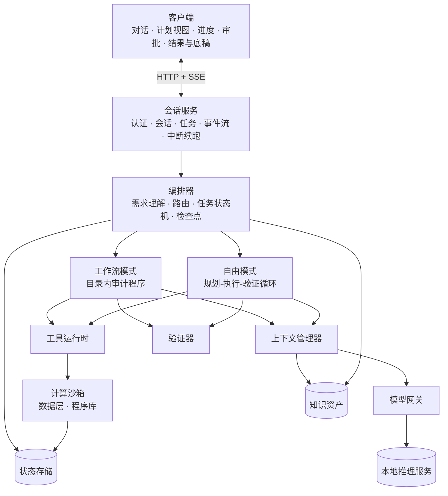
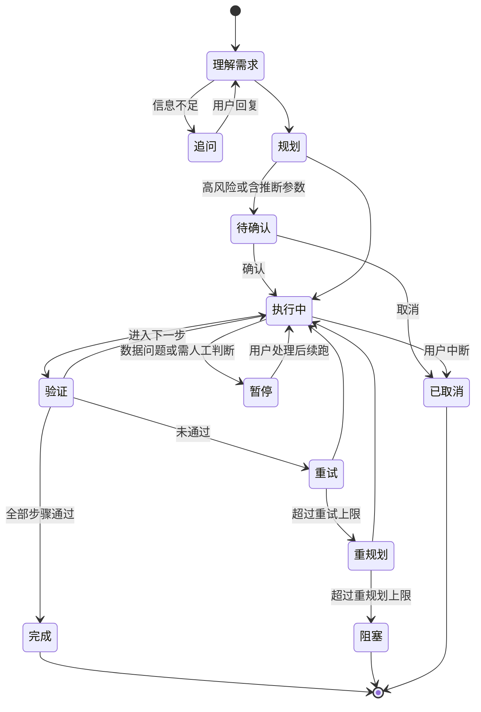

# 08 Agent 搭建方案（运行时架构与实施路线）

前面的文档分别讲了循环逻辑（03）、上下文（04）、审计架构（05）、交互（06）、诊断（07）。本文把它们落到一套可实施的系统上：有哪些模块、各自的职责和接口、如何协作、按什么顺序建设、每个阶段如何验收。

**设计目标**：在不更换模型的前提下，让 agent **准确、稳定**地完成任务量较大的审计任务。

**三条设计原则**
1. **流程由代码控制**：模型只在指定节点做指定的小事，何时开始、何时结束、是否通过由代码决定。
2. **代码算数，模型写判断**：数据处理和计算全部由程序完成，结果不经模型转述。
3. **每一步都可验证、可追溯、可恢复**。

---

## 一、路线选择

| 路线 | 做法 | 优点 | 缺点 |
|---|---|---|---|
| A. 在现有运行时上改造 | 裁剪提示词、关闭无关模块、以插件或工具形式加入审计程序 | 改动小、上线快、保留现有客户端 | 循环控制权在框架内，规划-执行-验证难以由代码强制；跟随框架升级有维护成本 |
| B. 自建编排层 | 自建编排器、工作流引擎、上下文管理、验证器；借鉴现有运行时的审批、工具策略、日志等设计 | 流程完全可控，可针对模型弱点优化 | 开发量最大 |
| C. 混合 | 审计任务走自建编排层，通用问答仍走现有运行时 | 风险分散，可渐进迁移 | 过渡期两套系统并行维护 |

**建议**：以 C 起步，逐步过渡到 B。

**关键判断点**：现有运行时是否允许外部完全接管某类任务的执行过程（例如插件接管整个循环，而不只是注册工具）。如果可以，A 的成本更低。需查看源码确认后再定。

---

## 二、总体架构



观测与评估模块贯穿全部模块（图中未画出），记录每次模型调用、工具调用和状态变化。

---

## 三、两种执行模式

这是整个方案中对"准确稳定"影响最大的设计。

| | 工作流模式 | 自由模式 |
|---|---|---|
| 适用 | 程序目录内的审计程序（大部分审计任务） | 目录外的临时查询、解释、问答 |
| 步骤 | 由工作流定义固定 | 由模型规划（03 的循环） |
| 模型职责 | 只在指定节点做指定事情：参数转换、结果解读、写说明 | 规划、选工具、执行、自检 |
| 工具 | 按节点指定 | 限定为只读查询类 |
| 稳定性 | 高，可预期、可测试 | 中，依赖模型能力 |

**为什么这样设计**：弱模型在自由循环中最不稳定。把高频任务固化为工作流，模型每次只面对一个小而明确的问题，是提升准确性和稳定性最直接的手段。

**路由规则**
- 需求映射到程序目录（06 第四节）→ 工作流模式
- 映射不到，但属于数据查询、解释、手册问答 → 自由模式
- 其他 → 告知不支持，记录到需求池

**嵌套**：工作流中的"下钻核查"节点使用受限的自由模式（只读工具、轮数上限）。

### 3.1 工作流定义

工作流由六类节点组成：

| 节点类型 | 说明 | 是否调用模型 |
|---|---|---|
| code | 代码逻辑，如前置检查、数据准备 | 否 |
| procedure | 执行审计程序（程序库） | 否 |
| llm | 单次模型调用，指定角色和输出 schema | 是 |
| agent | 受限的自由循环，指定工具和轮数上限 | 是 |
| human | 等待用户确认或输入 | 否 |
| verify | 执行验证器 | 视验证类型 |

示例（应收账款函证）：

```yaml
workflow: AR_CONFIRMATION
version: 1.0
steps:
  - { id: precheck,     type: code,      action: precheck_data }
  - { id: params,       type: llm,       role: extractor, output_schema: ar_conf_params }
  - { id: confirm,      type: human,     when: "risk_level == 'high' or has_inferred_params" }
  - { id: run_aging,    type: procedure, procedure: AR_AGING }
  - { id: verify_aging, type: verify,    checks: [detail_sum_eq_tb] }
  - { id: select,       type: procedure, procedure: AR_CONFIRM_SELECT }
  - { id: interpret,    type: llm,       role: analyst, inputs: [summary_table, exceptions_top50] }
  - { id: drilldown,    type: agent,     tools: [query_by_party, query_voucher], max_turns: 5, optional: true }
  - { id: write_wp,     type: llm,       role: writer, template: WP_AR_CONF }
  - { id: verify_wp,    type: verify,    checks: [numbers_traceable, "checklist:AR_CONF"] }
on_verify_fail: { retry: 3, then: pause_and_report }
```

工作流和程序目录一样纳入版本管理，修改需审核并跑回归评估。

---

## 四、模块设计

### 4.1 会话服务（API）

**职责**：认证、项目权限、会话管理、任务提交、事件推送、中断与续跑。

| 接口 | 说明 |
|---|---|
| `POST /sessions` | 创建会话（绑定项目） |
| `POST /sessions/{id}/messages` | 发送用户消息，返回任务 ID |
| `GET /sessions/{id}/events` | SSE 事件流（事件类型见 03 第 12 节） |
| `POST /tasks/{id}/cancel` | 中断任务 |
| `POST /tasks/{id}/resume` | 从检查点续跑，可携带修改后的参数 |
| `POST /approvals/{id}` | 确认、修改或拒绝 |
| `GET /results/{result_id}` | 获取结果表、异常清单（分页） |

### 4.2 编排器

**任务状态机**



工作流模式下"规划"即加载工作流定义，"重规划"一般不适用，验证失败直接进入重试或暂停。

**检查点**：每个步骤完成后保存输入、输出、结果 ID。进程重启或用户续跑时从检查点恢复，不重跑已完成的步骤；用户修改参数后，只重跑受影响的步骤。

**后台执行**：长任务进入队列由 worker 执行，客户端断开不影响任务。

**并发**：无依赖的步骤可并行；同一项目的写操作（底稿、正式样本）串行。

### 4.3 模型网关

统一封装对本地推理服务的所有调用，其他模块不直接调用推理服务。

**按调用角色配置参数**（初始值，需通过评估调整）

| 角色 | 用途 | 思考 | temperature | 输出 |
|---|---|---|---|---|
| router | 意图抽取、程序选择 | 低或关 | 0 | JSON（约束解码） |
| extractor | 约束转参数、手册抽取 | 关 | 0 | JSON（约束解码） |
| planner | 自由模式规划 | 高 | 0.2 | JSON（约束解码） |
| executor | 自由模式单步执行 | 中 | 0.2 | 工具调用 |
| analyst | 结果解读、异常定性建议 | 高 | 0.2 | JSON + 文本 |
| judge | 验证判定、最终自检 | 高 | 0 | JSON（约束解码） |
| writer | 底稿说明、结论 | 中 | 0.3 | 文本 |

**功能要点**
- **约束解码**：结构化输出一律使用推理服务的 JSON Schema 约束；解析仍失败时才走修复调用。
- **思考参数**：按角色设置，前提是 07 诊断确认参数已生效。
- **推理内容**：单独记录用于调试；是否回填进下一轮历史按模型要求处理；max_tokens 需覆盖推理加答案。
- **重试与超时**：连接错误、超时指数退避重试；格式错误走修复流程；所有调用记录日志。
- **token 计数**：使用模型自身的分词器，供上下文管理器做预算。
- **并发与优先级**：本地 GPU 资源有限，网关内设队列，交互请求优先于后台批处理。
- **前缀缓存**：开启推理服务的前缀缓存；每个角色的固定前缀（角色提示词 + 工具描述）保持字节级不变。

### 4.4 上下文管理器

- **按角色组装**：每个角色有独立的提示词模板，只包含该角色需要的内容，不再使用一个包罗万象的 system prompt。
- **按槽位预算**：system、任务清单、步骤输入、检索内容、历史分别设上限（见 04 和 03 的 `CONFIG`）。
- **大对象放引用**：结果表、文件、凭证列表存于状态存储，上下文中只放"结果 ID + 摘要 + 前 N 行"，需要时再按 ID 查询。
- **结构化状态每次重新渲染**：计划、已确认参数、结果 ID 列表不参与压缩，每次调用时从状态存储重新生成，压缩只作用于对话和工具往返。
- **不允许静默截断**：组装后超出预算时按优先级裁剪并记录，绝不把超长请求直接交给推理服务截断。

### 4.5 工具运行时

**工具注册表字段**：名称、参数 schema、描述、读写类型、风险等级、超时、结果压缩方式。

**三类工具**

| 类别 | 说明 | 开放阶段 |
|---|---|---|
| 审计程序 | 程序库实现的固定逻辑（05） | 第一批 |
| 参数化查询 | 下钻工具集（06 第 9.2 节），只读 | 第一批 |
| 受限 SQL 查询 | 模型编写只读 SQL 查询标准数据表，经语法检查、只读校验、行数限制、超时后执行；用于目录外临时查询 | 视评估结果，可后开放 |

- 每个工作流节点或计划步骤指定工具白名单，模型只能看到该步需要的工具。
- 初期不向模型开放任意代码执行，审计计算全部由程序库完成。
- 写操作（写底稿、生成正式样本、覆盖已有结果）需审批，沿用现有运行时审批机制的思路。
- 工具结果进入上下文前按工具类型压缩（03 第 7.2 节）。
- 重复调用检测：同一步内相同工具 + 相同参数重复出现，视为原地打转，终止本步。

### 4.6 计算沙箱与数据层

- 每个项目一个独立的分析库，存放标准数据表（05 第一节），项目之间物理隔离。
- 程序库在沙箱中执行：输入标准表和参数，结果写回结果表，返回 `ProcedureResult`（05 文档）。
- 大数据量处理全部在此完成，原始数据不经过模型。

### 4.7 验证器

| 类型 | 示例 | 实现 |
|---|---|---|
| 格式 | 输出 JSON 字段齐全、类型正确 | 代码 |
| 勾稽 | 明细合计 = 总账；期初 + 发生 = 期末 | 代码 |
| 可追溯 | 模型写的文字中出现的每个数字，都能在结果表中找到 | 代码（抽取数字后匹配） |
| 覆盖 | 用户每项要求都有对应结果；检查清单必需项齐全 | 代码 + judge |
| 一致性 | 文字结论与数据一致（如写"未发现异常"但异常清单非空） | 代码规则 + judge |
| 判定 | 无法程序化检查的完成标准 | judge 角色 |

**可追溯验证**专门防止模型编造或算错数字，是底稿质量的关键防线。

**失败处理**：回到对应节点带失败原因重试 → 超过上限 → 暂停并报告。

### 4.8 状态存储

- **关系库**：项目、用户、会话、消息、任务、步骤、检查点、审批记录、结果索引、异常定性记录。
- **文件存储**：导入的原始文件、结果表、底稿文件。
- **版本**：每个结果有 ID 和版本，参数变更重跑生成新版本，旧版本保留。

### 4.9 知识资产

- 内容：程序目录、工作流定义、行业配置、所内默认参数、检查清单、底稿模板、手册检索索引。
- 来源：审计手册抽取 + 人工维护。
- 管理：全部版本化，变更需审核；每个任务记录所用资产的版本，便于事后追溯。

### 4.10 观测与评估

- **调用日志**：每次模型调用记录角色、提示词版本、输入输出 token、耗时、原始输出、解析是否成功。
- **任务回放**：按检查点重放任务，可替换提示词、参数或模型后对比结果。
- **评估集**：07 的诊断样本 + 手册出题 + 历史任务，按任务类型分组。
- **回归门禁**：提示词、工作流、程序、模型、参数的任何变更，先跑评估集，指标不下降才上线。
- **线上指标**：07 第三节的基准指标，按周统计。

### 4.11 权限与安全

- **项目隔离**：项目成员只能访问本项目数据；复核人有权确认异常定性和底稿结论。
- **数据不出内网**：推理服务和全部存储部署在内网。
- **输入信任边界**：凭证摘要、合同、回函等内容放入上下文时加数据标记，不作为指令处理。
- **操作留痕**：参数确认、审批、异常定性修改、底稿修改记录操作人和时间。

---

## 五、失败处理矩阵

| 失败类型 | 检测方式 | 处理 |
|---|---|---|
| 输出格式错误 | 解析失败 | 约束解码；修复调用最多 2 次；仍失败按步骤失败处理 |
| 工具参数错误 | schema 校验 | 错误信息回填，让模型修正 |
| 工具执行失败 | 返回码或异常 | 可重试错误自动重试；否则回填错误信息 |
| 原地打转 | 轮数上限、重复调用检测 | 终止本步，带原因重试或重规划 |
| 验证不通过 | 验证器 | 带原因重试最多 3 次 → 重规划最多 2 次 → 报告阻塞 |
| 数据问题 | 前置检查、勾稽差异 | 暂停，向用户展示差异 |
| 推理服务不可用 | 超时、连接错误 | 退避重试；长时间不可用则挂起任务，恢复后从检查点续跑 |
| 上下文超限 | token 计数 | 按优先级裁剪并记录，不静默截断 |

---

## 六、性能设计

- **少调用比调用快更重要**：本地 GPU 是瓶颈，工作流中能用代码完成的节点不调用模型。
- **优先级**：交互请求优先，批处理（手册抽取、批量下钻）放后台低优先级。
- **短上下文 + 前缀缓存**：降低首字延迟和单次耗时。
- **并行**：无依赖步骤并行，受推理服务并发上限约束。
- **流式反馈**：长任务持续展示当前步骤和进度，降低等待焦虑。

---

## 七、技术选型参考

以下为参考，需结合所内现有技术栈确定。

| 层 | 参考选项 | 说明 |
|---|---|---|
| 推理服务 | vLLM / SGLang | OpenAI 兼容接口、JSON Schema 约束解码、前缀缓存 |
| 后端 | Python + FastAPI | 与数据处理生态一致 |
| 编排基础 | 自研状态机，或 LangGraph 等框架 | 框架提供状态机、检查点等基础能力；审计流程本身仍需自己定义 |
| 任务队列 | Celery / arq + Redis | 后台长任务 |
| 数据计算 | DuckDB + pandas / Polars | 单机处理大体量序时账 |
| 关系库 | PostgreSQL | |
| 文件存储 | MinIO 或内网文件服务器 | |
| 事件推送 | SSE | |
| 前端 | React | |
| 底稿生成 | openpyxl / python-docx | 按模板填充 |
| 观测 | 自建日志表，或可本地部署的 LLM 观测工具（如 Langfuse） | |

---

## 八、实施路线

| 阶段 | 内容 | 验收标准 |
|---|---|---|
| 0. 诊断与基准 | 07 诊断清单、样本标注、基准指标；修复配置类问题 | 诊断报告完成；评估集首版；基准指标确定 |
| 1. 基础设施 | 模型网关（约束解码、角色参数、计数、队列）、上下文管理器、事件流客户端、调用日志 | 工具调用格式错误率明显下降；所有调用可追踪、可回放 |
| 2. 编排器与工作流引擎 | 状态机、检查点、六类节点、验证器框架、自由模式循环 | 示例工作流端到端跑通；可中断、可续跑；验证失败能正确重试和暂停 |
| 3. 数据层与首批程序 | 标准数据结构、1~2 个主流财务系统导入、勾稽、日记账测试、银行流水核对、往来款项 | 在 2~3 个真实项目数据上，结果与人工结果一致 |
| 4. 交互与底稿 | 程序映射、参数确认、追问、下钻、底稿模板输出、可追溯验证 | 评估集上需求映射准确率、多任务漏项率、底稿人工修改量达到设定目标 |
| 5. 知识资产与扩展 | 手册抽取（程序目录、参数、检查清单）、更多程序与行业配置 | 按板块逐步上线，每个板块通过回归评估 |

**每个阶段结束都用评估集回归**，与阶段 0 的基准对比，确认改造确实带来提升。

阶段 0 的根因分布会影响后续侧重：配置和提示词问题占比高，阶段 1 的收益最大；模型推理问题占比高，应尽快推进阶段 2 和 3。
