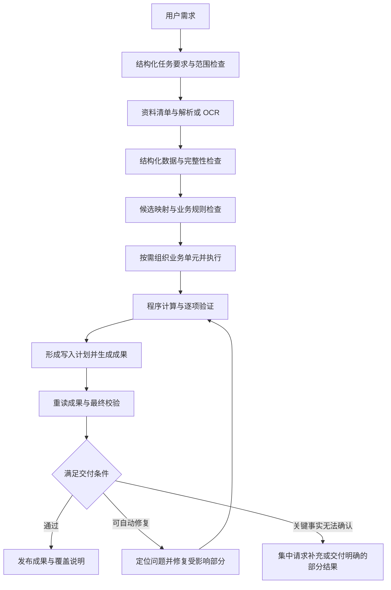
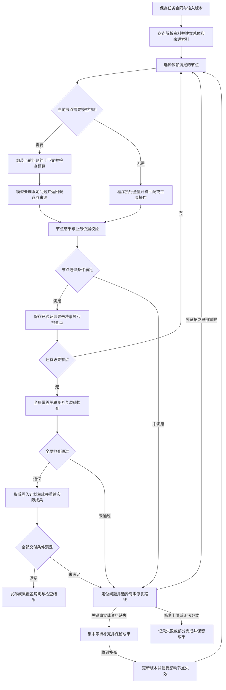
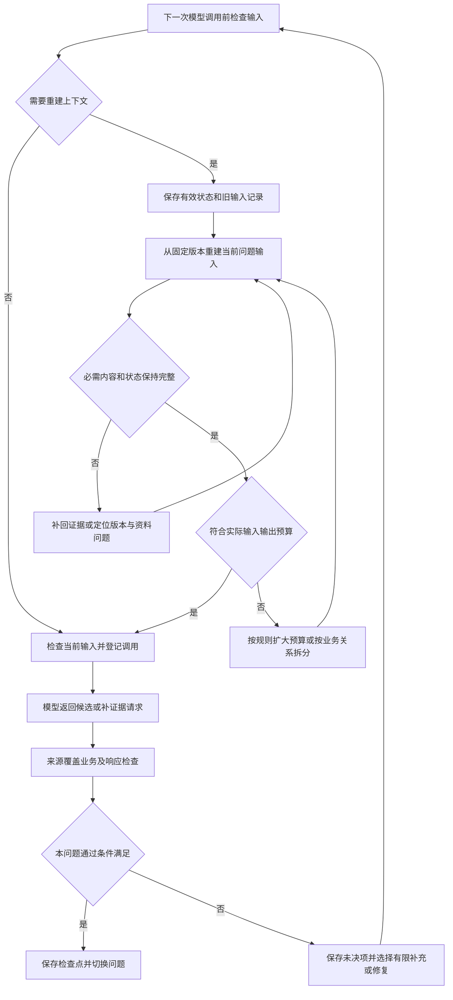
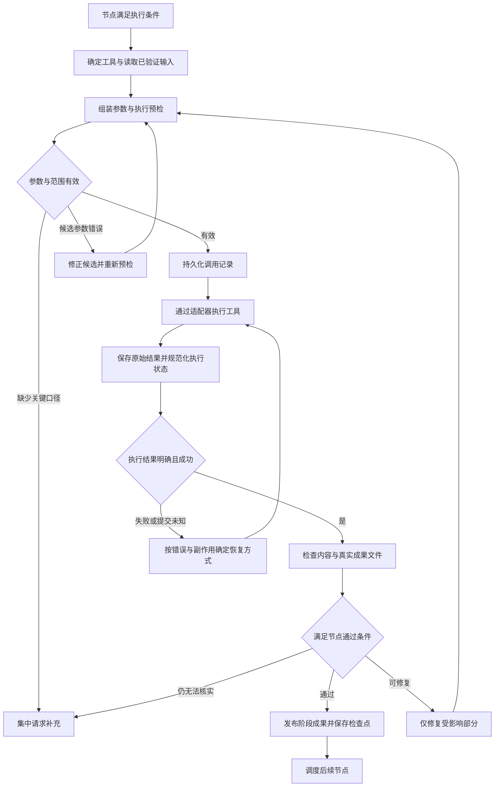

# 审计Agent工作流与准确性设计

日期：2026年10月10日。最近修订：2026年10月12日。状态：设计评审稿。关联方案：[Agent平台项目方案](C:/Users/Install/Desktop/ai助手/docs/Agent方案/审计Agent平台项目方案-20261010.md)。

本设计面向当前企业内部模型条件：DeepSeek V4 Flash，128K 上下文窗口，未微调，不支持图片识别，另有专用 OCR 服务。部署条件来自用户说明。OCR 调用方式依据用户提供的 bdo-ocr-document-parser 说明与脚本，返回字段的细节以结果样例和接入验证为准。

准确性优先于速度。平台根据任务复杂度组织完整局部问题或分阶段任务，通过明确边界、原始资料索引、程序校验和交付前自动修复，减少用户收到错误成果后重新整理资料或重新下任务的情况。

工作流由平台内置。用户提出需求、提供资料和下任务，系统自动推进；只有无法从资料和已确认规则中解决的关键问题，才集中询问用户。以下机制为拟实现内容。

## 准确性目标与责任边界

“不返工”的工程目标是将能发现和修复的问题留在交付前处理，并让无法核实的事项明确呈现。模型判断、OCR 识别和业务理解仍可能存在未被检出的错误，准确性需要在约定任务和有标准答案的案例中实测。

平台分别评价数据准确性、需求覆盖、自动完成率和用户返工率。输出大量空值或把任务都转为人工处理，不能视为准确性目标已经实现。

|参与者|负责的工作|必须遵守的边界|
|---|---|---|
|任务理解 Agent|提取用户目标、范围、输出和限制，匹配内置流程|每项要求有用户原文或已确认项目口径来源；关键歧义列为问题|
|字段与语义 Agent|从候选字段、主体、科目和证据中提出映射|选择受限候选；映射先校验；不得直接改写原始数据|
|分析 Agent|根据已验证结果解释异常，提出后续检查|解释关联证据；事实、推断和待核实事项分别保存|
|复核 Agent|重新检查要求覆盖、映射语义和解释依据|采用独立上下文和原始证据；模型复核结果作为候选意见|
|确定性执行系统|枚举总体、拆分任务、计算、匹配、写入、核对和判断通过条件|执行版本化规则，保存来源，失败不能靠修改范围或填零消除|
|OCR 服务|把扫描件转换为带来源标识的文字或表格候选|识别结果经过质量检查，关键值不能仅凭 OCR 成功状态判定准确|
|用户|提出目标、补充必要资料，解决确实无法确定的关键口径|使用自然语言和业务选项，无需搭建流程或填写技术参数|

Agent 的数量根据职责确定。可以由同一个企业模型在不同节点、不同上下文中执行这些角色。重复调用同一模型形成的一致意见，不能替代原始资料和程序校验。

## 内置执行流程与通过条件



|节点|输入与执行|产物|通过条件|
|---|---|---|---|
|需求整理|用户原话、相关项目口径；提取目标、主体、期间、限制和成果要求|任务要求记录与待问问题|每项关键要求有来源，已匹配可执行流程，缺失关键项已处理|
|资料盘点|枚举文件、工作表、PDF 页和附件版本|资料清单、格式和缺失说明|所有采用或排除的资料有明确记录，资料可读取|
|解析与 OCR|结构化文件直接解析；扫描页调用 OCR|带来源的文本、表格和质量问题|所有目标文件与页有处理状态，关键识别问题已定位|
|总体形成|识别记录、业务分组和结构，校验类型、重复、期间与主体|数据集、记录索引、总体检查|总体可枚举；计数依据和未确定范围明确|
|映射与口径|Agent 从候选中选择字段和规则，程序校验|版本化映射、规则和未决事项|字段确实存在，关键语义可核实，范围与规则一致|
|任务组织|根据依赖和预算保持完整问题，或按主体、账户、凭证、表格及文档单元拆分|执行单元清单和覆盖登记|执行单元覆盖已确定总体，无遗漏、重复处理或业务关系丢失|
|执行与核对|程序执行计算和工具；模型执行局部语义任务|事实表、匹配结果、异常与候选解释|结构、来源、数值和覆盖检查通过，异常有实际状态|
|计划写入|程序建立目标位置、来源、转换和预期值的对应关系|写入计划|必需位置齐全，同一位置的多来源有明确合并规则|
|生成与重读|程序写成果文件，再打开文件逐项比较|成果、重读差异、校验记录|实际文件与已批准写入计划一致，公式结果状态明确|
|需求复核与发布|按任务要求逐条检查交付物、范围与证据|发布清单、覆盖说明和问题清单|满足任务约定的完成条件，无法核实的事项未被包装为已验证事实|

每个节点必须定义输入版本、输出结构、校验器、失败分支和恢复点。普通节点通过后自动推进，失败自动进入修复或必要的补充分支。

执行成功、数据校验通过和结论证据充分分别记录。生成了一个 Excel 文件，只能说明生成步骤完成；任务是否完成要按目标和验收条件判断。

### 按问题执行的流程结构

流程分为任务级、节点级和交付级。任务级保存完整要求、资料版本、规则、依赖和总体；节点级只处理当前明确的问题；交付级核对全局关系、实际成果和全部要求。调度器读取保存的状态选择就绪节点，普通用户无需搭建或推进节点。



图中的节点校验包含模型候选的结构、来源与语义检查，也包含程序结果的覆盖和业务检查。模型判断节点的输出可以作为后续计算节点的已验证映射；无需语义判断的步骤由程序直接执行。全局检查失败时保存具体问题并返回受影响节点，不能直接跳过问题生成成果。

停止或进程中断时，模型请求、工具调用和已发布成果分别记录实际状态。继续时核对输入与规则版本、正在执行的远端任务和成果完整性，从有效检查点恢复；依据调用副作用判断是否可重试。

|执行层|维护的信息|推进依据|
|---|---|---|
|任务级|目标、范围、资料与规则版本、全部节点依赖、总体记录、未决问题|依赖满足且版本有效的节点可以执行；全局状态由真实记录汇总|
|节点级|当前问题、必要证据、允许工具、输出合同、尝试次数、候选与检查结果|达到节点合同的通过条件，保存结果后调度下一节点|
|交付级|需求覆盖、全局关联、写入计划、重读结果、成果与待处理范围|完成合同规定的范围与检查后发布；部分结果使用明确状态|

## 工作流需要搭建的组件

内置工作流的建设包含下列组件。流程定义由维护者提供，用户只负责提出目标和提供资料；运行时根据已确认范围、节点依赖和检查结果自动推进。

|组件|需要实现的内容|完成后应能检查到什么|
|---|---|---|
|任务要求与项目口径存储|保存用户原话、结构化目标、主体、期间、排除项、成果要求及规则版本|每项执行要求有来源，重启或压缩对话后仍能完整重建|
|内置流程库与节点合同|为每类可承接任务定义节点依赖、输入输出、允许的工具和 Skill、通过条件及失败分支|需求匹配到具体流程；每个节点有明确责任与阶段成果|
|流程调度与持久化状态|驱动节点和批次，处理等待、停止、重试、检查点和输入变更|能判断下一步；中断后核对状态继续；旧输入成果不会用于新版本|
|Agent 执行器与上下文组装|按节点加载必要证据和规则，限制工具、输入输出预算和候选结构|同一模型承担不同职责，每轮只处理限定问题，内外层模型调用都有记录|
|资料解析、OCR 与来源索引|枚举文件与页，形成结构化数据、稳定记录编号、原文位置和识别问题|任何采用的数据可以回查；解析覆盖和业务总体覆盖分别记录|
|Skill 管理与规则绑定|管理导入、版本、依赖、适用任务和节点绑定，受管执行必要脚本|节点取得适用规则和资源；规则版本固定；缺少依赖有明确状态|
|统一工具目录与调用执行系统|注册现有 63 项及通用操作，适配外部 MCP、OCR，校验参数并记录执行|所有调用经过同一管线，有真实状态、参数来源和成果引用|
|确定性业务处理与批次汇合|使用已验证的映射执行全量计算、匹配、分类规则和模板写入；处理全局关系|总体记录无遗漏或重复，跨批次核对与去重按统一口径完成|
|校验、局部修复与发布控制|检查结构、来源、语义、金额、覆盖及实际文件，按错误类型修复|错误定位到节点和记录；修复后重验；完成标识来自实际验收结果|
|阶段成果与客户端事件|把执行记录转成阶段进度、成果、检查情况和集中补充事项|用户能看懂已经完成什么、结果在哪、哪些事项需要处理|

### 组件之间传递的核心记录

|记录|主要内容|用途|
|---|---|---|
|任务合同|目标、范围、要求来源、交付物、完成条件、版本|限制所有后续节点的处理范围|
|流程定义|流程与节点版本、依赖、输入输出合同、工具绑定、校验和失败路线|供调度程序判断可执行节点及分支|
|节点运行记录|输入引用、当前状态、批次、尝试次数、输出引用和检查点|继续执行、定位失败和使受影响成果失效|
|资料与业务记录索引|文件哈希、页或源行、稳定记录编号、实体关系、类型和质量状态|形成全量总体，支撑来源回查和漏项检查|
|工具调用记录|调用编号、节点、工具版本、参数来源、尝试状态、远端任务编号和结果引用|区分真实执行、重复请求、未知提交和可恢复任务|
|成果与校验记录|成果版本、来源、处理覆盖、实际输出位置、检查结果和发布状态|供下一节点读取及用户审阅，支撑最终验收|

这些记录保存于应用管理的存储中。模型接收当前节点需要的引用和内容；金额、范围、映射和调用状态由程序读取原始记录。自然语言摘要不承担节点之间关键数据的传递。

完整搭建的验收应包含：资料齐全时自动完成一个真实业务流程；关键资料缺失时提出具体补充事项；工具失败时定位并恢复；进程重启后继续；更换一份资料后只重做受影响部分。每种情况均核对实际成果和业务口径。

## 需求理解与业务规则

### 任务要求独立保存

把用户要求保存为结构化记录，至少包括主体、期间、任务目标、目标资料、排除范围、分析维度、输出字段、金额单位、币种、交付格式和完成条件。每个要求关联用户原文或已确认口径。

已有口径带有适用公司、期间、任务类型、版本和来源。模型临时提出的建议保持候选状态，不能自动升级为项目事实。

需求整理后进行两项检查：程序核对必需字段、范围和能力；另一次小上下文调用直接读取用户原话，检查遗漏、冲突及是否加入未经说明的假设。复核意见仍须结合规则和原文处理。

每项要求建立“要求 → 执行节点 → 成果位置 → 校验方法”的对应关系。交付前按此逐项检查，不能仅凭一段最终回答判断需求已完成。

例如，“分析A公司2025年收入，与2024年比较，分产品，排除内部交易”，必须分别落实主体、两个期间、收入定义、产品维度和内部交易排除依据。产品字段或内部交易标识不存在时，应提出具体问题。

### 业务方法由版本化规则提供

Skill 保存适用情形、必要资料、字段含义、处理规则、允许转换、常见歧义、输出和检查方法。现有恢复规则、已验证程序和经业务人员确认的方法可以作为规则来源。

每个节点按任务加载短而明确的业务说明，附少量已验证的正例和容易混淆的反例。例如，本期发生额和期末余额、含税和未税金额、单体和合并主体、开票日期和入账日期，应有明确的区分条件。

仅靠近似字段名称、取值规模或模型自报置信度，不能放行关键语义映射。映射证据应包括表头说明、上下文、数据类型、期间、业务定义以及必要的勾稽结果。

规则缺失时先形成明确问题；系统可以提出候选方案及理由，关键口径确定后保存。规则的增加和修改进入平台维护流程。

## 上下文管理与大任务拆分

本章细化上下文组装、证据补充、预算处理、窗口切换和压缩重建。需求理解与流程选择的多目标、歧义及路由规则留待下一轮细化。本章使用的字段和读取入口均为拟实现合同，不表示当前程序已具备这些机制。

### 本次采用的设计与 128K 适用边界

采用现有完整流程架构，并把“针对当前问题提供清晰上下文”作为模型执行的核心机制。其实现是应用在每次模型请求前选择输入、规则、工具和证据，属于上下文工程；不涉及更改模型内部的注意力计算或训练参数。

用户提出的滑动窗口想法，在本平台中落实为按业务问题重建输入。完整任务状态持续保存在窗口之外，模型当前输入随节点切换。窗口的边界由业务关联和通过条件确定；更早的原文、定义或关联记录仍可按需取回。

128K 是用户提供的部署窗口条件。平台区分请求容量、实际输出上限和对业务内容的正确处理能力。能够装入窗口的资料仍需要来源与业务检查；超出单次预算的总体由外部数据存储、程序处理和节点协作承接。实际可用预算及可靠输入长度以企业网关和标准案例测试为准。

|任务情况|执行选择|必要边界|
|---|---|---|
|纯计算、合并、填写或已确定规则的匹配|程序与业务工具直接读取全量资料|数据规模受处理器能力约束，结果仍需覆盖和业务检查|
|证据可以完整提供的单一语义问题|一次模型调用，或同一问题内有限补证据与修复|提供足够的定义和关联证据，符合实测预算与输出限制|
|包含多个目标、主体或阶段的任务|按节点依赖执行，每个节点组装自己的上下文|保留适用的全局约束，经过验证的前置结果按版本传递|
|批量凭证、合同或扫描资料|按完整业务单元分批处理，程序登记覆盖并汇合|同一凭证、表头、跨页关系和定义引用保留；汇合后检查重复和关联|
|当前问题需要跨文件或跨批次比较|建立共享索引与候选关系，提供有关证据或在已验证预算内扩大输入|局部判断后进行全局检查，不能只看本批数据就判定无关联|

需求和状态保存、调用前预算检查、来源与覆盖校验始终启用。拆分和上下文切换按任务需要实施。不得为了固定长度删去关键证据；能够完整处理的单一问题无需人为增加大量节点。

### 每次模型调用的上下文组成

上下文组装由程序读取节点合同与版本化状态完成。模型可请求补充允许范围内的证据；请求结果经过预算检查后再进入当前问题的输入。组装时保留有关冲突和未决项，避免仅提供支持已有结论的片段。

|输入部分|具体内容|来源与边界|
|---|---|---|
|适用的全局约束|任务目标、公司、期间、单位、币种、排除条件、交付要求和禁止假设|从完整任务合同按节点依赖选取，关键条件不能仅由摘要提供|
|当前问题|问题编号、职责、处理对象及记录范围、需要回答的具体事项|节点定义和执行单元清单；一个节点可处理同一目标下有关联的一组字段|
|必要业务规则|字段含义、适用方法、允许转换、关键歧义及少量已验证正反例|经过确认的 Skill 与规则版本；资料原文保持证据身份|
|原始证据与关联资料|表头、定义、来源记录、完整凭证、跨页续表、引用条款或实际异常明细|稳定来源编号，保留必要业务关系与矛盾证据|
|前置结果与未决事项|已验证映射、统计、相关结论、缺失和冲突|具体版本引用，并明确验证程度；候选与事实分开|
|可用操作|本问题允许的读取、查询、候选提交及必要业务工具|节点工具清单；确定性步骤可由程序直接调用|
|输出与完成要求|字段、编号、来源、未知状态、输出大小及节点通过条件|结构合同和实际服务能力，程序在返回后执行检查|

每次调用保存应用实际发送的输入内容或可重建的输入清单、问题编号、使用版本、证据范围、计量方式、输入输出预算及响应完成状态。后续可以复现本次发送的内容，并区分证据缺失、模型判断错误与执行错误；网关内部是否另行裁剪需要服务接入验证。

同一问题内读取更多证据或修复候选时，可保留必要的局部交互。工具结果过大或局部历史达到预算时，从保存的状态重建本问题输入；有关证据、约束和未解决问题重新加载。进入下一问题时重新组装上下文，已结束的详细交互留在执行记录中。

### 节点上下文清单

每个内置节点提供版本化的上下文清单，规定当前问题必须加载的约束、规则、证据、前置结果和输出条件。组装器根据清单读取内容；材料是否必需由节点与业务规则确定，不能完全依赖模型自行判断相关性。

|清单字段|具体约定|检查方式|
|---|---|---|
|节点与当前问题|节点版本、问题编号、职责、待处理业务单元、目标记录集合|与调度记录和输入版本一致；纯计算节点可以直接执行，无需模型上下文|
|适用要求|所服务的要求编号、主体、期间、单位、币种、排除条件、有关交付条件和缺失值处理|按要求到节点的对应关系读取；所有节点保留范围标识，有关关键条件必须带入|
|必要规则|字段定义、方法、适用条件、允许转换、检查规则和关键反例|规则版本有效且适用于当前主体、资料结构和任务；没有确定依据的建议保持候选|
|必要证据|证据类型、记录或页的范围、完整业务边界、需要补齐的定义与关联|检查实际内容、来源、版本及声明的关系是否提供；引用不能代替内容|
|前置结果|允许读取的成果编号、所需字段、有效版本和最低验证程度|只读取满足节点用途的有效结果；待复核候选明确标识，不作为确定事实|
|未决事项|影响当前问题的缺失、冲突、失败原因及已经明确排除的候选|保持具体来源和状态；无法确认的判断继续未决|
|允许操作|允许读取的数据范围、证据查询和必要工具|请求经过程序校验；资料内容不具有更改权限、范围或规则的效力|
|输出与预算|输出结构、来源要求、记录范围、通过条件、输入输出预算和补充次数|返回后检查结构、来源及覆盖；预算以最终实际请求为准|

条件字段使用“已确定、未知、冲突、不适用”等明确状态。不适用需要有规则依据，不能通过省略字段表示。未知条件可以进入专门的诊断或补证据问题，但不得进入要求该条件已确定的计算、写入或发布步骤。

节点声明的必需材料完整，并不等于业务判断已经正确。证据存在性与组装完整性由程序检查；字段含义、规则适用性等业务判断继续采用本方案的来源和语义校验。逐业务规则仍需按待细化清单 G01 固定。

|节点类型|在通用清单之外必须带入的内容|
|---|---|
|需求整理或范围诊断|本次用户原话、有关补充原文、当前任务版本、适用项目口径和已知冲突；不得仅依据旧聊天摘要|
|字段映射|完整表头、有关附注与定义、期间和单位、真实候选列、按结构与边界选取的样本、全量字段统计及适用控制关系|
|文档提取|当前业务对象的必要原文、表头与单位、跨页续表、引用定义、来源编号和解析质量问题；逐份处理范围可枚举|
|局部匹配或异常解释|已验证映射与统计、目标记录、候选对方记录及筛选规则、跨批次检索结果、矛盾证据和解释范围|
|独立语义复核|原始要求、规则和必要来源证据；需要独立形成判断时先不提供原答案，随后再比较处理结果|
|生成、重读与交付检查|程序取得全量有效数据、写入计划、实际文件和覆盖登记；只有具体语义争议才单独建立模型问题|

复用字段映射前检查资料结构、主体期间、单位及规则的适用性。列名相同或文件格式相同不足以证明业务含义相同。

### 上下文组装的执行步骤

一次组装按照下列顺序执行：

1. 固定当前任务、节点、原始资料、规则和前置成果版本，生成本次输入快照标识。
2. 读取当前问题与业务单元，确认依赖有效；确定性步骤直接进入统一工具管线。
3. 从任务合同加载适用要求，检查必要条件的状态。无法确定适用性时保留有关关键条件，先定位歧义。
4. 按明确编号与范围读取证据，补齐业务关系、定义和冲突信息。
5. 加载经过相应检查的前置结果，以及本问题的未决项、失败原因和必要局部交互。
6. 按固定结构组装指令、规则、资料、允许工具和输出合同。资料标明为证据，不能覆盖平台规则和任务要求。
7. 检查必需内容、来源和版本，计量输入并预留输出；需要补证据或超限时先进入相应分支。
8. 保存适配器最终实际发出的模型输入和组装清单，登记调用后发送。
9. 检查返回的结构、来源、记录覆盖、响应完成状态和业务依据，保存候选及检查结果。
10. 保存结果前再次核对有效版本；输入已改变时，该响应属于旧版本，不能覆盖当前成果。通过后保存检查点并调度下一问题。

同一问题因补证据再次调用时，也执行上述检查。模型可提出补充或候选，但不能修改检查状态、清单中的必需条件或任务范围。

### 证据定位、关联补齐与范围控制

证据读取分三层。第一层按主体、期间、账户、凭证号、文件、源行、页或条款编号定位；第二层补齐完整业务关系；第三层加入不同解释和矛盾信息。

|读取情形|必须保留的内容|覆盖边界|
|---|---|---|
|理解表格结构|完整表头、附注、单位、类型统计、代表性及异常样本|样本说明结构，计算和检查仍读取全量数据；不同结构分别检查|
|处理凭证或分录|同一凭证的相关分录、附件和定义|全量凭证及记录由程序登记；分批处理不拆散必要关系|
|读取跨页表格|表头、单位、必要前后页、续表关系和缺页情况|若解析未确认续表关系，保持问题状态；不能根据 Markdown 合并结果直接宣称完整|
|读取条款|当前条款、实际引用的定义和有关修订或冲突条款|引用递归补齐至满足节点所声明的判断需要；过大时进入预算分支|
|分析差异|目标记录、候选关联记录、候选生成范围和不匹配依据|局部窗口不能代替全局候选检索；未提供对方记录不等于不存在关联|
|使用聚合结果|分组口径、全量覆盖、计算版本、统计值与有关异常编号|只适用于统计已经足够回答的问题；具体交易判断继续展开明细|

语义检索可以辅助定位说明和条款。总体枚举、缺页、漏记录和重复检查按资料及业务单元清单执行，不能用检索返回前几项替代。

跨期间、跨主体资料可以作为已声明用途的比较、关系或冲突证据读取，需标明其范围和用途。它们不能自动并入当前处理总体。例如，为解释跨年核对补取上一年度记录，需要记录跨期匹配规则与适用关系。

OCR 证据关联原文件、解析版本和原始返回。服务未提供或尚未核验的页码、坐标、置信度保持未知；不能为了满足证据结构编造字段。关键原文无法定位或识别有冲突时，先处理解析问题。

### 定向补证据

补证据请求必须说明当前问题、缺少什么、涉及哪些记录及读取理由。下列为拟实现的请求结构示例；read_definition、read_records 等属于拟新增的平台读取入口，并非现有 63 项工具中已经实现的同名能力。

```json
{
  "question_id": "example-mapping-balance",
  "reason_code": "ambiguous_field_meaning",
  "missing_item": "余额列的期间、单位和借贷方向定义",
  "target_refs": ["example-dataset@v1:sheet1:balance_columns"],
  "requested_content": ["full_header", "period_note", "unit_note", "balance_definition"],
  "purpose": "区分期初余额与期末余额，核实转换依据"
}
```

程序检查请求是否属于当前节点允许范围、引用是否真实、是否重复取过相同内容。合法请求经过证据读取、关联补齐和预算检查，再重建输入。越界请求返回明确错误；确有任务需要的范围调整进入任务版本变更流程，不能由模型自行扩展。

补证据、模型候选修复和服务重试分别计数。补证据与候选修复可各从两次作为工程起点，按节点配置并实测调整。相同有效输入、相同请求和相同失败重复出现，且没有新增证据或候选改进时，停止循环。读取到了新证据才进入实质性的重新判断。

必要材料在受管资料中存在时自动读取。材料不存在、关键业务口径无法核实或当前能力不能取得时，保存具体缺口并集中补充；用户不需要填写读取接口或技术参数。

### 保存每次模型实际输入

每次调用保存最终输入及其清单。仅保存“用了某份文件”的引用不足以复原调用；必须保存实际展开的证据片段和不可变来源快照，或有能够精确重建这些内容的版本与读取规则。

|清单内容|必须记录的信息|
|---|---|
|身份与版本|任务、节点、问题、尝试编号，任务合同、资料、规则和成果版本，模型及适配器配置引用|
|要求与规则|实际带入的要求编号、规则编号、适用条件和未知或冲突状态|
|证据|实际展开的来源编号、页或源行范围、内容哈希、必要关联、冲突及读取结果|
|状态|已验证结果、候选、未决项、被拒候选及失败原因；其验证程度不能省略|
|实际请求|最终 messages、工具定义、输出合同、渲染版本和请求内容哈希；授权信息保存配置引用|
|预算|计量方法、估算不确定性、输入量、输出预留、安全余量、实际 usage 和响应完成信号|
|组装决策|必需项检查、可选项选择或省略理由、重建或拆分原因、补证据轮次|

适配器为兼容接口进行格式转换或重试时，每个实际请求分别记录，不能仅保存转换前的计划。引用的源文件被替换后，旧输入仍需能从原快照重建。

来源编号对应的内容只有实际展开到模型请求中，才登记为“本次已提供”。仅列出引用的内容登记为“可按需读取”。模型提出需要后，由程序解析引用并读取；组装器不能把这两种状态混同。

### 窗口切换与节点输出合同

切换前保存当前问题的候选或结论、来源、主体与期间、单位、规则与输入版本、校验结果、处理记录集合、未决事项和下一步依赖。模型生成的摘要可以解释过程；下游执行从结构化记录取得关键值与条件。

节点输出先作为候选保存，随后经过合同、来源和业务检查。通过后记录其实际验证程度，供适用的下游节点读取；不能验证的语义保持未决。模型表示已经完成、返回合法 JSON 或生成文件，都不能单独触发窗口推进。

新窗口加载前，程序检查前置结果是否有效、当前范围是否覆盖所需输入、必要规则和关联证据是否齐全。结果本身错误时返回受影响节点；当前证据不足时定向补证据；关键业务事实仍不确定时集中询问。每种路径受修复次数、时间和有效输入版本约束。

按窗口分别通过的结果，还需在任务级检查跨批次重复、主体串用、关联匹配、总体勾稽及需求覆盖。全局失败可使有关节点及其后续成果失效，复用其他已经验证且输入未变的部分。

### 原始资料与任务状态保存在模型窗口之外

持久化保存四类信息：

- 原始文件、OCR 返回、结构化数据和来源索引。
- 用户原话、任务要求、已确定规则、字段映射和补充回答。
- 节点状态、子任务清单、总体覆盖登记和未决事项。
- 工具结果、写入计划、校验记录和成果版本。

这些记录是后续执行的依据。自然语言摘要可以帮助解释历史，不负责保管金额、记录编号、排除条件、规则参数等关键事实。

新节点建立新的上下文，只加载当前任务约束、节点说明、必要 Skill、相关字段或证据片段、实际统计和未决问题。已完成工具的详细输出通过结果引用按需读取。

任务续跑由保存的状态重建工作输入。对话压缩后，程序核对任务要求与规则版本，再继续节点；关键要求的保留不依赖模型摘要是否完整。

长上下文研究显示，部分受测模型对信息位置和上下文长度敏感；该结论提供一般设计依据，企业部署的可靠工作长度仍需实测。[Lost in the Middle](https://aclanthology.org/2024.tacl-1.9/)

### 上下文压缩的分级处理

压缩落实为“保存有效状态，再为当前问题重新构建输入”。原始资料和完整执行记录保存在窗口之外；模型生成的过程摘要只帮助解释历史，不负责传递关键事实或决定完成状态。

|内容|压缩与保留方式|使用条件|
|---|---|---|
|主体、期间、币种、单位、排除条件、关键规则和交付约束|程序从任务合同和规则记录重新加载，当前问题适用的内容完整带入|保留明确值、未知或冲突状态、来源和版本；不能以一段概述代替|
|金额、日期、字段映射和处理结果|保存带来源、转换规则和验证程度的结构化记录，按需加载|源值与标准值可回查；缺失、无效、零值和不适用分别保存|
|原始文件、OCR、完整工具返回和大表|原文保留；当前输入展开必要证据，其他内容按引用读取|保存引用不等于已经读取；需要具体判断时展开具体材料|
|重复表头、冗余格式和重复证据|由程序统一表达并去重，保留作用范围和来源|不能丢失分组单位、续表关系、不同版本或不同记录身份；相同文字不必然代表重复业务记录|
|操作过程、重复说明和已结束讨论|允许生成短过程摘要，完整可见交互与工具记录归档|摘要不生成新事实，不代替原文证据；下游通过结构化记录取得关键内容|
|未决项、失败原因、必要候选和排除依据|结构化保留并在相关问题中重新加载|候选不能因进入摘要升级为事实；已排除候选保留其依据及有效版本|

选择当前问题所需字段和证据属于输入裁剪，不表示整份资料经过摘要后仍保留全部业务含义。能否使用聚合结果，按问题所需证据判断：总额计算可使用经过检查的全量统计；单笔差异、字段含义或交易原因需要实际展开相应记录与定义。

已有结构化记录由程序迁移，不让模型在压缩时重新抄写金额、范围或映射。尚未结构化的关键非结构化内容继续保存原文并按需读取；需要提取时建立有来源和检查条件的专门问题。

### 同一问题内的压缩重建流程

压缩在下一次模型调用前进行，或在切换问题、局部交互增长、工具返回过大及中断恢复时进行。重建属于输入管理，不代表当前业务问题已经完成。



补回、拆分与修复有相应上限。关键事实缺失、单个必要单元仍无法处理或连续没有改进时，保存明确缺口并进入待补或失败状态，图中的返回路径不能无限循环。

具体操作分四步：

1. 保存当前候选、有效结果、来源、未决事项、已处理及待处理记录集合、失败原因、有效排除依据和尝试计数。正在执行的工具保留实际调用状态和远端任务编号，不因重建而重新提交。
2. 读取同一有效版本下的任务要求、节点清单、规则、必要证据和前置结果，重建输入。完整历史归档，当前输入保留必要的局部问题、检查错误及候选。
3. 程序比较重建前后的关键状态，检查必需约束、证据关系、版本和当前处理范围。必要证据不足时先补回；不能通过删去失败原因、未决项或待处理记录来缩短输入。
4. 保存新的实际请求及组装清单，检查预算后继续当前问题。候选通过相应检查才成为下游可用结果。

保存状态与新输入记录需要有完成标识；中断时从完整有效的版本恢复，不能混用保存到一半的新旧内容。具体存储事务与状态枚举在共用数据结构合同中固定。

### 压缩重建的完整性检查

|检查对象|重建后必须成立的条件|不成立时的处理|
|---|---|---|
|任务约束|当前适用的关键要求、值与状态没有缺失或改变，原文来源可回查|重新加载要求；任务发生变更则进入新版本失效检查|
|数值与映射|值、金额精度、正负号、单位、转换规则及字段绑定与有效记录一致|程序重载原记录；压缩过程不执行未经批准的转换或四舍五入|
|结果身份|已验证、候选、冲突和未知状态没有互相替换|拒绝该输入并修复状态组装；不让过程摘要覆盖验证记录|
|覆盖与范围|待处理集合和已处理集合完整保存在外部，本次实际处理编号明确；跨批次关系仍有检索与汇合依据|补齐登记或回到总体形成节点；数量相同不能代替编号集合检查|
|证据与定义|节点声明的必要原文、关联、定义和矛盾信息实际展开，或在专门补证据步骤中明确待取得|补证据；只存在引用时不标为本次已提供|
|未决与恢复|未决项、失败原因、排除依据、次数和进行中的调用状态继续有效|从保存记录重建；旧调用状态不明时先核对实际状态|
|版本一致性|任务、资料、规则、前置成果和读取结果属于当前有效快照|拒绝混合版本，按依赖使受影响结果失效|

检查保证声明的关键内容被保留，不能保证最初录入的数据已经正确。结构化记录录错、原始资料有误和模型误解仍需通过来源、业务规则及标准案例发现。

### 摘要、自动压缩与截断的边界

过程摘要可以概述已经做过什么、为何调整和下一步准备做什么。摘要涉及金额或判断时仍关联原记录，程序读取关键数据时使用有效结构化记录与原文。摘要遗漏信息不会删除外部状态。

模型执行框架的自动摘要功能不得承担关键状态迁移。统一调用入口在发送前完成组装和预算检查，确保工具内部的模型调用采用相同机制。企业网关是否存在自动裁剪、截断或不可见的输入变换，需要在接入验证中确认；本地日志能够证明应用实际发送了什么，不能直接证明服务内部没有再次裁剪。

输出截断单独处理。返回内容即使能够解析为 JSON，仍检查响应完成状态、必需字段、重复编号和预期记录覆盖。缺少记录的批次保持未完成，缩小输出批次后局部重做；输入压缩不能替代输出预算控制。

### 128K 窗口的预算方式

先验证企业网关的实际窗口、输出限制、Token 计量、工具调用、JSON 模式和响应截断信号。不能从模型名称推定网关已经支持全部接口能力。

初始设计预算如下，数值是待测的工程起点。32K／48K 属于普通输入的起始目标，60K 属于检查触发点，80K 属于首版保守策略限制；这些数值都不是企业模型的能力结论。需要更多完整关联证据时，可以在通过实测的配置中提高预算，并重新确认服务窗口、输出预留和安全余量。

|项目|初始策略|
|---|---|
|普通节点输入|包含指令、工具定义、Skill、证据和本节点历史在内，通常控制在 32K Token 以内|
|较复杂节点输入|以 48K Token 为起始目标；完整关联证据需要更大输入时，使用经过验证的预算配置|
|达到 60K 输入|检查预算和必要证据，按需重新组装、扩大已验证预算或按业务关系拆分|
|输入硬限制|首版取 80K 与“实际窗口减输出预留和安全余量”中的较小值，超过当前配置时不发送；调整后仍必须满足实际服务限制|
|输出预算|在服务已验证的上限内按结果结构预留，普通节点可从 8K 起；上限较小则缩小批次，小型映射任务采用更小输出|
|安全余量|初始预留 16K，并依据网关计量校准|
|单轮工具暴露|仅提供节点需要的少量工具，确定性节点由执行系统直接调用|

这里的预算包含工具结果进入下一轮后的增长，也包含必要时由服务计入的推理 Token。总输入、输出预留和安全余量必须共同满足实际服务限制。

优先使用与企业部署匹配的 Tokenizer 或服务计量接口。无法取得时，用保守估算、更小批次和实际 usage 校准；估算不标为精确计数。网关仍报告超限时，按下述策略重建或重新组织业务单元后有限重试；不能直接截掉必要材料。

输出也必须计量。输入能容纳一百条记录，不代表输出上限足以返回一百条记录的所有字段。根据每条记录的预期输出大小限制批次；finish_reason、JSON 完整性和记录覆盖同时检查。

### 超限处理的固定顺序

初始硬限制按 `min(80K, 实际服务窗口 - 本次输出预留 - 安全余量)` 计算；更大输入必须采用经过实测的预算配置。计量包含最终指令、工具定义、Skill、证据、局部历史及工具结果。服务若将推理内容计入限额，也需按已验证的接口规则预留。

|顺序|处理|必须保留的边界|
|---|---|---|
|1|移除重复历史、无关说明和不影响当前判断的可选材料；大返回留在外部按需读取|保留必需证据、关键约束、矛盾、状态和输出条件，记录可选材料省略理由|
|2|把可确定性计算、筛选、匹配和覆盖登记交给程序，模型读取经检查的统计与有关异常|计算使用全量资料；统计的口径与来源可回查；需要具体判断时继续展开明细|
|3|完整问题仍需更多证据时，使用经过验证的较大预算，重新计量实际请求|满足服务窗口、输出预留和安全余量；扩大窗口不代表语义准确性已得到验证|
|4|按完整业务单元或可验证的子问题拆分，共享必要定义和全局索引，保存依赖与覆盖|保留凭证、续表和引用关系；跨批次匹配、去重及勾稽由全局处理|
|5|单个必要单元仍无法容纳时，重新设计可验证的判断步骤，或保存明确的待处理范围|不得删掉关键证据后放行；不得把超限的剩余记录标为已经完成|

预计输出过大时，独立缩小结果批次或拆分字段组，保留完整记录与依赖关系。任何压缩或拆分都不自动改变任务总体、排除条件和完成标准。

### 按业务关系拆分

|资料类型|拆分单元|需要保留的关系|
|---|---|---|
|序时账|主体、凭证及其全部分录|同一凭证的借贷、对方科目和附件关系|
|银行资料|主体、账户；局部分析可再按时间区间|全局核对的候选关系和跨区间匹配仍由共享数据集处理|
|明细底稿|主体、模板、科目、目标表或字段组|同一底稿的金额、分类、账龄和合计口径|
|合同及其他文档|业务对象、章节、条款或完整表格|表头、单位、定义、跨页续表和上下文引用|
|扫描凭证|一份凭证及其相关页和附件|凭证主体、号码、日期、金额和附件证据|

字符长度检查可以作为最外层大小保护；实际拆分边界按业务单元形成，保留必要重叠并根据来源标识去重。长度超限时进入重组流程，不能把完整业务单元任意截断后直接交给模型。

大表全量由程序读取、分组和计算。模型读取字段说明、代表性样本、实际统计或特定异常记录。样本用于理解结构，不能代替总体执行。

存在全局匹配、去重和勾稽关系的任务，先完成所有分段的规范化，再统一计算。不能把独立小批次的局部核对结果直接当作全局结果。

检索用于查找相关方法、原文和异常依据。总体枚举和漏项检查使用文件、页、记录或业务单元清单，不能仅靠语义检索返回的前几项判断全部处理完成。

Anthropic 提出的按需读取和外部状态保存可作为上下文管理的参考；本平台进一步让关键任务状态由程序和结构化记录维护。[上下文工程说明](https://www.anthropic.com/engineering/effective-context-engineering-for-ai-agents)

### 示例：多家公司往来底稿的上下文与压缩

以下是假设案例，用于说明上述机制，不作为当前工具已经具备的业务验收结果。任务包含多家公司余额资料和模板，要求使用指定期末余额、排除已确认内部往来，并按有依据的方法形成账龄。

|问题|交给模型的内容|外部程序处理与保存|
|---|---|---|
|识别一种来源结构|当前适用主体期间、有关要求、表头与附注、单位和方向、候选列、样本与统计、模板字段及规则|登记全量资料和记录；保存映射候选、来源和语义检查结果|
|核实期初与期末歧义|当前候选、失败原因、补取得的定义与控制关系、有关矛盾记录|核查来源与关系，记录仍未知的条件；不必继承此前全部讨论|
|同一问题对话变长|从上述有效记录重建必需约束、当前证据、候选和未决项|归档历史，检查重建前后关键状态，记录实际新输入|
|复用映射并生成|只有新的语义争议需要模型；生成过程无需把所有明细塞进窗口|逐公司检查映射适用性，转换单位、建立全量写入计划，调用实际工具并登记覆盖|
|复核与交付|具体争议的原始要求、来源和必要业务证据|重读全部目标位置，执行全量及跨主体检查；满足要求后发布|

例如某子问题的关键状态是：A 公司、2025年12月31日、源金额为万元、目标金额为元、内部往来排除清单已有确定版本、期末余额映射仍为候选、账龄依据待补。压缩后这些值、来源与状态保持有效。不能把它们概括为“已基本完成 A 公司底稿”，也不能把待补账龄填为零。

收到新的排除清单时更新版本，重新处理其影响的范围与后续成果；其他输入未变且检查有效的部分可以复用。新的模型调用不使用旧清单下的结论作为当前事实。

### 现有工具与模型入口的接入要求

已有 monthly_preview、detailed_table_inspect 和 detailed_table_inspect_template 可提供结构理解的基础；全量总体、来源关系和上下文清单仍需新增。monthly_execute、detailed_table_generate 等业务执行入口按真实参数调用，执行能力与节点通过条件分别记录。

上下文组装必须覆盖客户端 Agent 调用、monthly_ai_analysis 等业务工具内部调用、受管 Skill 脚本及后续 OCR 文本处理。统一模型适配器负责发送前的预算与输入记录，节点组装器负责业务要求和证据选择，检查器负责候选与成果验证；仅在聊天界面缩短历史不足以覆盖这些入口。

对于无法经过统一入口记录和控制的内部模型调用，登记具体接入缺口，不能将该路径标为已符合上下文合同。现有文本提取、视觉任务和 OCR 的支持范围仍按相关能力合同核验。

### 上下文组装与压缩的验收条件

下列为待实现机制的验收案例，当前只固定检查要求；业务答案、样例规模和企业模型准确性阈值继续按准确性验收集细化。

|案例|检查结果必须满足的条件|
|---|---|
|长交互后重建|主体、期间、单位、排除条件、规则、未决项与次数保持正确；旧摘要没有覆盖有效记录|
|只提供证据引用|必需原文未展开时不能标为本次已提供，先进入定向读取或明确的待补分支|
|多主体与不同单位|映射复用检查适用性；相同字段名不造成主体、单位或方向串用|
|负数、无效值和缺失|重建前后源值与标准值、精度、方向及缺失状态一致；压缩不产生填零或四舍五入|
|跨页表格与引用条款|必要表头、单位、续表和定义进入实际输入；缺页或关系未知继续显示问题|
|候选及矛盾|候选不会升级为事实，重要反证保留，已经排除的候选及其依据可回查|
|语义检索只命中部分资料|全量总体及覆盖登记仍能发现未处理对象，不将检索命中视为任务全部范围|
|跨批次关联和重复|局部结果汇合后执行全局候选、去重及勾稽，窗口切换不丢失关联关系|
|补证据反复无进展|相同请求和失败可识别，达到限制后退出，缺口明确；不把问题全部无条件转给用户|
|单个业务单元超限|扩大预算或可验证拆解有明确依据，剩余部分保持未完成；必要证据不被任意截断|
|输出合法但漏记录|结合预期编号集合与完成信号判定未通过，局部重做后重新检查覆盖|
|输入变更或中断|旧快照可复原，混合版本不能发布；重启后次数、未决项和远端调用状态没有重置|
|工具内部模型调用|与外层调用执行相同的预算、证据及记录合同，大型返回不会不受控地进入下一轮|
|适配器兼容重试|实际发送的每次请求可查，工具定义与输出格式的变更纳入重新计量|

验收分别记录必需约束缺失、来源不符、记录遗漏、错误放行、自动完成及用户返工。上下文机制通过上述检查后，再用版本固定的业务标准案例评价整体准确性。通过输入完整性检查不替代业务规则校验，也不构成所有审计任务零错误的保证。

## OCR 与非视觉模型的处理流程

结构化 Excel、CSV、TSV 直接读取。PDF 按页检查可用文本层，扫描页、质量不足的页面或需要版面分析的资料调用 OCR。识别后的文本和表格供 DeepSeek 文本模型使用，主模型不接收图片。

### 已提供的企业 OCR 调用合同

调用依据为 [OCR说明](C:/Users/Install/Desktop/bdo-ocr-document-parser/SKILL.md) 和 [调用脚本](C:/Users/Install/Desktop/bdo-ocr-document-parser/scripts/ocr_parse.py)。说明描述 ParserFlow 的 Skill 服务，脚本封装三项接口。

|步骤|接口与请求|文档明确的返回|
|---|---|---|
|上传|POST /api/v1/skill/upload，multipart/form-data 的 file 字段|code、message、data.task_id 和初始 status|
|查询|GET /api/v1/skill/{task_id}/status|task_id、status；完成时可有 download_url|
|下载|GET /api/v1/skill/download?task_id=...|ZIP 包，包含 result.md、result.json 和可选 images 目录|

服务地址从包内 _meta.json 的 gateway_base_url 读取，该目录已包含服务地址配置。三个接口使用 BDO-SOA-TOKEN 认证头；示例脚本支持 BDO_SOA_TOKEN 环境变量或命令行参数。平台接入时由受管配置在调用时提供授权，任务和模型上下文中只保存配置引用。

服务状态为 pending、processing、success 和 failed。示例脚本默认每两秒查询，等待上限为三百秒，并支持用已有 task_id 继续查询。平台保存服务任务 ID，把本地等待超时与远端任务失败分别处理。

result.md 是所有页面合并的 Markdown，result.json 被说明为完整解析结果，包含详细版面和识别信息。当前目录没有这两类结果样例，因此尚不能确认页码、表格单元格、坐标或置信度的具体 JSON 结构。以下适配字段属于平台目标合同。

|平台标准字段|用途|当前依据|
|---|---|---|
|source_id、source_hash、remote_task_id|关联资料版本与服务任务|文件和服务 task_id 可由平台记录|
|page_no、page_status|页面覆盖与来源定位|服务说明包含按页分析，需确认结果中的页面结构|
|block_id、text、table_id、row、column|文字块、表格和字段定位|需检查 result.json 样例后确定映射|
|bbox、confidence|区域回查和优先复核|尚未确认；服务缺少时保持缺少状态|
|raw_result_ref、image_ref|回查原始返回和图像|保存原始 ZIP、JSON、Markdown 和原始文档；images 目录不代表完整原页图|

### 平台的异步执行方式

采用受管 OCR 适配器，上传、查询和下载由工作流执行系统控制。模型按任务读取解析后的局部资料，不负责反复查询远端状态。

完整扫描 PDF 可以作为一个服务任务上传，保存上传文件哈希、服务地址、解析参数和远端任务 ID。后续轮询、中断继续和下载均使用该 ID。超时后继续查询，避免已知任务被重复上传。

如果上传响应丢失而没有取得 task_id，记录“提交结果未知”。当前说明未提供上传幂等或按文件查询任务的接口，不能承诺该场景绝不会重复提交，需要保守重试和服务能力确认。

当前说明未提供远端取消接口。用户停止时停止本地等待和后续处理，保留任务 ID；远端是否继续识别按服务行为处理。恢复时检查输入版本，再查询原任务。

下载结果检查后保存在本任务的隔离目录，记录哈希、大小和原始文件清单，验证解压位置和结果结构。远端 success 表示服务处理完成，成果需要经过本地解析和质量检查。

优先解析 result.json 的页、块和表格结构，建立本地资料索引；result.md 用于展示和补充文本。按需读取页、表格或业务对象，避免把合并后的整份 Markdown 直接塞入主模型。

若真实返回缺少可靠分页，平台将有关 PDF 拆成单页或可追踪小段再提交，保存原文件与原页号映射，之后恢复跨页业务关系。服务缺少坐标或置信度时，不生成假坐标或假分数。

OCR 中间结果保存原始返回、服务及识别参数、输入版本、页号和可取得的文本块或表格位置。数字候选同时保留原文与标准化值。

### OCR 质量检查与能力边界

质量检查包括：

- 页数与页面处理清单一致，空白页、失败页和待核实页有明确状态。
- 检查合并单元格、跨页续表、标题、单位、重复页和明显的列错位。
- 检查金额中的小数点、千分位、括号负数、币种、零与字母混淆等问题。
- 依据来源中实际存在的表头、编号、合计、余额或账面数据做一致性检查。
- 出现冲突时，对有关页、表格或可定位区域重新识别，并比较结果。

识别置信度只能用于决定优先复核范围。一致的多次 OCR 返回也可能存在共同错误，需要结合原图、交叉资料或有已知答案的验证来评价。

两次识别或不同来源相互矛盾时，保存候选和原始证据，不能让文本模型猜出一个数字再写入底稿。服务支持坐标时提供局部定位；仅返回文本时提供完整页面定位。

“全部页面调用过 OCR”和“全部业务记录被正确识别”分别评价。扫描资料缺少独立记录数或可勾稽依据时，不能仅按识别出的记录数宣称全量准确。

OCR 服务需要独立的配置、接口适配、超时与重试策略。现有视觉模型参数不能直接代表 OCR 接入已经完成。

文字识别和表格解析不能自行证明印章、签名、图像真实性或附件图像完整性。涉及这些要点时，只使用服务明确提供且验证过的识别能力；其余要点标为需要图像能力或人工核实。

后续接入验证使用无敏感信息的样例，检查单页图片、多页 PDF、跨页表格、金额识别、失败状态和继续查询。确认结果结构后固定适配合同，再接入正式资料处理。

## 防止错填漏填的数据处理机制

### 记录和字段使用稳定标识

程序为资料、页、工作表、记录、标准字段和目标位置建立稳定标识。源记录保存原始文本、工作表及源行；OCR 记录保存页级或更细来源。

源标识与来源版本绑定。业务实体的去重键与原始记录标识分开保存，避免去重后丢失原记录，也避免重叠分段产生重复数据。

关键字段的候选结构示例：

```json
{
  "record_id": "document-017/entry-04",
  "fields": [
    {
      "field_id": "amount",
      "source_span_id": "document-017/page-02/span-18",
      "normalization_rule": "amount_decimal_v1",
      "status": "candidate"
    }
  ],
  "missing_fields": ["currency"],
  "conflicts": []
}
```

模型选择真实存在的来源标识和允许的转换规则，程序从对应原文取值。来源所表达的业务含义仍须检查；来源存在本身不能证明选对了字段。

### 输出结构与语义同时检查

模型输出使用 JSON Schema 或等效合同，包含必需字段、枚举、类型和未知状态。网关支持约束输出时启用；不支持时采用完整 JSON 解析、合同校验和有限修复。

检查必须覆盖记录编号集合、重复、缺失字段、额外字段、候选范围和来源有效性。截断响应、无效响应和未覆盖记录均进入修复，不能通过提取一段有效 JSON 就放行。

结构化输出保证结构时仍可能包含错误值，因此程序还要检查业务语义、来源和数值关系。[OpenAI 结构化输出说明](https://openai.com/index/introducing-structured-outputs-in-the-api/)

### 程序负责数值与写入

金额由明确的解析函数处理，保留原始值、单位、币种和规则版本。解析失败、来源为空、不适用和真实零值分别保存。计算采用与任务相符的精度和舍入规则。

模型可以提出字段或转换候选；程序执行金额转换、计算、筛选、汇总、匹配和目标写入。常用映射和填充使用已验证规则或模板。

公式任务优先使用受控公式模板和程序引用。新增公式方案先检查引用范围、类型、目标数量和已知案例，再展开填充。公式未重算时标明实际状态；需要数值成果的任务必须解决重算或取得可验证的计算结果后通过。

### 覆盖登记与逐项来源

针对已确定的输入总体，输入记录集合与已处理、明确排除、待处理集合完全对应；这些状态互斥，重复与集合差异由程序检查。

目标填写位置同样枚举。每个必需位置必须对应已验证值、按任务合同允许的缺失说明或明确待解决状态。必填未决项不能通过空值或随意填零变成完成。

仅检查数量和合计不足以发现互换、错列、正负抵消和主体串用。还需逐项保存来源与转换链，检查公司、账户、期间、科目、币种、单位和目标位置。

### 交付前重读实际文件

生成前形成写入计划，每项包含目标位置、来源集合、转换规则和预期值。写入后由独立读取步骤打开实际成果，逐项比较内容、必需字段、记录数、范围和计算结果。

校验器应采用明确的验收规则，必要时独立实现控制计算；生产步骤与校验步骤共用同一个错误映射时，重读文件可能仍一致。关键映射还要与原始资料和业务定义检查。

工作簿样式和标题、批注、合并区域等影响目标位置时，需要加入模板结构检查。文件能够打开只能作为基础文件检查。

## 工具调用流程与统一执行接口

Agent 的工具请求、确定性节点的直接执行和受管 Skill 脚本均进入统一执行系统。已有工具仍使用其实际参数合同；平台新增资料引用、节点版本、校验和恢复记录，再由适配器转换为具体入口需要的参数。

### 一次调用的完整过程



恢复和修复分支受次数、时间及状态限制。图中的返回路径仅在具备可重试条件时执行，不能无条件重复调用。

|步骤|负责方与处理|落盘结果|
|---|---|---|
|1. 确定入口|调度器读取节点绑定的工具和版本；允许选择时，Agent 从本节点工具清单提出候选|节点、具体提供方、工具标识和版本|
|2. 组装参数|程序从任务合同、数据索引和前置成果读取确定参数，将经过检查的模型候选转换为实际参数|参数及每项来源，输入版本|
|3. 执行预检|检查依赖节点、格式、必需参数、字段存在性、主体期间、文件可读性、输出范围和服务配置|通过或具体错误；未通过不执行业务工具|
|4. 登记调用|在发送前生成调用编号，保存本次尝试、输入哈希、规则版本和预期输出|可恢复的调用记录；凭据仅保存配置引用|
|5. 适配执行|调用应用自带 Python、外部 MCP 或 OCR 服务，接收进度；工具内部的模型调用也经过预算和记录机制|真实执行事件、远端任务编号或进程状态|
|6. 规范化返回|保存原始结果，统一解释 isError、success、status、等待输入及中断；相互冲突的状态进入核对|执行成功、业务失败、待补充、中断或提交结果未知|
|7. 校验成果|检查输出结构、文件可读性、格式、覆盖、来源及业务规则；按任务重读数据或逐项核对|成果清单、哈希、实际检查和未完成项|
|8. 完成节点|执行系统判断通过条件，发布可供下游使用的版本，保存检查点|节点通过记录和阶段成果引用|
|9. 继续或修复|调度器进入后续节点，或定位到参数、数据、规则、服务和写入问题进行局部处理|后续节点、修复记录或集中补充事项|

### 参数由谁提供

|参数种类|来源和处理边界|
|---|---|
|资料路径、工作表、模板、输出目录|程序根据受管资料引用解析；候选引用必须存在且属于本任务范围|
|主体、期间、币种、单位、排除条件|读取任务合同或已确定项目口径；缺少关键项时先补充，不能用模型猜测替代|
|字段映射、类别或局部匹配候选|Agent 依据真实候选与证据提出；程序检查字段存在性、语义和规则后固定版本|
|阈值、账龄方式、抽样及匹配规则|读取已验证 Skill、规则包或任务明确口径；采用默认值需要记录业务依据|
|模型和在线服务授权|执行适配器从运行配置读取；不交给 Agent 拼接，不写入可展示的参数或事件|

模型建议不能覆盖已确定范围。前置成果未通过相应检查时，不作为后续计算或写入的已验证输入。参数修改需要留下来源、原因及版本，重新检查受影响范围。

### 执行适配与返回合同

统一目录需要保存实际能力、输入输出格式、参数结构、提供方和版本、依赖、写入行为、超时、重试规则、结果校验方式及是否包含模型调用。外部 MCP 发现到的工具需经过合同适配与能力验证后，才能绑定到自动工作流。

|执行方式|平台处理|
|---|---|
|内置 63 项审计工具与通用操作|使用应用自带业务环境或现有处理器，补充来源、覆盖和成果适配，不依赖原工具箱程序|
|外部 MCP|按经过验证的连接方式执行，记录连接与业务状态，规范化结果；不能仅凭协议返回正常判断任务成功|
|OCR 异步任务|上传后保存 task_id，轮询状态，下载并校验结果，建立来源索引；已知任务中断后查询原 ID，具体接口见 OCR 章节|
|含模型调用的工具或 Skill 脚本|调用统一模型适配器，固定规则、预算和输出合同，保留局部证据及记录编号|

平台返回合同分别保存执行状态、校验状态和发布状态，并携带输入版本、实际处理范围、统计、成果引用、来源引用、警告、未完成记录编号及补充事项。返回码正常或文件存在，都不能单独触发节点完成。

完整工具返回和大型表格保存在受管存储中。Agent 取得短摘要、成果引用、异常编号及按需读取入口；相关记录可以定向读取，全量记录校验由程序完成。

### 失败、重试与中断恢复

参数或语义错误先修正候选并重新预检；内容校验失败只重新处理定位到的记录或节点；暂时性服务错误按限定策略重试；资料或口径确实缺失时集中询问用户。调用重试次数与模型候选修复次数分别记录。

恢复前核对工具、输入、参数、规则和成果版本。已验证且符合节点复用策略的结果可以继续使用；输入变化使有关检查点失效。在线查询和模型结果有各自的有效性条件，不能仅按文件哈希永久复用。

具有文件写入或远端提交行为的调用需先核对实际状态，再决定重试。已取得远端任务编号时查询原任务；请求发出但响应丢失时保存“提交结果未知”，依据服务可查询状态或幂等能力处理。平台生成本地调用编号本身不能保证远端只执行一次。

### 月间分析的调用实例

以下采用现有工具名称说明节点组织方式，节点间字段引用和校验机制属于拟新增内容。实际参数按审计工具合同转换。

|顺序|节点与工具|交给下一步的内容和通过条件|
|---|---|---|
|1|资料预览：monthly_preview|实际字段、工作表、样本和资料索引；样本用于结构理解，全量总体另行登记|
|2|映射与结构检查：Agent 提出映射，按需调用 monthly_detect_structure|日期、金额、科目等字段候选与结构信息，经程序和业务语义检查后形成确定映射|
|3|计算：monthly_execute|使用已验证范围和参数执行全量汇总，核对记录覆盖、期间、单位和相关合计|
|4|异常解释：需要时调用 monthly_ai_analysis|仅读取已验证统计和有关明细；内部模型调用按节点预算，解释关联实际证据|
|5|成果检查与发布：平台校验和发布节点|重读真实输出，对照需求和控制计算；保存阶段成果及完成记录|

用户提出月间分析需求后，平台完成这些调用和检查。常规参数由程序从资料和任务合同取得；界面展示阶段结果，只有无法核实的关键口径需要用户处理。

## 节点合同与自动修复

每个内置节点包含可检查的责任合同。以下为概念示例，字段属于拟实现接口：

```json
{
  "node_id": "field_mapping",
  "input_refs": ["task_contract@v1", "dataset@v1", "mapping_rules@v1"],
  "agent_goal": "从实际候选字段中选择标准字段对应关系",
  "allowed_tools": ["read_schema", "read_representative_records"],
  "output_contract": "field_mapping_v1",
  "validators": ["candidate_exists", "required_fields", "scope_consistency", "semantic_mapping"],
  "completion_rule": "required_mappings_verified",
  "failure_routes": {
    "response_truncated": "reduce_batch_and_retry",
    "schema_invalid": "repair_candidate",
    "semantic_ambiguous": "request_business_clarification"
  },
  "max_repair_attempts": 2,
  "checkpoint_after_validation": true
}
```

通过条件由执行系统判定。Agent 可以提出候选、解释和问题，不得修改校验结果或发布状态。

自动修复按错误类型处理：

|错误|自动处理|停止条件|
|---|---|---|
|窗口或输出超限|缩小业务单元，重建上下文，保留待处理标识|单个必要业务单元仍不能处理时进入针对性拆解或待处理状态|
|JSON 或结构错误|提供局部错误和合同，重新生成候选|达到节点修复上限后报告实际问题|
|缺少或重复记录|只重新处理对应编号，汇合后再检查全部集合|相同问题重复且无法解决时保留未完成项|
|字段语义冲突|回查原文、表头和关联数据，重新核对候选|仍有多个合理解释时集中询问|
|OCR 冲突|重新识别有关页或区域，与原图及其他资料比较|关键值仍无法核实时保持待核实|
|金额、单位或勾稽错误|检查解析、映射、转换和重复，重算受影响部分|来源或规则本身无法确认时等待补充|
|模板写入或公式错误|修正写入计划或允许的引用，重新生成并重读|目标结构或计算能力不足时明确等待条件|

修复默认可从两次起步，具体次数按节点和错误配置。每次保留问题、原因、改动和校验结果；连续无改进时退出循环。不得删除原始行、放宽阈值或更换范围来掩盖失败。

用户补充一次资料或口径后，程序判断受影响的节点，复用通过校验且输入未变的成果。配置、模板和服务调用结果按版本固定，输入变更使有关检查点失效。

复核 Agent 独立读取原始要求与有关证据，必要时先形成自己的候选映射，再与处理结果比较，减少原答案带来的影响。双方一致仍要通过程序规则；双方不同也不能简单投票放行。

明确步骤间的程序检查有助于控制多步执行。这里采用可检查的通过条件，并在局部修复后重新验证受影响成果。[工作流设计参考](https://www.anthropic.com/engineering/building-effective-agents)

## 明细底稿任务示例

用户需求：“根据这些公司余额表和模板生成往来明细底稿，金额和账龄要准确。” 具体方法依据项目规则和模板定义。

|阶段|Agent 的工作|程序的工作与校验|
|---|---|---|
|目标整理|提取公司、期间、往来科目、账龄目标和输出要求|检查资料与规则是否齐全；账龄方法或主体范围不明确时形成问题|
|资料解析|理解表头和模板含义|枚举公司、文件、工作表、源行和模板字段；建立原始资料索引|
|映射候选|选择科目、金额和辅助维度对应字段|检查来源、单位、期间、金额方向和模板必需字段；错误映射不进入生成|
|小范围验证|解释不同字段候选的业务依据|按全部数据中的不同公司、科目和异常情况选验证记录，执行规则与勾稽|
|全量生成|处理少量无法规则化的分类候选|程序读取全量数据，分公司和模板生成写入计划，再生成底稿|
|逐项核对|独立检查关键映射及未决问题|重读全部目标数据，检查来源、金额、分类、账龄分组和合计|
|交付|说明异常、覆盖和待核实判断|要求覆盖与校验通过后发布；需要解决的关键字段保持待补状态|

小范围验证覆盖不同结构和边界情况，全量计算与全量填写核对随后完成。模型不需要把所有公司和全部明细长期留在一个上下文窗口中。

### 示例中的节点、工具与上下文切换

下列绑定使用现有工具名称，来源索引、写入计划、语义校验和流程衔接需要按本方案补齐。账龄等规则以工具实际能力和经过验证的方法为准，能力不足时记录具体缺口。

|节点|模型接收的内容或程序执行范围|工具与阶段输出|
|---|---|---|
|目标确定|模型读取用户原话与有关项目口径，确认本任务公司、期间、科目、模板和规则要求|任务合同、能力检查和必要补充事项|
|资料与模板盘点|程序枚举全量资料、工作表、源行及模板；预览用于结构理解|detailed_table_inspect、detailed_table_inspect_template；资料与目标字段索引|
|按结构形成映射|每个窗口处理一种来源结构与适用模板，加载表头、定义、代表性及异常记录和规则；存在关联时补充有关资料|模型返回字段、来源和转换候选；校验通过后保存映射版本|
|配置与控制检查|程序将已验证映射转成实际配置，核对必需字段和业务含义，执行必要控制检查|detailed_table_save_config、detailed_table_validate，补充业务校验；任务隔离配置及检查结果|
|全量计划与生成|程序按公司、模板和确定规则读取所有记录，建立来源与写入位置对应关系并生成|detailed_table_generate 及平台补充处理；写入计划、成果和覆盖登记|
|重读与全局复核|程序读取实际成果；需要语义复核时，模型只取得当前争议的原始要求和证据|逐项差异、跨主体与全量检查、需修复节点及未决项|
|交付|执行系统检查全部需求和完成条件，发布真实成果|底稿、来源与覆盖说明、检查结果和必要待处理事项|

一个映射问题通过后，下一窗口从任务合同、输入索引和已保存结果取得必要内容，不继承整段映射对话。公司或期间不同的记录保持来源隔离；共同定义可按适用范围复用。发生错误时，定位并重做有关映射、配置或写入节点，再重新检查受影响的全局结果。

银行任务采用相同约束：先确定主体、账户与字段，规范化后由程序全量匹配。模型只对具体差异及其证据作局部分析。交易金额相同但账户、主体或期间不符的情况需要专门验证。

## 当前代码需要优先调整的部分

|现有实现|准确性相关问题|拟调整方式|
|---|---|---|
|src/harness-adapter/agent.mjs|历史和工具结果持续追加，按字符限制结果，并设固定轮数和调用次数|按问题组装上下文，增加证据完整性检查、输入输出预算、持久化状态和结果引用|
|src/host/service.mjs|自动模式将全部审计工具定义加入调用，历史证据以截取文本进入上下文|按节点提供工具，重要事实与要求结构化保存，历史详情按需读取|
|src/skills/loader.mjs|按文字匹配加载指南，缺少节点合同和版本固定|增加适用任务、输入输出、歧义、校验和示例的绑定|
|src/audit-domain/runtime/transport.py|Python 工具内部也调用模型；当前 JSON 模式主要是 json_object，缺少统一业务合同与响应完成校验|所有模型调用进入统一预算与记录机制，检查结构、截断和覆盖|
|src/audit-domain/runtime/document_tasks.py|文字按固定字符分段，扫描件调用视觉模型，部分分类依据截取内容|增加 OCR 层、业务分段和来源映射，区分分类样本与完整提取|
|同文件中的 info_multi|多条记录的同名字段可拼接为字符串，关系和类型容易丢失|保留实体、记录与来源结构；合并必须使用任务指定的键和规则|
|同文件中的 text_match|已有记录编号完整性检查，是可复用的基础|推广集合、来源和必需字段检查到其他模型处理任务|
|同文件中的 formula_filler|把工作表单元格内容交给模型生成公式，规模和语义风险同时存在|先形成目标与字段计划，使用受控公式、局部验证和全量重读|
|src/audit-domain/runtime/context.py 中的 number|数值转换失败可被合并为零值，不能区分无效值与真实零|按业务字段区分零、缺失、无效和不适用，保存问题并校验|
|src/workflows/state.mjs 与 definitions.mjs|阶段依靠逐步确认，尚无统一的自动校验与恢复合同|定义问题、依赖、输入输出、通过条件和修复路径，保存窗口切换记录，按条件自动推进|
|src/conversations/store.mjs|现有会话与执行记录尚未承载完整的任务级状态和节点输入合同|保存任务要求、输入清单、结果与规则版本、未决事项、检查点及受影响节点关系|
|src/workflows/contracts.mjs、mcp-runner.mjs 与 src/mcp/independent-client.mjs|工具入口已有参数和执行基础，仍需统一模型所见结果与节点衔接|固定工具版本和参数来源，大型返回使用结果引用，执行与校验状态分别记录|
|src/client|需要将新的自动流程和实际检查情况呈现为业务进度|展示目标、资料、阶段成果、来源和集中补充事项，继续操作使用持久化状态|

预算和校验必须覆盖外层 Agent 及 Python 工具内部的模型调用。保留一个外层 Token 上限而让工具内部自由拼接正文，仍会导致超限和遗漏。

现有业务处理器也需要验收规则和标准案例。确定性程序的结果可以重现，并不自动意味着业务规则正确。

## 验收数据与准确性指标

建立经业务人员确认的标准资料集，覆盖已支持的任务、常见变体和失败边界。原始资料、目标口径、标准结果、允许缺失、预期异常和版本全部固定。模型自行生成的答案不能单独作为验收标准。

|指标|评价方式|
|---|---|
|关键字段正确率|在已标注资料中逐项核对主体、期间、金额、单位、币种、科目和填写位置|
|漏项与重复率|在有明确总体的资料中核对源记录、页、目标字段和结果集合|
|需求覆盖率|每项用户要求对应正确范围、处理节点和可核对成果|
|错误放行率|统计实际错误被标为已验证并发布的情况，作为重点改进目标|
|自动完成率|在资料齐全且规则明确的任务中，统计无需用户修正即可通过的任务|
|待补或拒判率|统计等待用户的原因，区分资料不足、规则不足、识别问题和模型能力问题|
|首次交付通过率|由预先确定的验收规则和业务复核评价完整交付|
|用户返工率|统计用户收到成果后因错填、漏填或范围错误而要求重做的任务|
|上下文与修复|记录峰值 Token、超限、截断、内部修复次数与问题类型|

首版验证目标是：明确总体的覆盖登记完整，关键字段有来源，规定的程序检查通过，验收集中的严重错填和错误成功状态为零。零错误是该验收集上的观察结果，不能作为所有新资料零错误的保证。

需要重点加入的案例包括：

- 字段名称相近但含义不同；借贷方向、正负数、单位和币种存在差异。
- 多公司、同名账户、重复凭证、跨期或跨批次匹配。
- 表头位置变化、隐藏工作表、合并单元格、空值和非数字金额。
- 扫描页缺失、跨页表格、小数点识别错误和同一页面重复。
- 总额一致但记录互换、错列或不同公司串用。
- 输入超过工作预算、输出截断、JSON 合法但字段或记录不全。
- 中断续跑、旧成果失效、服务超时、模型或 Skill 版本改变。

同时执行结果稳定性检查：改变记录顺序或合理批次大小，关键结果应保持一致；加入范围外公司或期间不应改变本任务结果；重复附件按既定规则处理；改变单位时结果按明确规则变化。

模型或网关升级后，重跑固定标准集，比较关键字段、遗漏、错误放行和人工介入情况。速度与调用成本作为附加指标。

### 上下文机制与流程结构的专项验收

先以明细底稿完整流程验证上下文组装、切换、检查和恢复，再推广到全部内置工作流。固定标准资料、任务口径、企业模型部署、工具与规则版本，对比原有持续追加历史的执行方式和按问题组装上下文的方式。新增校验带来的收益与上下文调整带来的收益分别记录；不能把全部提升都归因于窗口变小。

|验证事项|案例与通过依据|
|---|---|
|关键要求保留|切换窗口、重启和补充资料后，主体、期间、排除条件、单位、规则与用户要求仍与原记录一致|
|必要关联完整|跨页表格、完整凭证、合同定义引用、跨文件证据与跨批次候选能够正确关联，关键结果符合业务标准答案|
|候选错误不误放行|注入错公司、错期间、错列、错误金额来源、缺字段和无效值，检查明确失败或未决状态，未被发布为已验证成果|
|局部成功与全局完整|全部必要输入与目标位置可枚举；检查遗漏、重复、跨主体串用、全局匹配及总体勾稽|
|停止、恢复与资料变更|保留实际调用与成果状态；输入变化只重做受影响部分；远端已知任务继续查询原编号|
|输入长度与证据位置|在服务支持范围内测试不同长度及关键证据位置，比较字段正确率、遗漏、截断和关联判断，据此确定各类节点预算|
|简单与复杂路径|简单问题可以直接完整处理；复杂问题切换上下文后保持语义关系；没有为减少输入而丢弃关键证据|
|交付与返工|对真实输出逐项验收，同时记录首次交付通过率、用户返工、自动完成、待补原因、时间和调用量|

这些测试用于验证设计效果，当前文档不表示已取得上述结果。准确性评估依靠业务确认的标准答案和实际成果，不能只用模型自评、输出格式通过或同一模型反复同意作为依据。

## 实施顺序与交付表现

|顺序|实现内容|可检查的完成结果|
|---|---|---|
|一|任务要求、资料索引、总体登记和严格数值状态|关键要求和数据范围可追踪，无效值不静默变零|
|二|统一文本模型与 OCR 适配、按问题组装上下文、内外层输入输出预算|扫描资料实际经过 OCR，所有模型调用保留必要证据，有预算与完整响应检查|
|三|流程依赖、映射候选、节点与窗口切换合同、输出结构及来源校验|节点切换保留关键事实，模型判断受限，错列、缺字段和漏记录被截获|
|四|写入计划、全量重读、业务控制校验|真实成果通过逐项和总体核对后发布|
|五|局部自动修复、检查点和独立语义复核|失败在内部定位并修复，补充资料后只重做受影响部分|
|六|标准案例、全流程验收和单文件程序验证|准确性、自动完成和用户返工分别可测，全部内置能力接入统一机制|

客户端显示任务目标、采用资料、阶段成果、检查情况和待解决事项。用户可以在执行中查看结果，但未通过校验的成果带有明确状态。

交付页分别展示处理覆盖、数据校验和判断依据。系统在发布前解决可自动处理的问题；关键问题集中呈现一次，并保留已完成部分，避免用户反复重传资料和重新描述需求。
