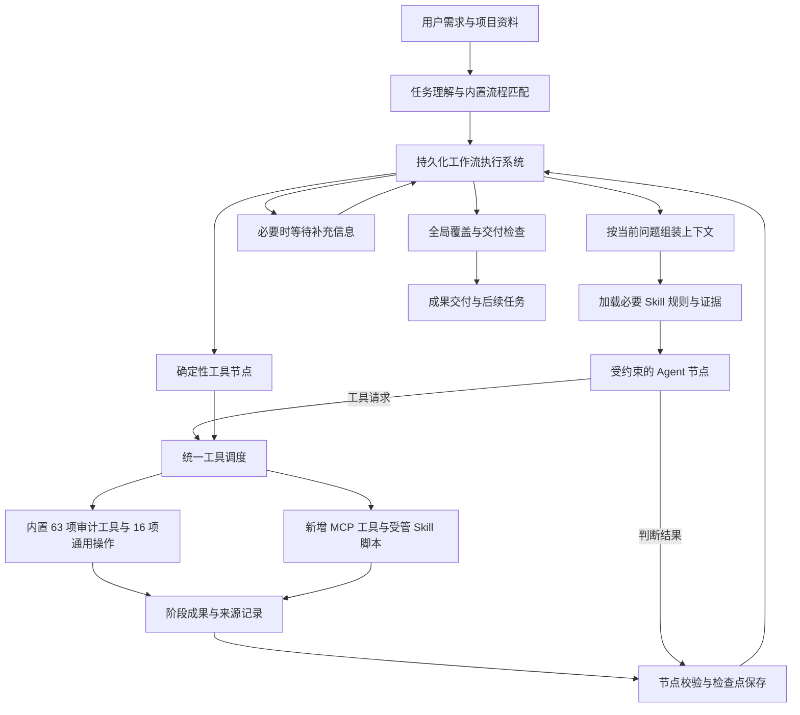

# AI审计助手 Agent 平台项目方案

日期：2026年10月10日。最近修订：2026年10月12日。状态：评审稿。当前程序基线：0.1.0-internal.29。

本次改造将 AI审计助手建设为能够承接审计任务的 Agent 平台。用户用自然语言提出需求、提供资料和下达任务；平台自动理解目标，组织内置工作流，调用 Skill 和工具，交付阶段成果与最终成果。

工作流由平台内置和维护。普通用户无需搭建流程、选择 Agent、配置工具参数或编写 JSON。客户端围绕任务执行和成果使用重新设计，每个入口都以完成实际工作为目的。

以下平台架构、自动执行机制和新界面均为拟实现内容。当前已有能力与需要新增的能力分别列明。

## 产品定位与交付目标

平台的基本工作单位是“有明确目标、资料范围和交付物的任务”。同一项目可以连续开展资料整理、账表分析、分录检查、银行核对和底稿生成，前一任务的成果可以作为后一任务的输入。

用户可以说“检查这些资料是否齐全”“分析本年度收入的月间波动”“核对这些银行流水和序时账”“根据这个模板生成往来明细底稿”。系统需要把这些表达落实到真实可执行的程序步骤。

首版交付目标包括：

- 内置工作流自动承接与现有能力相符的任务，常规步骤连续执行。
- 现有 63 项独立审计工具和 16 项通用操作接入统一执行系统。
- 支持接入并管理 Skill，支持在统一工具目录中扩展 MCP 工具。
- 每项任务保存输入、流程版本、处理记录、阶段成果、异常和证据来源。
- 支持补充资料、调整任务、停止、失败重试和中断后继续。
- 客户端围绕下任务、看进度、处理必要事项和使用成果组织。
- 最终交付仍采用一个可双击启动的 EXE，包含内置审计业务运行环境。

当前工具能够完成的操作构成首版自动化范围。涉及新增业务算法、未提供资料或未配置在线服务的需求，系统需要明确说明实际完成范围，并展示可继续处理的部分。

## 当前基础与改造内容

|组成|当前程序的基础|本次需要完成的改造|
|---|---|---|
|审计工具|63 项任务注册到应用自带的独立 Python 业务处理器|统一工具目录、参数合同、执行记录和成果接入|
|通用操作|16 项文件与表格操作|与审计工具使用同一调度入口，消除重名和重复选择问题|
|Agent|已有模型工具调用循环|改为按工作流节点执行，保存状态，支持继续、分支和任务预算|
|Skill|读取固定目录中的 SKILL.md，根据文字匹配加载内容|增加导入、版本、依赖检查、按任务绑定和受管脚本执行|
|工作流|已有固定阶段、任务记录和人工确认|改为平台内置的自动运行流程，支持条件分支、数据传递和必要时等待用户|
|成果|已有成果文件、任务结果和部分哈希记录|增加阶段成果合同、来源索引、覆盖情况和成果之间的依赖关系|
|客户端|以资料、操作搜索、任务参数和工作记录为主|改为需求输入、任务执行和成果交付为主|
|运行设置|已有文本模型、视觉模型和在线服务授权配置|统一为 Agent、Skill 和工具提供服务配置，任务页面使用引用|

当前 Agent 对审计工具的直接调用，与手动任务入口分别保存记录。新平台必须让这两类调用归入同一任务执行管线，保证状态、停止操作和成果统计一致。

当前部分 Skill 写有逐步等待用户确认的规则；当前工作流也把执行成功转换为等待阶段确认。这些交互规则需要依据本方案重新设计，正常步骤自动推进，用户集中处理资料缺失和关键口径问题。

现有 63 项的验证覆盖合成业务资料、客户端调用、部分真实公开服务及文本和视觉模型。注协在线查询按用户要求跳过真实授权验证。迁移到平台后，需要重新验证工作流衔接、恢复和成果来源，不能以原单工具测试代替平台验收。

## 企业模型条件与准确性约束

按当前部署条件，文本模型使用企业内部 DeepSeek V4 Flash，上下文窗口为 128K，未微调且不支持图片识别；扫描件和图片通过专用 OCR 服务处理。用户提供的 bdo-ocr-document-parser 调用说明明确了上传、查询状态和下载结果的异步流程，成果包括 Markdown 和 JSON。JSON 中页码、表格、坐标和置信度的具体字段尚待真实样例核验；模型接口能力与 Token 计量同样需在工程接入时确认。

Agent 工作流以完整的持久化任务状态为基础，按当前业务问题组装上下文。简单问题在一次完整输入中处理；复杂任务按节点或完整业务单元执行，切换时重新加载必要的约束、规则、证据和前置结果。原始资料、任务要求、规则、映射和成果保存在上下文之外。程序负责总体覆盖、计算、写入、核对和发布条件；模型负责受约束的需求理解、候选映射和有证据的解释。关键字段无法验证时保持待核实状态。

### 本次确定的上下文与流程原则

平台采用“按当前问题组装上下文、外部保存完整状态、校验后推进、最终全局核对”的执行方式。每次模型调用有明确目标和足够证据，已经完成的详细对话退出当前输入；业务事实与处理状态仍可从原始记录准确取回。

|原则|执行要求|
|---|---|
|按任务选择处理粒度|小任务直接执行，复杂任务按业务问题和依赖组织节点；大表由程序全量处理，模型读取必要证据|
|上下文保留必要关联|提供当前问题有关的公司、期间、单位、排除条件、规则、原始证据和冲突；完整凭证、跨页表格、引用条款等关系需保留|
|节点声明上下文清单|按节点明确必带约束、规则、证据、有效前置结果、允许操作和输出条件；必要证据实际展开，单独列出的引用不算已读取|
|压缩通过状态重建|关键事实从带来源和版本的结构化记录加载，原始证据按需展开，过程叙述可以摘要；重建后检查约束、结果身份、范围、未决项和版本|
|切换前保存结果|保存结论或候选、来源、适用范围、规则与输入版本、校验状态、未决事项和检查点|
|通过条件由程序判断|模型返回候选后，按节点合同核对结构、来源和业务语义；未经相应验证的结果保持候选状态|
|局部执行后全局核对|检查跨批次重复、关联匹配、主体和记录覆盖、总体勾稽及需求覆盖；错误返回受影响节点修复|
|控制模型调用范围|程序承担枚举、计算、填写和状态推进；模型集中处理需求、语义、非结构化提取和解释，必要时独立复核|

128K 可以作为平台的单次调用容量基础。是否直接处理或拆分，由实际输入输出预算、证据关联和企业模型测试结果决定。32K／48K 等数值是起始工程预算，复杂问题可在经过验证的预算内扩大输入；不得为了缩短上下文丢掉必要证据。对全部任务始终启用要求和状态保存、调用前预算检查及结果校验。

具体流程结构、上下文组成和切换、128K 适用边界、OCR 流程、填充校验、自动修复及验收见[Agent工作流与准确性设计](C:/Users/Install/Desktop/ai助手/docs/Agent方案/审计Agent工作流与准确性设计-20261010.md)。该设计作为本方案的执行细则。

2026年10月12日本轮补充上下文组装与压缩设计：节点清单、组装步骤、分层取证与定向补证据、实际输入记录、压缩重建、完整性检查、超限处理顺序、多家公司底稿案例及验收条件。工具内部的模型调用也必须接入这一机制。32K／48K 等起始预算和接口能力仍待实测，需求理解与流程选择的详细路由留待后续细化。当前修订更新设计文档，未将这些机制标记为已经实现。

## 用户使用过程

### 发起任务

用户选择或建立项目，在任务输入框描述目标，并附上文件或选择项目中的资料。已有项目资料可以由 Agent 在该项目范围内查找，系统同时显示实际采用的资料。

任务输入框支持目标、范围和交付要求，例如：“分析2025年收入月间波动，与2024年比较，给我分析表和异常说明。” 用户已经说明的期间、科目和输出要求直接进入任务信息。

### 理解需求并开始执行

Agent 将需求整理为任务目标、资料范围、期间、主体、输出要求和已知业务口径。平台依据可用能力匹配内置流程，并显示简短的执行说明。

资料与口径齐全时，提交任务即开始执行。系统通过语义理解和明确的能力映射共同选择流程；涉及多个目标时，可以组织多个内置流程，并建立它们的输入输出关系。

只需要提取一列、下载文件等简单操作时，使用包含少量节点的内置流程。复杂任务采用完整流程。流程的长度由工作需要决定。

### 必要时补充信息

能从文件、已有任务成果或已确认项目口径中可靠确定的信息，由系统自动使用。关键信息不足、同名主体有歧义、字段存在多个合理解释，或者资料缺失时，系统集中提出最少的补充问题。

用户可以用自然语言回答、补充文件或从明确的候选项中选择。技术参数由平台形成，用户面对的是实际业务问题。

### 接收成果并继续工作

任务执行期间，阶段成果随完成随展示。结束后提供处理范围、结果摘要、异常事项、可打开的成果文件和来源依据。

用户可以继续说“只分析这一家公司”“补上这份资料重新核对”“根据这个结果生成底稿”。平台保留前次成果，生成新的处理版本，并复用仍然有效的步骤。

## 平台架构与执行关系

平台由任务理解、内置流程库、Agent 执行、Skill 管理、统一工具调度和成果记录六部分组成。工具提供具体执行能力；Skill 描述处理方法；Agent 在限定的任务范围内作出选择；工作流控制顺序、条件和完成标准。

首版采用可复用的协调、处理和检查职责。协调职责负责拆解需求与选择流程，处理职责负责组织资料和工具调用，检查职责核对完成条件与成果一致性。它们可由同一执行系统调度不同 Agent 配置，按任务需要启用。

数值计算、匹配、抽样和文件生成由业务程序执行。Agent 依据实际结果组织解释，将计算事实、证据支持的解释和待核实判断分别保存。

工作流允许 Agent 在节点内部选择工具、修正参数、补充检查和提出问题。分支依据结构化结果和内置条件触发；扩大任务范围、改变关键口径等调整需要显示原因，并按照任务授权处理。

## 内置工作流设计

内置流程属于执行系统，用户通过需求触发。下列内容描述首版能够承接的目标和交付物，也供开发建立节点定义；客户端按项目和任务呈现工作。

|任务目标|基本处理过程|主要成果|主要输入格式|
|---|---|---|---|
|整理资料并检查缺失|识别资料类型、检查字段、提取目录与关键信息、汇总缺失|资料清单、分类结果、缺失项、提取表|按工具支持的 XLSX、XLSM、CSV、TSV、PDF、DOCX、TXT、MD 和图片|
|整理账表并形成可分析数据|预览、识别表头和科目、清洗、拆分辅助项、形成账表并校验|标准化账表、字段映射、清洗和勾稽记录|XLSX、XLSM、CSV、TSV；具体整理工具以其合同为准|
|开展月间波动或毛利率分析|确定范围与口径、汇总计算、识别异常、结合明细解释|分析表、异常清单、依据和待补资料|XLSX、XLSM、CSV、TSV|
|检查分录并形成后续检查样本|检查序时账结构、绑定规则、执行测试或截止抽样、去重并汇总|命中分录、抽样清单、总体与规则说明|XLSX、XLSM、CSV、TSV；截止抽样配置使用 Excel|
|核对银行资料并准备函证表格|按账户汇集、核对账面与流水、检查差异；按需求生成函证表格|匹配表、差异清单、函证表格|流水和账面数据使用 XLSX、XLSM、CSV、TSV；函证模板和配置使用 Excel|
|生成明细底稿|检查数据与模板、形成映射、保存并校验配置、填充并检查成果|明细底稿、配置记录、校验结果|数据使用 XLSX、XLSM、CSV、TSV；模板使用 XLSX、XLSM|
|收集公开披露资料并整理披露表|根据查询范围下载资料、核对文件有效性、编制索引；按需求提取已有 Excel 披露表|PDF、下载索引、披露表和失败清单|下载任务使用查询条件；披露表提取使用 XLSX、XLSM|
|整理工商资料并分析关联方线索|识别主体、整理已有工商资料、按需在线补充、执行关联分析|主体资料表、关联线索、来源和覆盖缺口|关联核查配置使用 XLSX、XLSM；企查查报告处理使用 DOCX|
|提取或核对凭证与扫描资料|识别文档、提取字段、与目标资料匹配、汇总差异|提取表、核对结果、低可靠性和缺失事项|按工具支持的 PDF、图片和其他文档；凭证检查主要使用 PDF 或图片|
|整理底稿链接与表格成果|检查链接、按明确要求替换、汇集工作表、提取单元格或插入批注|整理后的工作簿、变更和校验记录|XLSX、XLSM|

同一工具可以参与多个流程。多个流程也可以组合，例如资料整理完成后继续月间分析，分析结果形成后继续底稿整理。全部 63 项能力的接入归属见文末索引。

### 银行流水与账面数据核对

|阶段|执行内容|完成条件与阶段成果|
|---|---|---|
|资料识别|检查账面数据和流水，识别主体、账户、期间和必要字段|形成资料范围、账户清单和缺失项；范围明确后继续|
|规范化处理|根据实际表头形成映射，必要时汇集流水，按主体和账户隔离|规范化数据、映射说明、有效行数及未采用记录|
|核对执行|调用 bank_flow，对实际支持的匹配情况执行核对|匹配结果、双方未匹配记录、差异统计；原有统计不足时补充结果适配|
|差异整理|回查源记录，结合补充资料解释差异|每项差异的源记录、已有依据、可能原因和待核实事项|
|交付与后续任务|检查总体和成果完整性，按需求准备函证表格|核对成果、异常清单、处理说明；函证表格作为独立成果|

函证表格生成能力负责准备文件。函证发送、回函获取和回函真实性验证需要相应的新服务或工具后才能成为自动执行步骤。

### 月间波动与毛利率分析

|阶段|执行内容|完成条件与阶段成果|
|---|---|---|
|确定分析范围|解析期间、公司、科目或产品维度，检查本期与比较期资料|范围说明、资料清单；缺少比较资料时说明可完成的分析范围|
|识别结构与口径|调用预览和科目结构工具，确定字段、科目层级和金额方向|映射及口径记录；存在关键歧义时集中询问|
|计算分析表|根据目标调用 monthly_execute 或 gross_margin_analysis|真实汇总数据、变动或毛利率结果、计算口径|
|解释异常|依据结果回查账簿明细，按需求调用 monthly_ai_analysis|异常事项、明细依据、解释与待补资料|
|检查并交付|核对期间、范围、总额和表格输出|分析工作簿、范围与覆盖说明、后续检查建议|

阈值、筛选规则和金额方向来自用户要求、已确认项目口径或明确版本的内置策略。系统展示实际使用值，关键口径无法确定时询问用户。

### 明细底稿生成

|阶段|执行内容|完成条件与阶段成果|
|---|---|---|
|检查资料与模板|调用 detailed_table_inspect 与 detailed_table_inspect_template|源字段、模板字段、公司和科目范围、缺失项|
|形成映射|Agent 按 Skill 形成字段、科目、模板和多期资料映射|保存可解释的映射，集中解决主体、账龄等关键问题|
|保存并校验配置|调用 detailed_table_save_config 与 detailed_table_validate，隔离本次任务配置|配置文件、校验通过记录；未通过时返回可定位的问题|
|生成成果|调用 detailed_table_generate|实际生成的底稿、未覆盖模板与异常说明|
|检查并交付|核对数量、金额、模板必需字段和输出文件|底稿文件、校验摘要、来源与配置记录|

模板公式的重算方式和结果状态必须随成果说明。XLSM 处理是否保留宏、复杂格式和链接，以具体工具已验证能力为准。

### 公开披露资料收集

|阶段|执行内容|完成条件与阶段成果|
|---|---|---|
|解析范围|确定交易所、日期、公司、文件类型和更新要求|查询范围；缺少决定查询范围的信息时询问|
|查询与下载|调用 ipo_sh、ipo_sz、ipo_bj 或 announcement|真实下载记录、文件列表、失败和重试结果|
|筛选并校验|核对文件类型、有效性、目标范围和重复情况|有效 PDF、目标范围命中表和未完成清单|
|整理交付|组织资料目录和来源索引|资料文件、名称、日期、可取得的来源链接和下载时间|

当前三所 IPO 入口主要接收日期与更新参数。按公司或文件类型精确筛选需要在平台适配层补充索引和过滤能力；全范围下载量不能替代用户目标范围的命中结果。当前披露表提取工具处理 Excel，下载 PDF 后的表格提取需要单独验证文档提取能力。

### 其余流程的阶段成果

|流程|阶段与成果衔接|
|---|---|
|资料整理|资料清单 → 分类或字段提取表 → 缺失与格式问题清单 → 可供后续任务使用的资料索引|
|账表整理|结构预览 → 映射与清洗记录 → 标准化账表或小账套 → 勾稽与覆盖说明|
|分录与抽样|总体及字段检查 → 规则或抽样配置 → 命中分录及样本 → 来源、总体覆盖和后续检查事项|
|工商与关联方|主体确认 → 已有或在线工商资料 → 关联线索 → 依据与资料覆盖缺口|
|凭证与扫描资料|文件有效性检查 → 提取字段 → 核对结果 → 原文引用、差异和待人工核实项|
|底稿链接与汇集|原工作簿检查 → 变更方案 → 在工作副本上处理 → 成果工作簿和前后变化校验|

分录规则命中、关联方线索和模型解释以其证据强度展示。最终成果需要区分“已执行的检查”“观察到的事实”和“仍需核实的判断”。

## Skill 接入与管理

首版支持以 SKILL.md 为核心的能力包，可附带说明、脚本、模板、规则和样例。平台维护者在管理入口导入或更新，普通用户通过任务自动使用。

Skill 的描述需要覆盖以下内容：

|信息|用途|
|---|---|
|标识、版本和说明|确定具体使用了哪套方法|
|适用任务与触发条件|供任务理解和流程节点绑定|
|输入与完成条件|规定需要什么资料，以及怎样算完成|
|工具与服务依赖|检查所需 MCP、内置工具、模型和授权是否可用|
|过程、分支和问题处理|指导 Agent 执行、修正和提出必要问题|
|输出结构与模板|让阶段成果能够交给下一节点|
|资源和脚本声明|限定运行环境、文件范围和可执行入口|
|验证样例|检查导入后的实际行为|

基础 SKILL.md 可以按指南模式接入；带脚本、依赖和结构化输出的能力包，需要满足平台扩展约定。兼容情况按包实际验证，不预先承诺所有来源的 Skill 均可直接运行。

平台先读取 Skill 摘要，再按流程节点加载正文和需要的资源。已有内置流程可以明确绑定 Skill，任务匹配也可以选择适用 Skill，避免只依靠零散关键词。

Skill 状态包括未启用、依赖缺失、待验证、可用和停用。单纯改变措辞无需改变工作流；增加新的业务任务、工具依赖或关键处理规则时，维护者更新流程绑定并验证。

运行中的任务固定 Skill、规则和模板版本。更新后的版本用于后续任务；历史任务保留使用记录。模型密钥与服务授权通过平台设置引用，Skill 包中保存方法和资源。

## MCP 与现有工具接入

现有 63 项已经拥有独立业务实现。平台把它们注册为内置审计工具包，继续由独立 Python 处理器执行。新增 MCP 工具通过接入适配器进入同一目录和调度管线。

工具目录保存提供方、唯一标识、版本、实际能力、参数合同、支持格式、输出合同、依赖和文件写入行为。相似或重名工具采用明确的提供方标识，节点绑定经过验证的具体实现。

统一调用过程为：定位任务和节点 → 校验资料与参数 → 创建调用记录 → 执行工具 → 规范化状态 → 核对成果文件 → 发布阶段成果 → 推进流程。

组件分工、参数来源、执行适配、状态校验、失败恢复及月间分析调用实例，见[工作流与准确性设计](C:/Users/Install/Desktop/ai助手/docs/Agent方案/审计Agent工作流与准确性设计-20261010.md)中的“工作流需要搭建的组件”和“工具调用流程与统一执行接口”。

手动快捷操作、Agent 调用和确定性流程节点均采用这条管线。现有 MCP 风格返回中的 isError、success、status 和等待输入状态需要统一解释，避免业务失败被记成成功。

工具结果按需补充以下结构：状态、处理范围、统计摘要、成果列表、警告、未完成项、来源和需要补充的信息。大型结果保存为文件，模型获取摘要、检索接口和所需片段。

新增 MCP 的首版接入范围包括工具发现、参数校验、调用、连接状态、服务配置和结果适配。资源读取等额外能力按接入场景另行验证。外部服务的可用性与内置工具运行状态分别展示。

注协授权缺失或失效时，仅在线查询步骤等待配置；已有工商资料能够支持的分析继续执行。保留此前跳过注协真实在线验证的决定，实际在线验收在获得可用授权后补充。

## 执行状态与恢复机制

任务状态采用待理解、执行中、等待补充、已暂停、中断、部分完成、失败、已停止和已完成。阶段和工具调用另存状态，任务摘要由它们汇总。

每个节点定义输入来源、执行方式、工具或 Skill、输出结构、通过条件、分支、重试规则和等待条件。通过条件满足后自动进入下一步；阶段成果仍然可供用户随时查看。

关键运行规则包括：

- 创建任务时固定资料引用、流程版本和规则版本，记录真实输入文件哈希。
- 不相关的只读步骤可以并行；共享配置或修改同一工作副本的步骤按依赖执行。
- 长任务按节点或批次保存检查点，模型调用和工具执行分别设预算。
- 参数错误、连接失败和业务规则失败分别处理；限制重试次数，保存失败原因。
- 关闭或崩溃后的活动调用标记为中断，核对已发布成果后继续，避免重复生成。
- 停止操作传递到相关模型请求和工作进程，未完整发布的文件标为未完成成果。
- 用户更换资料或修改口径时，生成新版本，只重新执行受影响的节点及其后续步骤。
- 对失败或不可用的步骤记录实际原因，已完成部分可以先交付，并标明剩余范围。

恢复执行需要检查输入是否改变、成果是否完整和当前服务是否可用。恢复不能只重放最后一条聊天消息。

项目口径作为单独记录保存，包含期间、主体、金额方向、规则、来源和确认状态。已确认口径可以用于相关任务；模型提出的建议保持建议状态。

## 成果与证据记录

平台保存项目、任务、流程节点、Agent 步骤、工具调用、资料、成果、证据引用、项目口径和补充事项。对话作为需求与解释的一部分，执行事实存为独立记录。

每项阶段成果需要关联到任务、节点、输入资料、使用规则、输出文件和校验状态。结构化表格优先定位到原文件、工作表和源行；文档尽量定位到页码或原文片段。定位粒度不足时明确显示实际可取得的来源范围。

文件转换、合并、筛选和清洗过程需要携带来源映射或另存来源索引。现有处理器未提供这些信息的地方，新增伴随文件或结果适配，保证后续解释可以回查。

成果页同时展示总体、已处理范围、未处理范围和校验情况。例如，流水核对展示参与核对的账户和期间；扫描提取展示成功、失败和需核实的文件；查询展示实际命中的目标主体。

成果目录由平台管理，源资料与处理副本分开。后续任务引用具体成果版本；过期成果仍可查看，并说明哪些输入已经改变。

## 客户端设计

客户端采用浅色背景、清晰文字层级和紧凑的项目导航。颜色主要表达运行状态、待处理事项和异常。常用任务入口与成果区域保持明确位置。

### 任务工作区

项目工作区以“要完成什么工作”的输入框和正在进行的任务为主。资料区展示文件格式、识别情况和任务采用范围，可以附加资料或替换版本。

左侧提供项目和任务导航；中央呈现当前任务。资料详情按需打开，支持用户核对文件。主界面以业务目标为入口，处理模式、输出目录和内部参数由系统管理。

### 执行页

顶部显示任务目标、项目、状态和执行控制。中央按阶段展示已完成事项、当前处理内容和阶段成果，下方提供补充指令与资料入口。

任务信息包括目标范围、实际使用资料、阶段结果和待补事项。工具名称、参数、调用记录和模型用量放在可展开的执行详情中。过程说明来自实际执行事件。

普通步骤自动推进。需要用户处理时，显示具体问题、判断依据和可选答案，同时保留已经完成的成果。用户回复后从对应节点继续。

### 成果页

成果页按任务交付物组织：结果摘要、表格或底稿、异常事项、来源与覆盖说明。用户可以打开文件、查看具体差异或原始记录，并从当前成果发起后续任务。

提供“基于这份成果继续处理”的输入入口。常见后续动作依据当前成果推荐，例如继续分析差异、补充资料重跑或生成底稿。

### 设置与平台管理

文本模型、OCR 服务和在线服务授权位于运行设置。Skill 导入、MCP 连接和内置流程版本位于平台管理入口，供维护者操作。工作流设计和节点编排属于开发维护能力。

新用户只需建立项目、提供资料和下达任务。已有模型与项目配置通过明确的数据迁移读取，业务记录可按历史成果继续查看。

## 实施顺序与工程落点

实施阶段用于内部推进；最终验收覆盖全部工具接入、内置工作流和新客户端。

|阶段|工作内容|通过条件|
|---|---|---|
|一 统一执行基础|统一工具目录、调用状态、任务与节点记录、参数校验和成果发布|全部 63 项及 16 项操作能够从统一入口实际执行并形成可追踪成果|
|二 自动流程与 Skill|实现内置流程运行、按问题组装上下文、依赖传递、自动分支、Skill 导入和版本绑定|银行、月间和底稿流程首先跑通，节点切换保留关键事实，正常步骤自动连续执行；其余流程按合同接入|
|三 恢复与成果依据|实现检查点、部分失败、停止重试、输入变更和来源索引|中断后继续可复现；改资料只重算受影响部分；异常可以回到来源|
|四 新客户端|实现需求输入、任务进度、补充信息、成果及平台管理|用自然语言完成完整任务，普通用户无需编排节点或填技术参数|
|五 验收与打包|执行完整流程与包内测试，生成单文件程序|工具、流程、界面、恢复和实际包内执行全部达到验收要求|

当前代码的改造位置包括：

|现有位置|工程用途|
|---|---|
|src/host/service.mjs|收敛任务、Agent 与手动执行入口，提供统一任务服务|
|src/workflows/contracts.mjs|扩展能力和参数合同，建立统一工具目录|
|src/workflows/state.mjs 与 definitions.mjs|重建内置流程定义、节点状态和自动推进机制|
|src/harness-adapter/agent.mjs|支持按问题组装上下文、节点级 Agent 执行、输入输出预算和状态恢复|
|src/skills/loader.mjs|扩展 Skill 包索引、导入、按任务加载、依赖与版本管理|
|src/mcp/independent-client.mjs 与 workflows/mcp-runner.mjs|接入统一调度，规范化调用、停止和结果状态|
|src/audit-domain/runtime|补齐来源、处理范围和阶段结果字段，继续提供确定性业务能力|
|src/conversations/store.mjs|扩展任务、节点、成果、来源、检查点和项目口径存储|
|src/client|实现新的任务工作区、执行页、成果页和管理入口|

首版基于现有桌面运行环境实现以上职责。运行系统、模型适配与工具适配分开，方便后续评估更换调度实现；具体框架选型另作工程验证。

## 验收标准

|验收项|可检查的结果|
|---|---|
|自然语言下任务|给定真实可支持的需求和资料，平台选择正确流程与资料范围，形成实际成果|
|自动推进|资料和口径齐全时，整条流程无需逐步点击确认即可完成|
|信息不足|集中提出实际缺失问题，收到回答后继续，不填造业务口径|
|工具覆盖|63 项审计工具和 16 项通用操作逐项从统一入口验证，错误与等待状态正确传播|
|阶段成果|每阶段输出明确结构，后续节点读取其实际结果，完成状态可验证|
|上下文切换|切换或重启后，公司、期间、排除条件、规则、来源和未决事项从持久化记录完整恢复|
|自适应处理与全局关系|简单问题保持足够的完整输入；复杂任务拆分后仍保留跨页、跨文件和跨批次关系，覆盖与总体检查通过|
|计算与依据|金额、匹配、抽样和规则命中由程序验证；解释能够引用实际资料|
|Skill 接入|样例包导入、依赖缺失、版本更新、停用和按任务使用均有实际测试|
|MCP 扩展|新增工具可发现、校验、执行并记录；失联和业务错误可以定位|
|恢复与修改|中断、停止、失败重试和资料变更不会误报完成，旧成果与新版本可区分|
|资料隔离|不同公司、账户、期间和项目按任务范围处理，共享配置不相互覆盖|
|交付文件|支持格式与实际工具合同一致，文件可打开，宏和重算等限制随成果说明|
|单文件程序|在无原工具箱和开发环境的测试位置首次启动、再次启动并完成关键流程|

测试同时包含单工具案例、完整工作流案例和客户端操作。模型解释使用有已知答案的合成资料检查准确性，计算和匹配核对确定性结果；真实服务测试单列覆盖范围。

公开下载及可用模型需要重新验证平台调用链路。注协真实在线验证保持待补状态，其他流程按可用能力验收；依赖它的在线覆盖情况在成果中明确记录。

## 63项审计工具接入索引

以下按执行能力列出完整工具归属，供内部接入和验收使用。输入格式、模板、逐项参数与现有成果示例见[任务与文件格式对照](C:/Users/Install/Desktop/ai助手/docs/任务与文件格式对照-20261010.md)。

|执行能力|数量|工具标识|主要使用位置|
|---|---|---|---|
|表格整理与预览|13|add_column、asist_split、fill_column、headers_process、merge_column、dropsummary、insert_column、select_column、pickup_value、tool_execute、tool_preview、monthly_preview、detailed_table_inspect|资料准备、账表标准化、分析和底稿的前置步骤|
|分析与检查|8|monthly_detect_structure、monthly_execute、monthly_ai_analysis、gross_margin_analysis、jet_test_inspect、jet_test_execute、cutoff_sampling、ledger_check|分析程序、分录检查、抽样和账表校验|
|工作簿链接与披露整理|10|link_extractor、link_replace_text、link_replace_workbook、link_replace_range、link_ref_replace、multi_collect_file、multi_collect_folder、insert_footnote_comments、extract_disclosure_scope、extract_disclosure_tables|底稿整理、资料汇集和披露成果|
|底稿与配置|6|detailed_table_save_config、detailed_table_inspect_template、detailed_table_validate、detailed_table_generate、subject_clean_after、xlsx_writer|明细底稿、账表形成和校验|
|文档与资料处理|11|info_extract、info_extract_multi、file_classification、photo_rename、text_match、auxiliary_selection、data_field_check、paper_verify、voucher_check、ai_formula_filler、subject_allocation|资料整理、凭证核对、账表准备和成果整理|
|银行资料处理|5|bankflowmerge、bank_flow、bank_digit2、bank_paper1、bank_paper2|流水汇集、账面核对和函证表格准备|
|公开与在线资料|6|ipo_sh、ipo_sz、ipo_bj、currency、announcement、cicpa_query|披露资料、汇率资料及工商资料补充|
|主体资料与关联线索|4|related_party、qcc_processor、address_split、id_card|主体资料整理、关联分析和函证资料准备|

数量合计为 63。这些能力共同支撑任务，工具归属不限定其只能参与某一流程。

## 当前基线与设计参考

- [当前独立客户端验收与使用](C:/Users/Install/Desktop/ai助手/docs/独立客户端验收与使用-20261010.md)：现有交付版本、验证范围及单文件程序。
- [审计工具定义](C:/Users/Install/Desktop/ai助手/src/resources/audit-task-tools.json)：63 项工具的实际入口和参数。
- [独立业务注册表](C:/Users/Install/Desktop/ai助手/src/audit-domain/runtime/registry.py)：独立业务分派和工具覆盖检查。
- [Agent 执行器](C:/Users/Install/Desktop/ai助手/src/harness-adapter/agent.mjs)：当前模型工具调用循环。
- [Skill 加载器](C:/Users/Install/Desktop/ai助手/src/skills/loader.mjs)：当前指南加载与匹配方式。
- [工作流状态服务](C:/Users/Install/Desktop/ai助手/src/workflows/state.mjs)：当前阶段状态与确认机制。
- [后台服务](C:/Users/Install/Desktop/ai助手/src/host/service.mjs)：当前任务和 Agent 调用入口。

本方案定义这一轮平台改造的产品目标和验收依据。此前九类任务界面方案中的入口划分和逐阶段确认机制，按本方案的用户交互与自动执行设计调整。

当前已明确决策、待细化合同、业务流程覆盖深度和待验证事项，见[方案梳理与待细化清单](C:/Users/Install/Desktop/ai助手/docs/Agent方案/审计Agent方案梳理与待细化清单-20261012.md)。
