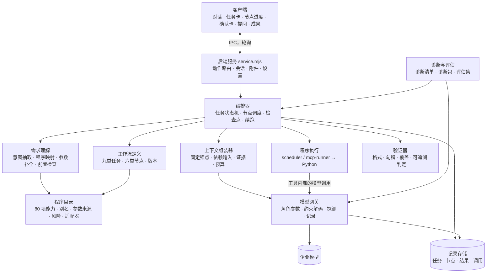

# 执行核心重建实现设计

日期：2026-10-14。状态：待评审。

本文不提出新方案，而是把仓库已有方案落到这个代码库上：
- `main` 分支 `docs/01–09`：自建 Agent 方案；
- 本目录的《审计Agent平台项目方案》《审计Agent工作流与准确性设计》《方案梳理与待细化清单》。

本文回答四件事：
- 现有执行方式放弃哪些部分；
- 新的执行核心由哪些模块组成，模块之间的接口是什么；
- 九类任务如何用同一套机制承接；
- 按什么顺序实现，每一步如何验收。

目标是一套通用、完整的工作流执行核心，不针对单个任务调试。

---

## 一、前提与取舍

### 1.1 已确定的前提

- **模型接入：**应用直接调用企业模型（OpenAI 兼容接口），不经过 openclaw。
- **用户配置：**用户只配置请求地址和 API Key。服务提供多个模型时，从模型列表选择一次；只有一个时自动选用。
- **参数由应用决定：**温度、输出上限、上下文预算、是否思考、结构化输出方式等，全部由工作流按调用角色设定。"测试连接"时探测服务的实际能力，作为这些参数的依据（第五节）。
- **部署形态：**仍是可双击启动的桌面 EXE（Electron + Node 后端 + 内置 Python）。
- **模型条件：**企业内部 DeepSeek V4 Flash，128K 窗口，未微调，不支持图片。扫描件走企业 OCR 服务。

### 1.2 两套方案的取舍

两套方案原则一致：流程由代码控制、代码算数、模型写判断、每步可验证可恢复、先诊断再改造。有分歧的地方按下表处理。

| 事项 | 采用 | 理由 |
|---|---|---|
| 执行原则与运行时结构 | main 03、04、08：规划、执行、验证分离；每步干净上下文；模型网关按角色设参；六类节点；状态机与检查点 | 两套方案的共同核心，分支方案的节点合同是它的细化 |
| 产品范围 | 分支平台方案：九类任务、63 项独立工具加 17 项内置操作、OCR、任务合同 | 已有实现和资源都按这个范围建设 |
| 部署形态 | 桌面应用（分支方案） | 与现有交付一致；main 08 的 FastAPI/PostgreSQL 只是技术选型参考 |
| 执行前确认 | 按风险决定（main 06 §5.3）：只读且参数有来源的自动执行；含推断参数的展示确认卡；产生正式样本、写入底稿或覆盖已有结果的必须确认 | 与分支方案"正常步骤自动推进、集中处理关键口径"一致，又保留了审计人员对关键决定的控制 |
| 标准数据层 | 分两步。先做"数据集登记"：每张输入表的字段映射经过校验后保存，程序按映射取数。之后再为序时账、余额表、银行流水建立统一标准表（main 05） | 63 项工具目前直接读原始文件，一次性改成标准表的工作量和风险都太大；有映射登记后，可以逐个程序迁移 |
| 预算起点 | 每次调用的输入按 32K 起步（main 03 的 CONFIG），由诊断测出的有效长度调整，经验证后可扩大到 48K（分支方案） | 两套方案的数值可以兼容 |

### 1.3 放弃的部分

现有 Agent 的核心是"一个由模型自由选择工具的长对话循环，外面叠加护栏"。重建后，这条路径整体退出，下表逐项说明。

| 现有部件 | 处理 |
|---|---|
| `src/agent/runtime.mjs` 的 `send` 和后台执行块：一次运行就是一个 `runAgent` 长循环 | 删除，由编排器取代（第四节） |
| 给模型的 16 个控制工具（`set_agent_plan`、`get_audit_tools`、`run_audit_tool`、`ask_user_questions`、`read_agent_result`、工作簿三件套等） | 删除。读取、执行、提问、保存计划都由节点完成，模型不再调用"流程控制"类工具 |
| 一次请求带全部 79 项工具定义 | 删除。只有 agent 节点向模型提供工具，而且只给本节点白名单里的少数只读工具 |
| `task-intent.mjs` 的正则意图判断、`requiresWorkbookOutput` 填表模式、`completionGap` | 删除，由需求理解节点和覆盖验证取代 |
| `context-builder.mjs` 的整段对话压缩（约 9 万估算 token 才触发）、上下文归档与回读 | 删除，由按节点组装的上下文取代：没有长对话，也就不需要压缩 |
| `progress.mjs` 的重复读取和重复输出检测 | 删除。节点有轮数和修复次数上限，不再需要事后检测空转 |
| `skills/loader.mjs` 按触发词注入 SKILL.md | 删除。业务规则改为节点绑定的版本化规则（第七节） |
| `workflows/state.mjs` 的旧阶段确认流程，以及 `workflow.*`、`task.run` 手动入口 | 删除。客户端已经不用 |
| 整体 30 分钟时限（`runtime.mjs:43`）、单工具 10 分钟等待 | 删除，改为按节点设预算、按进度判断超时（第四节） |
| 设置中的温度、输出上限、上下文窗口、视觉模型、处理模式 | 从用户设置中移除，由应用内部决定 |
| 已有但无人调用的函数：`historyImages`、`addAgentCheckpoint`、`checkpointValid`、`resultForModel` 等 | 删除 |

### 1.4 保留和复用的部分

| 现有部件 | 复用方式 |
|---|---|
| 输入快照：`inputs.mjs` 的内容寻址、只读、按哈希去重；附件导入与内容提取 | 作为任务输入版本的基础，原样保留 |
| 记录存储：`store.mjs`，SQLite 记录表加 JSONL 事件 | 保留。新增记录种类（第四节 4.7） |
| 独立工具执行：`scheduler.mjs`、`worker.py`、`mcp-runner.mjs`、`independent-client.mjs`、`task_worker.py` | 作为 procedure 节点的执行器，保留 |
| 成果发布与校验：暂存目录、manifest、哈希、`verifyTaskArtifacts`、启动时恢复 | 保留，作为 procedure 节点的第一层验证 |
| 63 项工具的 `inputSchema`、17 项内置操作的字段定义、`buildCatalog` | 作为程序目录的基础，再补充业务字段（第六节） |
| 填写计划编译与执行：`workbook_plan.py` 的受控表达式、写入后回读核对 | 作为"模板填写"程序，供底稿类工作流使用 |
| 模型适配中的网关兼容处理：`model.mjs` 的流式解析、`<tool_call>` 文本识别、参数双重编码、空流回退 | 并入模型网关 |
| 客户端：React 外壳、项目、会话、附件、文件预览、轮询机制 | 保留，改造对话中的任务卡片（第九节） |

---

## 二、总体结构



新代码集中放在 `src/engine/`：

```
src/engine/
  gateway/       模型网关：调用、角色参数、能力探测、计量、调用记录、给 Python 用的本地转发
  context/       上下文组装：槽位预算、固定锚点、依赖输入、证据读取器
  task/          任务合同、项目档案、需求覆盖登记
  understand/    意图抽取、程序映射、参数补全、前置检查、提问
  catalog/       程序目录、参数适配器、结果规范化
  workflows/     工作流定义的加载与校验（定义文件放在 src/resources/workflows/）
  orchestrator/  状态机、调度、检查点、失效传播、六类节点执行器
  verify/        验证器
  free/          受限自由模式（目录外的只读查询和解释）
  eval/          诊断清单、诊断包导出、评估集运行器
```

---

## 三、一次任务怎么跑

以"用户发出一条请求"为起点。九类任务走同一条主线，差别只在第 5～8 步绑定的节点和程序。

| 序号 | 环节 | 节点类型 | 做什么 | 产物 |
|---|---|---|---|---|
| 1 | 受理 | code | 冻结输入版本（复用快照），读取项目档案，建立任务记录 | 任务记录、输入清单 |
| 2 | 资料盘点 | code / procedure | 枚举文件、工作表、页；用 `inspect`、`file_inventory`、工作簿结构读取得到表头候选、行数、期间标签、单位；扫描件调用 OCR | 资料清单（带稳定编号） |
| 3 | 需求理解 | llm（extractor） | 用户原话加资料清单摘要，输出任务列表 JSON：动作、对象、期间、约束原文、交付物、不清楚的地方 | 任务合同草稿 |
| 4 | 程序映射与参数补全 | code + llm（router、extractor） | 按别名和科目匹配候选流程与程序，模型从候选中选择并给出置信度；按优先级补全参数，约束原文转为参数，由代码校验 | 已选工作流、参数及来源、待问问题 |
| 5 | 提问与确认 | human | 关键缺项集中提问（最多 3 个，带选项和建议默认值）；按风险决定是否出确认卡 | 已确认参数 |
| 6 | 字段映射 | llm（extractor），按数据集逐个 | 每张输入表一个问题：表头、样本、统计、规则，输出标准字段到源列的映射；代码校验列存在、类型、期间、方向 | 已验证映射（数据集登记） |
| 7 | 执行 | procedure，可按业务单元展开 | 程序按已验证映射和参数全量计算；无依赖的节点可以并行 | 结果（汇总表、异常清单、文件、检查结果） |
| 8 | 验证 | verify | 成果文件校验、勾稽、覆盖、跨单元汇合检查 | 通过，或定位到节点的失败原因 |
| 9 | 解读与下钻 | llm（analyst）+ 可选 agent | 依据汇总表和异常清单撰写解读；需要时在 5 轮内调用只读查询工具下钻 | 结构化解读（引用结果编号） |
| 10 | 交付 | llm（writer）+ verify | 写结论；验证文字中每个数字都能在结果中找到；按任务合同逐条检查覆盖 | 最终答复、成果清单、覆盖说明、待处理事项 |

一句话里有多项工作时，第 3 步拆成多个任务。第 4 步按程序目录的前置关系排序（main 06 §4.3），在同一个任务运行里实例化多条工作流，前一条的成果可作为后一条的输入。

请求不属于目录内程序，但属于数据查询、对已有结果的解释或手册问答时，走受限自由模式（第八节）。两者都不是时，明确告知不支持，并记录下来。

---

## 四、编排器

### 4.1 任务状态机

状态沿用 main 08 §4.2：理解、追问、规划、待确认、执行、验证、重试、暂停、完成、阻塞、取消。

实现要求：
- 状态转换表写死在代码里，每次转换都写入事件流；
- 只有编排器能改状态，模型输出只能作为节点结果，不能改状态；
- 进程重启时，执行中的任务转为"已中断"，用户继续或应用重启后自动从检查点恢复。

### 4.2 节点调度

- 调度器读取工作流定义和节点运行记录，选出依赖已满足、输入版本有效的节点执行。
- 无依赖的节点可以并行，受模型并发上限约束。同一项目的写操作串行，包括写底稿、生成正式样本、覆盖结果。
- 节点可以声明 `foreach`，按业务单元展开：公司、账户、工作表、文件或凭证批次。
  - 每个单元是一个独立的节点实例，有自己的上下文和检查点；
  - 单元批量大小由预算决定；
  - 展开后必须有一个汇合节点，做跨单元的重复、关联和合计检查。

### 4.3 六类节点

| 类型 | 执行器 | 是否调用模型 | 说明 |
|---|---|---|---|
| code | `orchestrator/nodes/code.mjs` | 否 | 受理、盘点、前置检查、数据准备等代码逻辑，按 `action` 名称注册 |
| procedure | `nodes/procedure.mjs` | 否（工具内部的模型调用经过网关） | 执行程序目录中的一项能力；参数由适配器从已验证的上游输出生成；复用现有 scheduler 和 mcp-runner |
| llm | `nodes/llm.mjs` | 是，单次调用加有限修复 | 指定角色、输出格式、验证器；只接收声明的输入 |
| agent | `nodes/agent.mjs` | 是，受限循环 | 指定只读工具白名单和轮数上限（默认 5～8 轮）；用于下钻核查和自由模式 |
| human | `nodes/human.mjs` | 否 | 提问或确认卡；按 `when` 条件决定是否出现；无人回应时按 main 06 §6 处理：只读操作用建议默认值继续并标注，正式样本和写入等待 |
| verify | `nodes/verify.mjs` | 视验证类型 | 运行验证器；不通过时按失败路线回到对应节点 |

### 4.4 失败处理

按 main 08 第五节的失败矩阵：
- **格式错误：**先用约束解码；仍失败时修复调用最多 2 次。
- **工具参数错误：**把错误回填给上游 llm 节点修正。
- **验证不通过：**带原因重试最多 3 次，然后暂停并报告具体节点和原因。
- **数据问题：**暂停，展示差异。
- **服务不可用：**退避重试；长时间不可用时挂起，恢复后续跑。
- **上下文超限：**按优先级裁剪并记录，或缩小业务单元，绝不静默截断。

每次失败和修复都记录在节点运行记录里。不允许删行、放宽阈值、改范围或填零来让验证通过。

### 4.5 时限

- **不设整体时限。**长任务在后台运行，界面关闭或切换会话都不影响。
- **模型调用：**流式请求超过 2 分钟没有收到任何数据块就中止并重试（可在诊断后调整）。
- **程序执行：**只要进度、行数或阶段还在变化就不中止；超过设定时间没有任何变化才判为卡住。按程序设上限，默认 20 分钟无变化。
- **节点：**每个节点有调用次数和修复次数上限，超过后暂停并报告，不会无限循环。

### 4.6 检查点、续跑与失效

- 每个节点通过验证后保存检查点：输入引用、输出、结果编号、使用的规则和程序版本。
- 续跑时跳过已通过且输入未变的节点。
- 用户补充资料或修改参数后，沿依赖关系使受影响的节点失效，只重跑这部分（main 08 §4.2、分支方案"补充资料后只重做受影响部分"）。
- 已提交到远端或已写文件的调用，先核对实际状态再决定是否重试（沿用现有 `submission_unknown` 等状态）。

### 4.7 记录结构

**新增记录种类**（存于现有 `records` 表）：

| 记录 | 主要字段 |
|---|---|
| `taskRuns` | 会话、任务合同（要求及来源、范围、交付物、完成条件）、输入版本、工作流实例列表、状态、状态转换历史 |
| `nodeRuns` | 任务、工作流与节点版本、业务单元、依赖引用、状态、尝试记录、输出（结构化）、检查结果、检查点 |
| `modelCalls` | 节点、角色、提示词版本、实际发送内容（或可重建的引用）、输入输出计量、耗时、首字时间、结束原因、解析是否成功 |
| `results` | 结果编号（如 `R-BANK-003`）、版本、汇总表、异常清单（每条有编号）、成果文件、检查结果、来源 |
| `profiles` | 项目档案：主体、期间、准则、重要性水平、单位与币种、数据状态（main 06 第二节） |
| `datasets` | 数据集登记：文件哈希、工作表、表头行、字段映射版本、校验结果 |
| `questions` | 问题、选项、建议默认值、关联节点、回答及来源 |

**事件流：**沿用 JSONL，事件类型按 main 03 §12：start、plan、step_start、token、tool_start、tool_done、retry、step_done、step_failed、approval、cancelled、final。

**旧记录：**`agentRuns`、`toolCalls`、`agentToolResults`、`agentModelInputs` 不迁移。旧会话只显示原有的用户和助手文本。

---

## 五、模型网关

所有模型调用只经过网关，包括 Python 工具内部的调用。

### 5.1 接口

```js
gateway.call({role, nodeRunId, messages, schema, tools, budget})
  // → {json | text | toolCalls, usage, finishReason, timing, callId}
```

### 5.2 按角色设参

初始值取自 main 08 §4.3，由诊断和评估调整：

| 角色 | 用途 | 思考 | temperature | 输出 |
|---|---|---|---|---|
| router | 程序选择 | 关 | 0 | JSON |
| extractor | 意图抽取、约束转参数、字段映射 | 关 | 0 | JSON |
| analyst | 结果解读、异常定性建议 | 开 | 0.2 | JSON + 文本 |
| judge | 无法程序化的判定 | 开 | 0 | JSON |
| writer | 结论与底稿说明 | 中 | 0.3 | 文本 |
| executor | agent 节点内的单步 | 中 | 0.2 | 工具调用 |

### 5.3 结构化输出

- 优先使用服务支持的 JSON Schema 约束（`response_format: json_schema`）。
- 不支持时退到 `json_object`，再不支持就靠提示词加代码校验，修复最多 2 次。
- 用哪一种，由能力探测决定。

### 5.4 能力探测（"测试连接"时执行，结果保存）

探测以下内容：
- 模型列表；
- 实际最大输出：逐级请求，看是否被截断或拒绝；
- 是否支持 `json_schema`、`json_object` 和工具调用；
- 思考开关参数是否生效，推理内容的返回字段；
- 历史中的推理内容是否需要回传或必须去掉；
- 实际上下文上限：发送已知长度的请求。

结果决定各角色的 `max_tokens`、结构化输出方式和预算上限。用户界面只显示"可用 / 不可用 / 受限"及原因。

### 5.5 计量

- 先用字符估算。
- 每次调用后用服务返回的 `usage.prompt_tokens` 校准估算系数，并按服务保存。

### 5.6 调用记录

- 每次调用写 `modelCalls`，含耗时和首字时间。这是"时间花在哪"的直接依据。
- 记录有大小上限和清理策略：只保留最近 N 个任务的完整请求，其余保留摘要。

### 5.7 给 Python 工具的本地转发

12 项工具在 Python 内部调用模型：月间 AI 分析、信息提取、文件分类、公式填充等。

- 网关在本机回环地址开一个 OpenAI 兼容端点，执行任务时把这个地址和一次性令牌传给 Python，代替真实地址和密钥。
- 这样工具内部的调用也受预算、记录和角色参数约束（分支方案"工具内部的模型调用也必须接入"），真实密钥也不进入 Python 进程。

### 5.8 并发

网关内设队列，限制同时进行的模型调用数（默认 2，可由诊断调整）。交互类调用优先于后台批量调用。

---

## 六、程序目录与适配器

### 6.1 目录条目

在 `buildCatalog` 生成的 80 项能力基础上，增加业务字段（main 06 第三节）：

```json
{
  "id": "bank_flow",
  "name": "序时账与流水双向核对",
  "aliases": ["银行对账", "流水核对", "核对银行流水和序时账"],
  "requiresData": ["ledger", "bank_statement"],
  "prerequisites": ["bankflowmerge?"],
  "params": {
    "period": {"required": true, "defaultFrom": "profile.period"},
    "accountColumn": {"required": true, "from": "datasets.ledger.mapping.account"}
  },
  "sideEffects": "none",
  "risk": "low",
  "output": "procedure-result/1",
  "validators": ["artifact_verified", "row_coverage", "match_balance"]
}
```

业务字段放在 `src/resources/programs/*.json`，与工具的 `inputSchema` 分开维护。缺少业务字段的能力不会被自动路由，只能在定义里显式绑定。

### 6.2 参数适配器

- 每项能力一个适配器（`catalog/adapters/<id>.mjs`）。
- 职责：把上游节点的已验证输出（映射、参数、文件引用）转换成工具实际需要的参数。
- 每个参数记录来源：用户、本会话已确认、项目档案、规则默认值、上游节点。

### 6.3 结果规范化

- 所有程序的返回统一成 `procedure-result/1`，字段为汇总表、异常清单、完整成果文件、检查结果（main 05）。
- 进入模型上下文的只有汇总表和截断后的异常清单，带结果编号；需要更多时，按编号定向读取。
- 先在 Node 端适配现有返回格式，再逐步让 Python 直接返回这个格式。

### 6.4 数值状态（属于 G01）

`audit-domain/runtime/context.py` 的 `number()` 改为区分有效值、空白、"-"、无效值四种状态：
- 无效值不再静默变成 0；
- 按字段统计后放进检查结果；
- 超过阈值时让验证不通过。

---

## 七、上下文组装

### 7.1 每次调用的组成

沿用 main 03 §9 和分支方案的"节点上下文清单"：

| 槽位 | 内容 | 起始预算 |
|---|---|---|
| 系统 | 角色提示词（每个角色固定前缀，字节级不变，便于前缀缓存） | 1.5K |
| 固定锚点 | 用户原话、已确认参数、全局约束（期间、主体、单位、排除条件） | 不裁剪 |
| 任务清单 | 每个节点一行状态 | 1K |
| 当前问题 | 节点目标、完成标准、上次失败原因 | 4K |
| 依赖输入 | 按节点 `inputs` 声明，从上游结构化输出中取指定字段；数字由代码原样读取 | 含在当前问题内 |
| 证据 | 按节点 `evidence` 声明，由读取器取得：表头、代表性样本、边界样本、全量统计、相关明细、原文页 | 8K |
| 本节点往返 | 仅 agent 节点有，节点结束即丢弃 | 10K |
| 输出预留 | 按角色和探测到的输出上限 | 4K～8K |

总量按 32K 起步。

### 7.2 证据读取器

`context/evidence.mjs` 提供一组按类型读取证据的函数：
- `table_schema`（表头与类型统计）
- `rows`（按条件、代表性、边界或异常挑选）
- `workbook_range`
- `document_pages`
- `result_rows`（按结果编号和异常编号读取）
- `profile`

每次读取都有大小上限，返回内容带稳定来源编号。

### 7.3 超限

先缩减证据样本数量，再缩小业务单元（回到调度器拆分），最后报告"单个必要单元无法处理"。不删固定锚点，不静默截断。

### 7.4 记录

组装清单与实际发送内容写入 `modelCalls`，可以复现任何一次调用的输入。

---

## 八、需求理解与受限自由模式

### 8.1 需求理解

需求理解是分支方案待细化清单中的 G03。分步如下：

1. **意图抽取**（extractor）：输出任务列表，原话中的数字、科目、条件原样保留，无法确定的写进"不清楚"，不自行补全。
2. **程序映射**：先用别名和科目做规则匹配，得到候选；候选为空时按程序描述检索前 3 个；模型从候选里选择并给置信度。
   - 高置信直接进入下一步；
   - 中置信（2～3 个候选）请用户选；
   - 低置信先追问，仍无法映射就明确说不支持。
3. **参数补全**：来源优先级为用户本次明说、本会话已确认、项目档案、规则默认值、程序默认值。约束原文由模型转成参数，由代码校验，例如期间在审计期间内、科目存在、阈值与重要性水平比较。
4. **前置检查**（代码）：所需数据是否齐、映射是否已确认、前置程序是否已通过、数据期间是否覆盖参数期间。
5. **覆盖检查**：另一次小上下文调用重读用户原话，列出全部要求点，检查每点是否有对应的任务和节点，防止漏项。

### 8.2 受限自由模式

用于目录外的数据查询、对已有结果的追问（如"刚才第 17 条""金额最大的几笔"），以及解释说明。

- 执行方式是一个 agent 节点：只读工具白名单，包括按结果编号查询、按条件查行、查凭证、查科目期间；最多 8 轮。
- 不能写文件、不能执行会产生成果的程序。
- 结果中的数字必须来自工具返回。

---

## 九、九类任务的工作流定义

定义文件放在 `src/resources/workflows/<id>.json`，有版本号，加载时校验：节点类型、依赖只指向前序节点、绑定的能力存在、输入声明的字段在上游输出合同里存在。

### 9.1 共用骨架

第三节的 1～5 步和 9～10 步对所有工作流相同，由骨架提供。每条工作流只定义中间的映射、执行、验证节点。

### 9.2 九条工作流的中段

按分支平台方案的阶段和能力绑定矩阵：

| 工作流 | 中段节点（示意） | 绑定的主要能力 |
|---|---|---|
| 资料整理 data | 分类 → 字段检查 → 处理（按需选择清洗操作）→ 缺失汇总 | file_inventory、file_classification、data_field_check、headers_process、select_column、fill_column、merge_files、multi_collect_* 等 |
| 账表 ledger | 结构识别 → 科目与辅助项映射 → 清洗拆分 → 勾稽或 JET 测试 | subject_clean、asist_split、auxiliary_selection、subject_allocation、ledger_check、jet_test_inspect / execute、voucher_check |
| 月间分析 monthly | 预览 → 结构与口径映射 → 计算 → 异常解释 | monthly_preview、monthly_detect_structure、monthly_execute、gross_margin_analysis、monthly_ai_analysis |
| 抽样 sampling | 总体检查 → 规则或抽样参数 → 抽样 → 去重汇总 | inspect、cutoff_sampling（目前只有截止抽样，其他抽样方法需要新增程序） |
| 银行 bank | 按账户汇集 → 字段映射（按账户展开）→ 双向核对 → 差异回查 → 按需生成函证表 | bankflowmerge、bank_flow、bank_paper1 / 2、bank_digit2 |
| 底稿 workpaper | 数据与模板检查 → 映射（按模板或公司展开）→ 配置保存与校验 → 生成 → 重读 | detailed_table_*（批注模板）、workbook_fill（普通模板）、xlsx_writer |
| 披露 disclosure | 范围 → 表格或链接处理 → 校验 | extract_disclosure_*、link_*、insert_footnote_comments |
| 外部查询 external | 主体确认 → 查询（在线服务）→ 关联分析 | cicpa_query、qcc_processor、related_party、announcement、ipo_* |
| 信息提取 aux | 文件识别（含 OCR）→ 字段提取（按文件展开）→ 匹配核对 | pdf_text、info_extract*、paper_verify、id_card、address_split、photo_rename、ai_formula_filler、currency |

各条工作流的完整节点定义、输入输出合同和验证器，在实现阶段 3 逐条编写。每条都配评估用例。

### 9.3 示例定义（银行核对，节选）

```json
{
  "id": "bank", "version": "1.0.0",
  "nodes": [
    {"id": "merge", "type": "procedure", "program": "bankflowmerge", "when": "inventory.bankFiles > 1"},
    {"id": "map_bank", "type": "llm", "role": "extractor", "foreach": "datasets.bank_statement",
     "inputs": [{"from": "task", "fields": ["entity", "period"]}],
     "evidence": [{"kind": "table_schema"}, {"kind": "rows", "pick": "representative+boundary", "limit": 30}],
     "output": "field-mapping/1", "validators": ["columns_exist", "required_fields", "type_check", "period_in_scope"]},
    {"id": "map_ledger", "type": "llm", "role": "extractor", "output": "field-mapping/1"},
    {"id": "reconcile", "type": "procedure", "program": "bank_flow",
     "inputs": [{"from": "map_bank"}, {"from": "map_ledger"}],
     "validators": ["artifact_verified", "row_coverage", "match_totals"]},
    {"id": "check", "type": "verify", "checks": ["unmatched_listed", "amount_reconciles"]},
    {"id": "explain", "type": "llm", "role": "analyst", "inputs": [{"from": "reconcile", "fields": ["summary", "exceptions_top50"]}]},
    {"id": "drill", "type": "agent", "tools": ["query_rows", "query_voucher"], "maxTurns": 5, "optional": true},
    {"id": "letters", "type": "procedure", "program": "bank_paper1", "when": "task.deliverables has letters",
     "confirm": "required"}
  ]
}
```

---

## 十、验证器

位置在 `src/engine/verify/`，按 main 08 §4.7 分类：

| 类型 | 实现 | 例子 |
|---|---|---|
| 格式 | 代码 | JSON 字段齐全、类型正确、编号存在 |
| 成果 | 代码（复用 `verifyTaskArtifacts`） | 文件存在、哈希、可打开、manifest 状态 |
| 覆盖 | 代码 | 源记录全部处理、目标位置全部填写、要求逐条有结果 |
| 勾稽 | 代码 | 明细合计等于总账；期初加发生等于期末；匹配金额平衡 |
| 可追溯 | 代码 | 模型写的文字中每个数字都能在结果中找到（抽取数字后匹配，允许格式差异） |
| 一致性 | 代码规则 + judge | 写"未发现异常"但异常清单非空 |
| 判定 | judge | 无法程序化的完成标准；证据不足按未通过处理 |

验证器按名称注册，工作流定义里按名称引用。

---

## 十一、客户端

- **设置页：**只保留请求地址、API Key、模型选择（从列表选；只有一个时隐藏）、测试连接（显示探测结果）。在线服务授权（注协）保持不变。
- **对话中的任务卡：**
  - 理解结果：识别出的任务、所选流程、参数及来源。
  - 确认卡：按风险出现，可修改参数。
  - 提问：最多 3 个问题，带选项和建议默认值。
  - 节点进度：每个节点一行状态；展开后看该节点的输入摘要、结果和失败原因。
  - 成果：结论、关键数字（代码填写）、异常分级、文件、覆盖说明、待处理事项。
- **操作：**停止、继续、从某个节点重来、修改参数后重跑受影响部分。
- **更新方式：**仍用轮询。`session.get` 只返回任务和节点的摘要，大内容按需读取，避免每 650 毫秒传回整份运行记录。
- **诊断与评估入口：**设置页提供"运行诊断""导出诊断包"；评估集运行放在开发者入口。

---

## 十二、诊断与评估（阶段 0）

### 12.1 诊断清单

按 main 07 第一节自动执行，结果保存并显示：
- 实际上下文长度
- 输出上限
- 思考参数是否生效
- 推理内容的处理方式
- 结构化输出与工具调用支持
- 有效上下文：8K、16K、32K、64K、100K 下的关键事实召回

诊断结果直接用来设定网关参数和上下文预算。

### 12.2 诊断包

一次任务运行导出为一个文件，用户实测出问题时一键导出：
- 任务合同、节点运行、模型调用（含输入输出与耗时）、程序执行摘要、验证结果；
- 去除密钥，附件内容可选择是否包含。

### 12.3 评估集

- **格式：**`evalsets/<用例编号>/`，包含 `case.json`（用户原话、项目档案）、`inputs/`、`expected.json`（预期流程、参数、关键结果、允许差异）。
- **运行器：**有两种模式。只跑需求理解和参数，成本低；或跑完整工作流。
- **指标：**main 07 第三节，加分支方案的错误放行率、需求覆盖率、首次交付通过率。按九类任务和判断类型分别统计。
- **来源：**先用现有测试资料为每类任务编写合成用例；真实脱敏用例由业务人员提供并确认答案。
- **门禁：**提示词、工作流、程序、网关参数的任何改动，都先跑评估集，指标不下降才合并。

---

## 十三、实施顺序与验收

每个阶段都用两种方式验收：
- 本地：用脚本模型做的自动化测试，覆盖流程、失败、恢复；
- 企业模型：用户在本机运行诊断和评估集，把结果发回。

| 阶段 | 内容 | 验收 |
|---|---|---|
| 1. 网关与诊断 | 模型网关（角色参数、约束解码、计量、调用记录、本地转发）、能力探测、诊断清单、诊断包；设置页简化 | 在企业模型上跑完诊断并得到参数建议；所有调用有记录和耗时 |
| 2. 编排器与节点 | 新记录种类、状态机、调度、检查点、失效传播、六类节点、上下文组装器、验证器框架、事件流；客户端任务卡与节点进度 | 示例工作流端到端跑通；中断后续跑；补充资料只重跑受影响节点；验证失败能重试和暂停 |
| 3. 理解与九类工作流 | 任务合同、项目档案、意图抽取、程序映射、参数补全、前置检查、提问与确认卡；程序目录业务字段与适配器；九条工作流定义；结果规范化；`number()` 数值状态 | 九类任务各至少 3 个合成用例在脚本模型下通过；企业模型上的需求映射准确率、参数正确率达到设定目标 |
| 4. 解读、交付与自由模式 | analyst、writer、下钻 agent 节点；可追溯与覆盖验证；结果编号与追问；受限自由模式 | 交付文字中的数字全部可追溯；追问能按编号定位；评估集首次交付通过率达到目标 |
| 5. 清理与回归 | 删除旧执行路径与无用代码；测试迁移；全量评估回归；打包 | 旧路径代码和测试已移除；EXE 打包通过；评估指标不低于阶段 3、4 |

阶段 1 完成后，就请你在企业模型上运行诊断，拿到真实的输出上限、结构化输出支持和有效上下文长度，后续阶段的预算按实测值设定。

---

## 十四、待确认事项

1. **企业 OCR 服务的接入配置。**用户设置只保留模型地址和 Key，OCR 的地址和凭据放在哪里？建议：放在设置页"在线服务"区域，与注协授权并列。
2. **评估集的真实用例。**需要业务人员按九类任务提供脱敏资料和确认过的答案，首批每类 2～3 个。
3. **重要性水平等项目档案。**由用户在项目设置里填写，还是首次需要时由工作流提问并保存？建议：首次需要时提问并保存，之后可在项目设置中修改。
