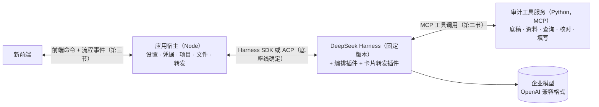

# 接口约定：工具、流程事件、界面卡片

日期：2026-10-17。状态：草案，待评审。

**用途：**底座、审计工具、流程编排、新前端四条线并行开发时，只按本文的接口对接。各线先用假数据按本文开发，汇合时不改接口。

**依据：**
- [通用审计Agent实现设计](通用审计Agent实现设计-20261014.md)第三到八节、第十三节：审计流程与核对；
- [DeepSeek Harness 接入评估](DeepSeek-Harness接入评估-20261015.md)：底座。

---

## 一、分层与通信



| 接口 | 双方 | 方式 | 版本标识 |
|---|---|---|---|
| 工具接口 | 编排插件、Harness → 审计工具服务 | MCP（标准输入输出） | `audit-tools/1` |
| 流程事件 | 编排插件 → 宿主 → 前端 | 事件流 | `audit-events/1` |
| 前端命令 | 前端 → 宿主 | 请求-响应 | `audit-app/1` |
| 界面卡片 | 编排插件 ⇄ 前端（经宿主） | 卡片随事件下发，回答随命令上传 | `audit-cards/1` |

**规则：**
- 前端只和宿主通信，不直接接触 Harness 的内部事件。Harness 升级时，只有宿主和插件需要改。
- 审计工具服务不依赖 Harness。它是普通的 MCP 服务器，可以单独测试。
- 模型看不到全量数据。工具返回的数据都按第 1.4 节控制体量。

### 1.1 待底座线确认的两点

- **宿主连 Harness 用 SDK 还是 ACP。**SDK 没有取消；ACP 有取消，但没有自定义提问。暂定 SDK，取消靠宿主结束 Harness 进程后续跑。底座线验证后定。
- **卡片回答怎么送进 Harness。**暂定：宿主把回答作为一条带标记的消息发进会话，编排插件在 `agent/pre-step` 拦下，不交给模型。底座线验证可行性。

这两点只影响宿主和插件内部，不影响本文其他接口。

---

## 二、通用约定

### 2.1 编号

| 对象 | 格式 | 例子 |
|---|---|---|
| 项目 | `P-` + 短编号 | `P-7f3a` |
| 任务 | `T-` + 短编号 | `T-0c21` |
| 输入文件快照 | `F-` + 哈希前 12 位 | `F-9a1be04c77d2` |
| 底稿结构图 | `W-` + 序号 | `W-003` |
| 区域 | 结构图编号 + `#` + 序号 | `W-003#R5` |
| 资料表 | `D-` + 序号 | `D-002` |
| 结果表 | `R-` + 序号 | `R-012` |
| 结果中的行 | 结果编号 + `#` + 行号 | `R-012#17` |
| 卡片 | `C-` + 序号 | `C-004` |
| 模板指纹、方案 | `TPL-` / `PLAN-` + 哈希前 12 位 | `TPL-51c0e2a9b3f1` |

- 编号在项目内唯一，由生成方分配，其他方只引用不改写。
- 单元格写作 `工作表!A1`，区域写作 `工作表!A1:D20`。工作表名含空格或符号时加单引号，例如 `'2025 明细'!B3`。

### 2.2 数值

- 金额、数量一律用**十进制字符串**传递，例如 `"-1234.50"`，不用浮点数。
- 空白、零、无效值三者分开：空白为 `null`，零为 `"0"`，无效值见 2.4 的数据问题。
- 日期用 `YYYY-MM-DD`，期间用 `YYYY`、`YYYY-MM` 或 `YYYY-MM-DD/YYYY-MM-DD`。

### 2.3 依据

凡是会影响结果的判断，都带一个 `basis` 字段：

| 取值 | 含义 |
|---|---|
| `user` | 用户原话或回答 |
| `confirmed` | 本任务已确认的口径 |
| `template` | 底稿上的标示（表头年份、"单位：万元"等） |
| `profile` | 项目档案 |
| `data` | 从资料中确定 |
| `inferred` | 推断。影响结果时必须进入确认 |

需要时另带 `basisRef`，指向具体来源（单元格、消息编号、档案字段）。

### 2.4 结果信封

每个工具调用都返回同一结构：

```json
{
  "ok": true,
  "data": {},
  "warnings": [],
  "refs": ["R-012"],
  "truncated": false,
  "next": null
}
```

失败时：

```json
{
  "ok": false,
  "error": {
    "code": "HEADER_MISMATCH",
    "message": "底稿!C4 实际文字为“期末余额”，与引用的“期初余额”不同",
    "where": "底稿!C4",
    "hint": "核对区域语义中引用的坐标和原文",
    "retryable": true
  }
}
```

**错误分类：**

| 类别 | `code` 前缀 | 处理方 |
|---|---|---|
| 参数或引用错误 | `ARG_`、`REF_`、`HEADER_` | 回给模型修正（`retryable: true`） |
| 核对不通过 | `CHECK_` | 编排插件按失败矩阵重做 |
| 数据问题 | `DATA_` | 暂停，出卡片给用户 |
| 需要用户输入 | `NEEDS_INPUT` | 出卡片 |
| 文件或环境问题 | `IO_`、`ENV_` | 报告阻塞 |

### 2.5 体量控制

- 单次返回给模型的内容不超过约 2,000 token。超出时 `truncated: true`，`next` 给出取下一页的参数。
- 大结果只返回编号、行数、合计和前 N 行。全量留在项目分析库。
- 原始数据明细不返回给模型。模型看到的是结构、统计和少量样例。

### 2.6 文件

- 工具只能访问当前项目目录和任务工作目录。
- 用户原文件只读。所有输出写到 `输出/<任务编号>/` 下的新文件。
- 输入文件在任务开始时生成快照（`F-` 编号）。快照哈希变了，依赖它的结果全部失效。

---

## 三、工具接口（`audit-tools/1`）

审计工具服务是一个 MCP 服务器。下列每个工具对应一个 MCP 工具，名称即下表的名称。参数和返回值都放在 2.4 的信封里。

### 3.1 工具清单

| 工具 | 用途 | 调用方 | 设计章节 |
|---|---|---|---|
| `workpaper_parse` | 解析底稿结构，生成结构图 | 编排 | 5.2 |
| `workpaper_region_view` | 取一个区域的紧凑渲染，供模型判断语义 | 编排 | 5.3 |
| `workpaper_semantics_check` | 校验模型给出的区域语义 | 编排 | 5.3 |
| `template_match` | 按指纹查模板库 | 编排 | 5.4 |
| `data_inspect` | 识别资料的表头、数据区和类型 | 编排 | 6.2 |
| `data_import` | 按确认的字段含义导入分析库 | 编排 | 6.2 |
| `data_profile` | 取资料表的字段统计和样例 | 编排、模型 | 6.2 |
| `data_quality` | 运行数据质量检查 | 编排 | 6.4 |
| `query_validate` | 校验受控查询 | 编排、模型 | 7.2 |
| `query_run` | 执行受控查询，生成结果表 | 编排、模型 | 7.2 |
| `result_get` | 分页读取结果表 | 编排、模型 | 7.2 |
| `check_basis` | 校验口径要素是否齐全、依据是否成立 | 编排 | 7.1 |
| `check_conservation` | 行数、金额守恒，关联放大，期间越界 | 编排 | 7.4 |
| `check_control` | 控制数核对 | 编排 | 7.5 |
| `check_compare` | 双路复算比较 | 编排 | 7.6 |
| `fill_compile` | 编译写入计划 | 编排 | 8.1 |
| `fill_apply` | 写入副本并回读核对 | 编排 | 8.3 |
| `trace_cell` | 查询某个写入单元格的来源、口径和核对结果 | 宿主 | 8.5 |
| `fill_preview` | 按写入计划列出每格拟写值、来源、是否覆盖 | 宿主 | 8.2 |
| `table_view` | 分页查看资料表或结果表，可定位到某行 | 宿主 | 6.1、7.2 |
| `drill_*` | 下钻查询（凭证、对方科目、往来单位等） | 模型 | 9 |

标"编排"的工具由编排插件按流程调用，不交给模型自由选择。标"模型"的工具会出现在相应节点的子 Agent 里。

### 3.2 `workpaper_parse`

**参数：**

```json
{ "file": "F-9a1be04c77d2", "sheets": null }
```

`sheets` 为空表示全部可见工作表。

**返回 `data`：**

```json
{
  "workpaper": "W-003",
  "fingerprint": "TPL-51c0e2a9b3f1",
  "sheets": [
    {
      "name": "应收账款",
      "hidden": false,
      "protected": false,
      "usedRange": "A1:K60",
      "meta": [
        { "label": "被审计单位", "labelCell": "应收账款!A2", "valueCell": "应收账款!B2", "kind": "entity" },
        { "label": "单位：元", "cell": "应收账款!J2", "kind": "unit", "unit": "元", "scope": "sheet" }
      ],
      "regions": [
        {
          "id": "W-003#R5",
          "range": "应收账款!A5:H30",
          "type": "fixed_table",
          "typeCertain": true,
          "headerRows": [5, 6],
          "columns": [
            { "col": "C", "path": ["期末余额", "账面余额"], "labelCells": ["应收账款!C5", "应收账款!C6"] }
          ],
          "rowLabels": [
            { "row": 7, "text": "1年以内", "level": 1, "cell": "应收账款!A7" }
          ],
          "totals": [ { "row": 30, "text": "合计", "formula": true } ],
          "inputCells": 96,
          "formulaCells": 12,
          "ambiguities": []
        }
      ]
    }
  ]
}
```

**区域类型 `type`：**`detail_table`（明细表）、`fixed_table`（固定项目表）、`form`（表单字段）、`checklist`（检查表）、`text`（文字区）、`none`（不需填写）。`typeCertain: false` 时，`ambiguities` 写明歧义。

### 3.3 `workpaper_region_view`

**参数：**`{ "region": "W-003#R5", "rows": [7, 40] }`，`rows` 可选，用于大区域分批。

**返回：**区域的紧凑文字渲染，只含坐标、标签原文和待填标记，不含数值明细。供区域语义节点直接放进上下文。

### 3.4 `workpaper_semantics_check`

**参数：**模型给出的区域语义（结构见第五节 5.2 的底稿理解卡，同一份数据）。

**校验：**
- 引用的坐标存在，原文一致；
- 期间、单位与标签一致；
- 每个待填位置都有归属。

**返回：**`ok` 或带 `HEADER_`、`REF_` 错误的清单，每条指明单元格。

### 3.5 `data_inspect` 与 `data_import`

**`data_inspect` 参数：**`{ "file": "F-…" }`

**返回：**每张识别出的表：

```json
{
  "candidate": "F-…/序时账/1",
  "sheet": "序时账",
  "headerRows": [1],
  "dataRange": "A2:N48210",
  "rows": 48209,
  "columns": [
    { "col": "A", "header": "日期", "types": { "date": 48209 }, "nulls": 0, "samples": ["2025-01-02"] }
  ],
  "totalsRows": [48211],
  "kindGuess": null
}
```

**`data_import` 参数：**

```json
{
  "candidate": "F-…/序时账/1",
  "kind": "journal",
  "fields": [
    { "col": "A", "name": "凭证日期", "meaning": "voucher_date", "type": "date", "basis": "data" },
    { "col": "H", "name": "借方金额", "meaning": "debit", "type": "decimal", "basis": "data" }
  ]
}
```

`kind`：`trial_balance`、`journal`、`bank_statement`、`ledger_detail`、`other` 等。识别为常见类型时，导入后自动建立标准视图。

**返回：**`{ "table": "D-002", "rows": 48209, "invalid": [ { "col": "H", "count": 3, "samples": [ { "row": 102, "value": "12万" } ] } ] }`。无效值超过阈值时返回 `DATA_INVALID_VALUES`。

### 3.6 `query_validate` 与 `query_run`

**参数：**

```json
{
  "sql": "SELECT ... FROM D002 ...",
  "inputs": ["D-002", "R-011"],
  "purpose": "W-003#R5 账龄分段",
  "maxRows": 5000
}
```

- 只允许 `SELECT`、`WITH`；只能引用 `inputs` 中声明的表；函数白名单见附录（审计工具线维护）。
- `query_validate` 只解析、不执行。

**`query_run` 返回：**

```json
{
  "result": "R-012",
  "rows": 6,
  "columns": [ { "name": "账龄段", "type": "text" }, { "name": "金额", "type": "decimal" } ],
  "sums": { "金额": "1834500.00" },
  "head": [ ["1年以内", "1200000.00"] ],
  "lineage": { "inputs": ["D-002@v1"], "sql": "…" }
}
```

### 3.7 核对类工具

**`check_basis`：**输入 7.1 的口径要素对象，检查是否齐全、`basis` 是否成立。

**`check_conservation`：**输入 `{ "from": "D-002", "result": "R-012", "amount": "金额", "excluded": "R-013" }`。返回各项守恒是否成立，不成立时给出差额和样例行。

**`check_control`：**

```json
{
  "region": "W-003#R5",
  "left":  { "result": "R-012", "column": "金额", "op": "sum" },
  "right": { "kind": "balance", "table": "D-001", "account": "1122", "field": "closing" },
  "tolerance": "0"
}
```

返回 `{ "passed": false, "left": "…", "right": "…", "diff": "…", "explainedBy": [] }`。

**`check_compare`：**输入两个结果编号和对应关系，返回逐项是否一致，以及两路查询在来源、期间、范围、方向上的差别。

### 3.8 `fill_compile` 与 `fill_apply`

**`fill_compile` 参数：**

```json
{
  "workpaper": "W-003",
  "bindings": [
    {
      "region": "W-003#R5",
      "cells": [
        { "cell": "应收账款!C7", "from": { "result": "R-012", "row": 1, "column": "金额" }, "scale": "1" }
      ],
      "manual": ["应收账款!H7"]
    }
  ],
  "overwrite": []
}
```

- `from` 也可以是 `{ "profile": "entityName" }` 或 `{ "text": "C-004" }`（第八节说明文字，引用卡片确认后的文本）。
- 不允许直接给数值。
- 明细表行数不够时，返回需要扩展的行数，由编排决定是否扩展。

**返回：**`{ "plan": "FP-…", "cells": 96, "manual": 4, "overwrites": [], "expand": [] }`，或按区域列出错误。

**`fill_apply` 参数：**`{ "plan": "FP-…", "approvedCard": "C-006", "excelRecalc": true }`。没有已批准的写入确认卡，返回 `NEEDS_INPUT`。

**返回：**

```json
{
  "output": "输出/T-0c21/应收账款底稿-填写成果.xlsx",
  "checks": {
    "readback": "passed",
    "formulas": "passed",
    "crossFoot": "passed",
    "untouched": "passed",
    "completeness": "passed",
    "excel": "passed"
  },
  "manualCells": ["应收账款!H7"],
  "report": "输出/T-0c21/填写核对.xlsx"
}
```

### 3.9 `trace_cell`

**参数：**`{ "output": "…xlsx", "cell": "应收账款!C7" }`

**返回：**来源（结果编号、资料表、源文件和行号）、口径要素摘要、核对结果。供前端点单元格查看。

### 3.10 `fill_preview`

**参数：**`{ "plan": "FP-…", "range": "应收账款!A5:H30" }`，`range` 可选，用于分块。

**返回：**

```json
{
  "cells": [
    { "cell": "应收账款!C7", "value": "1200000.00", "valueType": "number", "from": "R-012#1", "old": null, "overwrite": false },
    { "cell": "应收账款!H7", "manual": true }
  ],
  "next": null
}
```

### 3.11 `table_view`

**参数：**`{ "table": "D-002", "offset": 0, "limit": 200, "locate": 102, "columns": null }`

- `table` 可以是 `D-` 或 `R-` 编号；`locate` 为来源行号（`D-`）或结果行号（`R-`），返回包含该行的那一页并标出它。
- 这个工具只给宿主和前端用，不受 2.5 的体量限制，但单页最多 1,000 行。

**返回：**列定义、行数据（金额为十进制字符串）、`total`、`offset`、`highlight`。`D-` 表的每行带来源文件、工作表和原始行号。

---

## 四、流程事件与前端命令（`audit-events/1`、`audit-app/1`）

### 4.1 事件信封

```json
{
  "v": "audit-events/1",
  "task": "T-0c21",
  "seq": 128,
  "ts": "2026-10-17T08:01:22.410Z",
  "type": "node.finished",
  "data": {}
}
```

- `seq` 在任务内严格递增。前端断线重连后用 `task.events` 命令从某个 `seq` 之后补取。
- 事件只追加、不修改。状态由前端按事件累积，也可以用 `task.get` 取当前快照。

### 4.2 事件类型

| 类型 | 时机 | `data` 主要字段 |
|---|---|---|
| `task.created` | 任务登记 | 用户原话、附件快照、交付物 |
| `task.understood` | 需求理解完成 | 交付物、期间、范围、约束（原文）、拆分出的子任务 |
| `stage.changed` | 进入新阶段 | `stage`：`understand`、`workpaper`、`data`、`basis`、`confirm`、`compute`、`fill`、`notes`、`review` |
| `node.started` | 节点开始 | `node`、`kind`（`code`、`model`、`human`、`check`）、`region`（如有） |
| `node.progress` | 长节点进度 | `message`、`done`、`total` |
| `node.finished` | 节点结束 | `outcome`：`passed`、`failed`、`skipped`；`refs`（产出的编号） |
| `check.result` | 一项核对完成 | `check`、`passed`、`detail`（差额、样例）、`region` |
| `node.retry` | 重做 | `attempt`、`reason`（上次失败原因原文） |
| `card.opened` | 需要用户处理 | 整张卡片（第五节） |
| `card.closed` | 卡片已答或撤回 | `card`、`answer` 或 `withdrawn` |
| `region.state` | 区域状态变化 | `region`、`state`（见 4.4） |
| `user.message` | 任务进行中用户补充的话 | 原文、`seq`，以及 Agent 判断它影响了哪些区域 |
| `task.rerun` | 用户要求重跑 | 范围（区域或起始阶段）、修改说明、作废的结果编号 |
| `output.ready` | 产出文件就绪 | 文件路径、类型、核对摘要 |
| `task.blocked` | 无法继续 | 卡在哪、为什么、建议 |
| `task.finished` | 结束 | `status`：`completed`、`partial`、`cancelled`、`failed`；每项交付的状态 |

### 4.3 前端命令

请求格式 `{ "id": "…", "method": "…", "params": {} }`，响应 `{ "id": "…", "ok": true, "result": {} }` 或 `{ "ok": false, "error": { "code", "message" } }`。

| 命令 | 用途 |
|---|---|
| `settings.get` / `settings.save` | 请求地址、模型（多个时选择） |
| `secret.save` | 保存 API Key（宿主加密存储，不回传） |
| `connection.test` | 测试连接并返回探测结果 |
| `project.list` / `project.create` / `project.open` / `project.rename` / `project.remove` | 项目管理（项目对应本地文件夹；移除只从应用中移除，不删文件） |
| `files.add` / `files.list` | 添加资料和底稿，生成快照 |
| `task.create` | 提交需求：原话 + 文件快照 |
| `task.list` | 按项目列出任务：状态、交付物、创建和结束时间 |
| `task.get` | 当前状态快照（4.4） |
| `task.events` | 从某个 `seq` 之后补取事件 |
| `task.message` | 任务进行中补充一句话（4.6） |
| `task.cancel` | 停止任务 |
| `task.resume` | 从检查点继续 |
| `task.rerun` | 改口径后重跑（4.7） |
| `card.answer` | 回答卡片 |
| `outputs.list` | 按项目列出全部产出文件：所属任务、类型、核对摘要、时间 |
| `sheet.view` | 取工作表网格（4.5） |
| `table.view` | 查看资料表或结果表（转调 `table_view`） |
| `cell.trace` | 查单元格来源（转调 `trace_cell`） |
| `output.open` | 用本机 Excel 打开产出文件 |

**事件推送：**宿主主动推送 4.2 的事件，前端不轮询。

### 4.4 任务快照（`task.get`）

```json
{
  "task": "T-0c21",
  "status": "running",
  "stage": "compute",
  "lastSeq": 128,
  "deliverables": [ { "kind": "workpaper", "file": "F-…", "status": "in_progress" } ],
  "regions": [
    { "region": "W-003#R5", "state": "checking", "attempt": 2, "refs": ["R-012"], "card": null },
    { "region": "W-003#R6", "state": "awaiting_confirmation", "card": "C-005" }
  ],
  "openCards": ["C-005"],
  "outputs": []
}
```

**区域状态 `state`：**

| 状态 | 含义 |
|---|---|
| `pending` | 未开始 |
| `understanding` | 识别区域语义 |
| `awaiting_confirmation` | 等用户确认（理解卡、口径卡或差异卡） |
| `computing` | 计算中 |
| `checking` | 核对中 |
| `checked` | 核对通过，待写入 |
| `written` | 已写入并回读通过 |
| `manual` | 整个区域留给人工 |
| `failed` | 重做用尽，阻塞 |
| `skipped` | 不需填写 |

前端按 `state` 给区域着色。状态变化同时以 `region.state` 事件推送。

### 4.5 工作表网格（`sheet.view`）

**参数：**

```json
{
  "file": "F-…",
  "sheet": "应收账款",
  "range": "A1:K60",
  "overlay": { "workpaper": "W-003", "plan": "FP-…", "output": null }
}
```

- `file` 可以是任何已添加的 Excel 文件，底稿和资料都可以。
- `range` 用于分块加载，单次最多 5,000 格。
- `overlay` 可选：
  - `workpaper`：叠加区域边界和区域状态；
  - `plan`：叠加写入计划，每格返回拟写值、来源编号、是否覆盖（转调 `fill_preview`）；
  - `output`：叠加已写入标记，点格可查来源。

**返回：**每格的值、显示文本、数字格式、合并信息、行高列宽，以及叠加层数据。

### 4.6 任务中补充（`task.message`）

**参数：**`{ "task": "T-0c21", "text": "D 列用本年期初" }`

- 宿主把原话作为固定锚点追加给任务，编排插件判断它影响哪些区域：
  - 影响尚未计算的区域：直接作为口径依据（`basis: user`）；
  - 影响已计算或已写入的区域：生成一张口径确认卡，说明要重做哪些区域，确认后按 4.7 重跑。
- 推送 `user.message` 事件。

### 4.7 重跑（`task.rerun`）

**参数：**

```json
{
  "task": "T-0c21",
  "scope": { "regions": ["W-003#R5"], "fromStage": "basis" },
  "note": "账龄改从发票日期起算"
}
```

- `regions` 为空表示整个任务；`fromStage` 取 4.2 `stage.changed` 的阶段名。
- 重跑生成新的结果编号，旧编号标为作废，旧产出文件保留。
- `note` 作为用户口径（`basis: user`）进入重跑的区域。
- 推送 `task.rerun` 事件，之后照常推送各节点事件。

---

## 五、界面卡片（`audit-cards/1`）

### 5.1 卡片通用结构

```json
{
  "card": "C-004",
  "kind": "workpaper_understanding",
  "task": "T-0c21",
  "title": "请确认对底稿的理解",
  "blocking": true,
  "body": {},
  "actions": ["confirm", "edit", "reject"],
  "defaultAction": "confirm"
}
```

- `blocking: true` 表示流程等这张卡；`false` 表示其他区域照常进行，只有相关区域等待。
- **回答格式：**`card.answer` 提交 `{ "card": "C-004", "action": "confirm", "edits": {}, "note": "" }`。
- 卡片回答后不可修改。改主意时用 `task.message` 或 `task.rerun`（4.6、4.7），生成新卡片。

### 5.2 底稿理解卡 `workpaper_understanding`

```json
{
  "workpaper": "W-003",
  "template": { "fingerprint": "TPL-…", "known": false },
  "regions": [
    {
      "region": "W-003#R5",
      "range": "应收账款!A5:H30",
      "purpose": "应收账款账龄分析",
      "columns": [
        { "col": "C", "measure": "期末余额", "period": "2025-12-31", "unit": "元", "direction": "debit",
          "basis": "template", "basisRef": "应收账款!C5", "confidence": "high" }
      ],
      "manual": ["应收账款!H7:H29"],
      "uncertain": [
        { "item": "D 列期间", "options": ["上年期末", "本年期初"], "suggest": 0, "why": "表头只写“期初”" }
      ]
    }
  ]
}
```

前端用 `sheet.view` 显示底稿，按 `range` 高亮各区域；点区域显示其语义。`uncertain` 里的每一项都是一个选择题。

**修改（`action: "edit"`）时 `edits` 的格式：**

```json
{
  "uncertain": { "W-003#R5/D 列期间": 1 },
  "regions": [
    { "region": "W-003#R5", "type": "detail_table", "range": "应收账款!A5:H32" },
    { "region": "W-003#R5", "columns": [ { "col": "D", "measure": "期初余额", "period": "2025-01-01", "unit": "元", "direction": "debit" } ] },
    { "region": "W-003#R7", "type": "none" },
    { "add": { "range": "应收账款!A40:F48", "type": "fixed_table", "purpose": "坏账准备计提" } }
  ],
  "manual": { "add": ["应收账款!C12"], "remove": ["应收账款!H7"] }
}
```

- `uncertain`：键为"区域编号/项目名"，值为所选选项的序号，或一段文字。
- `regions`：每项改一个区域，只写要改的字段；`type: "none"` 表示该区域不填；`add` 新增一个代码没识别出的区域。
- `manual`：标记或取消人工填写的单元格。
- 修改过的区域由代码重新校验（`workpaper_semantics_check`），不通过时退回这张卡并标出错误。确认后的修改依据记为 `user`。

### 5.3 口径确认卡 `basis_confirmation`

用于依据为 `inferred` 且影响结果的口径，一张卡最多 3 个问题。

```json
{
  "questions": [
    {
      "id": "q1",
      "region": "W-003#R5",
      "text": "账龄从哪一天开始算？",
      "options": [
        { "label": "凭证日期", "impact": "1年以内合计 1,200,000.00" },
        { "label": "发票日期", "impact": "1年以内合计 1,150,000.00" }
      ],
      "suggest": 0,
      "allowText": true
    }
  ]
}
```

- `impact` 由代码算出，模型不写数字。
- 回答：`{ "action": "confirm", "edits": { "q1": 0 } }` 或自由文字。

### 5.4 差异卡 `discrepancy`

控制数或双路复算不一致，且自动重做后仍未解决时出这张卡。

```json
{
  "region": "W-003#R5",
  "check": "control",
  "left": { "label": "账龄合计", "value": "1834500.00", "ref": "R-012" },
  "right": { "label": "余额表 1122 期末", "value": "1835000.00", "ref": "D-001" },
  "diff": "-500.00",
  "threshold": "1000.00",
  "candidates": [ { "label": "第 102 行金额无法解析（“12万”）", "ref": "D-002#102" } ],
  "actions": ["accept_with_note", "fix_data", "stop"]
}
```

### 5.5 写入确认卡 `write_confirmation`

```json
{
  "plan": "FP-…",
  "target": "应收账款底稿.xlsx",
  "output": "输出/T-0c21/应收账款底稿-填写成果.xlsx",
  "regions": [ { "region": "W-003#R5", "cells": 96, "sources": ["R-012"], "basis": "凭证日期起算；单位元" } ],
  "manual": ["应收账款!H7:H29"],
  "overwrites": [],
  "actions": ["confirm", "reject"]
}
```

前端用 `sheet.view` 加 `overlay.plan` 在表上预览每格拟写值和覆盖位置，用户看过再确认。

### 5.6 一般追问 `question`

需求不清时使用，最多 3 个问题，结构与 5.3 相同，不带 `region` 和 `impact`。

### 5.7 结果卡 `result_summary`

```json
{
  "outputs": [ { "file": "输出/T-0c21/应收账款底稿-填写成果.xlsx", "kind": "workpaper" } ],
  "checks": { "passed": 14, "failed": 0 },
  "manual": 4,
  "notes": [ { "section": "审计说明", "text": "…", "status": "suggested" } ],
  "computedBy": "code",
  "suggestedBy": ["notes"]
}
```

- 前端区分"代码算出的结果"和"模型给出的建议"（09 §二.6）：数字区来自 `computedBy: code`，`notes` 中 `status: suggested` 的文字标为建议，审计人员确认后才算定稿。

---

## 六、各线先用的假数据

| 线 | 先用什么 | 由谁提供 |
|---|---|---|
| 审计工具 | 公开底稿格式及其变体、合成资料 | 审计工具线 |
| 流程编排 | 按第三节信封返回固定结果的假工具服务；仓库已有的假模型服务 | 编排线 |
| 新前端 | 一份按第四、五节写的事件回放文件（完整任务从创建到结束） | 编排线先出，前端线使用 |
| 底座 | 假模型服务（OpenAI 格式） | 底座线 |

**事件回放文件**已给出一份：[样例/事件回放-底稿填写.json](样例/事件回放-底稿填写.json)。场景是一份底稿、两个区域，其中账龄区域触发一次口径确认和一次控制数差异重做。它是前端线的起点，也是接口是否完整的检验：一个底稿填写任务的全部事件和卡片，都能用本文的结构表达出来。

---

## 七、变更规则

- 接口改动先改本文，版本标识的末位数字加一（如 `audit-cards/1` → `audit-cards/2`）。
- 只增加可选字段，不改版本号；删除或改变字段含义，必须升版本，并在宿主保留一个版本的兼容。
- 每份接口有一组样例（第六节的回放文件和工具样例），改动时同步更新。

## 附录：待审计工具线补充

- 受控查询的函数白名单；
- 通用函数清单（名称匹配、日历、抽样、分布、文本抽取）的调用方式；
- `drill_*` 下钻工具的参数。
