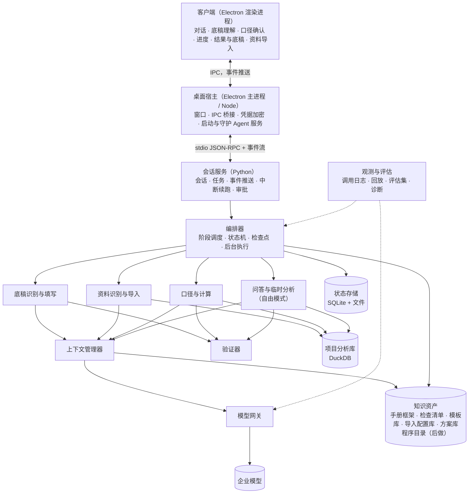

# 通用审计 Agent 实现设计

日期：2026-10-14，2026-10-15 修订。状态：待评审。

**依据：**`main` 分支一开始确定的自建 Agent 方案 `docs/01–09`。本文把它落成这个程序的实现结构、模块接口和实施步骤，不另立方案。

**定位：**
- 这个程序原来只有现有工具箱的功能，现在要扩充成能承接审计工作的通用 Agent。
- 审计人员可以把某阶段的某项工作，或某个模块的底稿，交给 Agent 完成（05）。
- 现有程序的界面外壳、Python 运行环境和部分逻辑作为零件复用。现有工具清单不是能力边界（第十六节）。

**本次修订的前提（2026-10-15 确认）：**
1. 不适配特定财务系统。用户给什么格式的资料，就识别什么格式。
2. 审计手册只有思想框架，没有具体程序和参数。所内底稿模板暂时不能提供。底稿格式由用户在任务中给出，Agent 要准确识别并填写。
3. 05、06 中"把需求映射到程序目录、选程序执行"的方式保留，放到后面做（第十节）。先实现**没有预置程序也能准确完成任务**的通用执行。

**模型条件：**
- 企业内部 DeepSeek V4 Flash，标称 128K，不支持图片。
- 有效上下文按 32K 起步预算，实测后调整（04）。
- 短期内不换模型，所以要靠结构把"想全、想对"从模型身上移到代码里（02）。

---

## 一、设计原则

| 原则 | 落实方式 | 依据 |
|---|---|---|
| 流程由代码控制 | 每个任务按固定阶段推进（第三节）。模型只在指定节点做一件小事。何时开始、结束、是否通过由代码决定 | 08 §三 |
| 代码算数，模型定口径 | 没有预置程序时，模型判断"该怎么算"，并用受控查询表达。查询由代码执行。所有数字来自查询结果，模型不写数字 | 05、08 §4.6 |
| 想全靠结构 | 每个待填区域都必须回答一组固定的口径要素（7.1），缺项由代码拦下 | 02 |
| 规划、执行、验证分离 | 识别、定口径、计算、核对分别是独立的调用或代码步骤。每次调用一个干净上下文 | 03 |
| 按有效上下文做预算 | 模型只看结构、字段说明、统计摘要和少量样例，不看全量数据。固定锚点不裁剪，不静默截断 | 04、03 §9 |
| 每个数字可核对、可追溯 | 自动核对、控制数核对、关键数双路复算。每个写入单元格记录来源和算法 | 08 §4.7 |
| 理解不了就问，不猜 | 口径无法从底稿、资料和用户原话确定时才问，最多 3 个问题，带选项和建议 | 06 |
| 审计人员掌握关键决定 | 口径确认、写入底稿、异常定性、结论由人确认 | 06 §九，09 §二.6 |
| 先诊断再改造，每次改动回归 | 阶段 0 建立诊断清单、评估集和基准，所有改动先跑评估集 | 07、08 §4.10 |

---

## 二、总体结构



### 2.1 进程与语言

- **Agent 服务用 Python 实现。**包括会话服务、编排器、上下文管理器、模型网关、底稿、资料、计算、验证器和评估。
  - 理由：DuckDB、表格解析和现有可复用的审计逻辑都在 Python。同一进程内可以直接查询分析库、执行计算、做核对，不必跨进程传大对象。
  - 08 §七 的选型参考也是 Python 后端。
- **Electron 主进程（Node）只做宿主：**
  - 窗口、IPC、凭据加密（safeStorage）；
  - 启动和守护 Agent 服务；
  - 把服务的事件转发给渲染进程。
- **通信方式：**宿主与服务之间用 stdio 上的 JSON-RPC，加一条事件流。客户端改为接收推送事件（03 §12 的事件协议），不再轮询。
- **部署形态：**单机桌面程序，数据在本地，打包方式沿用现有的单文件 EXE 和内置 Python。
  - 08 的多用户服务端（项目权限、复核人角色）不在首版范围。
  - 接口按 08 §4.1 设计，以后可以把同一服务放到内网服务器上。

### 2.2 代码布局

```
src/agent_service/
  api/            会话服务：动作分发、事件流、审批、续跑
  orchestrator/   阶段调度、状态机、检查点、后台队列
  understand/     需求理解、追问、确认卡
  workpaper/      底稿结构解析、区域语义、模板库、写入编译、填写与回读核对、说明生成
  data/           资料结构识别、字段语义、导入、数据质量检查、项目分析库、导入配置库
  derive/         口径与计算：口径要素、受控查询、通用函数、自动核对、控制数、双路复算、方案库
  free_mode/      问答与临时分析的规划-执行-验证循环（03）
  context/        槽位预算、固定锚点、依赖输入、结果压缩
  gateway/        模型网关：角色参数、约束解码、能力探测、计量、队列、日志
  tools/          工具注册表、权限与审批、下钻查询、文件读取
  verify/         验证器
  knowledge/      手册框架检索、检查清单；程序目录与程序库接口（后做）
  store/          状态存储
  eval/           诊断清单、评估集、回放、指标
src/client/       React 客户端（重做任务相关界面）
src/host/         Electron 宿主（瘦身为窗口、IPC、凭据、服务守护）
```

---

## 三、一次任务怎么完成

### 3.1 阶段

```
用户需求 + 底稿 + 资料
 → A 需求理解：要交付什么、期间、范围、用户给出的口径
 → B 底稿识别：填哪些位置，每处是什么指标、期间、单位
 → C 资料识别：有哪些数据，字段含义，数据质量
 → D 定口径：每个待填区域从哪些数据、怎么算、和什么核对
 → E 确认：只问影响结果又无法确定的口径
 → F 计算与核对：执行受控查询，自动核对，控制数核对，关键数双路复算
 → G 填写：编译写入计划，写入副本，回读核对
 → H 说明与结论：逐节撰写，数字可追溯
 → I 人工复核与反馈：确认后的底稿理解和计算方案入库，下次复用
```

- B 和 C 互不依赖，可以并行。
- 没有底稿的任务（例如"把这几份流水和账核对一下"），交付物是结果表和简要说明，跳过 B 和 G。
- 只是提问或临时查数的，走自由模式（第九节）。

### 3.2 每个节点做什么

| 节点 | 模型角色 | 输入 | 输出 | 代码负责 |
|---|---|---|---|---|
| A 需求理解 | router | 用户原话、最近 2 轮摘要、附件清单 | 交付物、期间、范围、约束（原文保留）、不清楚的点 | 原话存为固定锚点；校验结构；多项工作拆成多个任务 |
| B1 底稿结构解析 | 无 | 底稿文件 | 底稿结构图 | 全部（5.2） |
| B2 区域语义 | extractor，每区域一次 | 区域的紧凑渲染 | 区域用途；每个待填位置的指标、期间、单位、方向 | 引用核对、遗漏检查、关键语义多次采样（5.3） |
| C1 资料结构解析 | 无 | 资料文件 | 表头、数据区、类型 | 全部（6.2） |
| C2 字段语义 | extractor，每张表一次 | 表头、列统计、样例行 | 每列含义；表的类型（余额表、序时账、流水……） | 用值域核对含义（6.2） |
| D 定口径 | planner，每区域一次 | 区域语义、相关表的字段说明和统计、已确认口径 | 口径要素和受控查询 | 要素齐全；查询可解析、引用存在（7.1、7.2） |
| E 确认 | writer（问题措辞） | 依据为推断的口径 | 最多 3 个问题 | 决定问什么、什么时候不问 |
| F 计算与核对 | planner（双路复算的第二路） | 区域语义、字段说明 | 结果表、核对结果 | 执行、守恒、控制数、双路比较（7.3–7.6） |
| G 填写 | 无 | 结果表、区域映射 | 填好的底稿副本 | 全部（第八节） |
| H 说明与结论 | writer，每节一次 | 本节数据、已填数字 | 文字 | 可追溯验证 |
| 结果解读、异常建议 | analyst | 汇总、异常清单前 N 条 | 建议定性和理由 | 关键数字由代码填 |
| 下钻 | executor（受限循环） | 单条异常、下钻结果 | 工具调用或建议 | 每个异常最多 5 轮；判断必须引用凭证号和金额 |

### 3.3 模型调用的粒度

- 每次调用只处理一个区域、一张表或一节文字。
- 输入控制在步骤输入预算内（第十二节）。区域太大（例如上百行的报表项目）按行分批，每批几十行。
- 这样在 32K 内留足余量，每个判断都能单独核对和重试，一个区域出错不影响其他区域。

---

## 四、需求理解（A）

- **抽取：**
  - 交付物：填写哪份底稿、出哪些结果表；
  - 期间、范围（科目、主体、账户）；
  - 用户给出的口径和阈值。
- **固定锚点：**用户原话中的数字、科目、条件原样进入约束，后续每一步都带上，不经模型改写。
- **口径来源优先级（06 §四）：**用户本次 > 本会话已确认 > 底稿标示（如表头年份、"单位：万元"）> 项目档案 > 从资料推断。每个口径记录来源。
- **项目档案（06 §二）：**
  - 客户、行业、期间、准则、重要性水平。
  - 没有建档也能运行。有档案时作为默认值来源，减少追问。
  - 重要性水平用于判断差异是否需要暂停（7.5）。
- **多项工作：**拆成多个任务，分别登记；汇总时逐项核对是否完成。

---

## 五、底稿识别（B）

### 5.1 支持范围

- 首版支持 .xlsx、.xlsm。
- .xls 先转换成 .xlsx：用户电脑装有 Excel 时自动转换，否则请用户另存。原文件不改。
- Word 底稿（.docx 的表格和说明段落）放在阶段 5。
- 永远写到新文件，用户原文件只读。

### 5.2 结构解析（代码，不调用模型）

结果是一份底稿结构图，存入状态存储，后续步骤按编号引用。

| 识别内容 | 方法 |
|---|---|
| 工作表、隐藏行列、保护、命名区域、数据有效性（下拉选项） | 读 OOXML |
| 单元格分类：标签、待填、公式、已有数值、占位符（"-"、"/"、0） | 值类型、公式、样式（边框、填充色、数字格式）和位置 |
| 表格区域 | 有边框或有内容的连续块，按空行空列和标题行分隔 |
| 多级表头 | 区域顶部的文字行，结合合并单元格展开成"上级/下级"的列路径 |
| 行标签 | 区域左侧的文字列，识别缩进层级（"其中："、空格缩进、编号） |
| 合计与小计 | 标签含"合计、小计、总计"，或公式为同列求和 |
| 公式依赖 | 解析全部公式。被公式引用的空单元格判为待填。公式单元格不写，作为核对点 |
| 元数据字段 | 标题、被审计单位、期间或截止日、单位、索引号、编制人、复核人、日期等"标签：值"位置 |
| 期间和单位标签 | 年份、"期初/期末/本期/上期"、"单位：万元"，并记录作用范围（整表、区域或某列） |
| 文字区 | 大的合并区域，或标签为"审计说明、审计结论、审计程序"的区域 |

- **区域初判类型：**明细表（行数不定）、固定项目表（行标签固定 × 列指标）、表单字段、检查表（是否、勾选）、文字区、不需填写。
- 规则有把握的直接定下。有歧义的标为待模型判断，并写明歧义在哪。
- 同一套解析也用于识别资料的表头和数据区（第六节）。

### 5.3 区域语义（模型）

- 每个区域一次调用（extractor，约束解码）。
- **输入：**
  - 区域的紧凑渲染：坐标、标签原文、待填标记，不带数值明细；
  - 列路径，附近的标题、期间和单位标签；
  - 需求理解的结果。
- **输出（JSON）：**
  - 区域用途，例如"应收账款账龄分析"；
  - 每个待填列或位置的指标（期末余额、本期借方发生额、1 年以内……）、期间、单位、方向；
  - 固定项目表每个行标签对应的科目或项目；
  - 每项判断引用的标签坐标和原文；
  - 置信度和不确定点。
- **代码校验：**
  - 引用的坐标存在，原文与单元格一致（防编造，沿用现有 `same_label` 的做法）；
  - 期间与需求、资料期间一致，单位与标签一致；
  - 每个待填位置都有归属，没有遗漏；
  - 不通过就带着具体错误重做该区域。
- **关键语义多次采样（09 §二.4）：**期间、指标、单位、方向独立生成 3 次，一致才采纳，不一致的列为待确认。

### 5.4 底稿理解卡与模板库

- **底稿理解卡：**每个区域填什么、按什么口径、哪些位置留给人工。客户端在底稿上高亮各区域。
- **首次使用的底稿：**请用户确认一次理解卡，同时展示第七节定下的口径。
- **模板指纹：**由工作表名、标签文字和位置、区域结构、公式结构计算，不含数值和项目特有内容（如被审计单位名称）。
- **模板库：**确认过的底稿理解按指纹保存。
  - 再次遇到同一格式：直接复用，只重新取数；标签有变动的位置单独重新识别。
  - 部分相似（例如增删了几行）：复用相同部分，只识别差异。
  - 模板库在使用中积累，替代暂时无法提供的所内模板。只存结构和语义，不存客户数据。

---

## 六、资料识别与导入（C）

### 6.1 每个项目一个分析库

- 每个审计项目一个 DuckDB 文件，项目之间隔离。
- 原始文件保留只读副本和哈希。
- 每行带来源列（文件、工作表、行号），沿用现有导入的 `_source_file`、`_source_sheet`、`_source_row`。

### 6.2 导入步骤

1. **结构识别（代码）：**用第五节的解析找出表头行（含多级表头）、数据区、合计行、说明行。一个工作表里有多张表的，分开导入。
2. **字段语义（模型）：**
   - 每张表一次调用。
   - 输入表头和每列的统计（类型分布、空值、示例值、取值范围），不输入全量数据。
   - 输出每列含义和表的类型（余额表、序时账、银行流水、往来明细、合同台账……），带置信度。
3. **代码核对含义：**标为日期的列能解析成日期，金额列能解析成数值，借贷两列不同时有值，等等。不通过的列退回重判或询问用户。
4. **导入配置：**
   - 确认后按表头指纹保存，同一种导出格式以后直接复用。
   - 不按财务系统写专门适配器，导入配置库在使用中积累。

### 6.3 数值解析严格

- 能识别千分位、括号负数、全角数字、"-"、空白。
- 无效值单独标记和计数，不静默变成 0。现有 `src/audit-domain/runtime/context.py:54` 的 `number()` 要改。
- 无效值超过阈值的列，导入检查不通过。

### 6.4 标准化是增益，不是前提

- 识别出是余额表、序时账、银行流水等常见类型时，额外建立标准视图（05 的标准字段），并运行对应的数据质量检查：
  - 序时账借贷平衡（全表、每张凭证），凭证号重复、断号；
  - 余额表期初加发生等于期末；序时账按科目汇总等于余额表发生额；
  - 银行流水余额连续；期间覆盖与缺失月份；关键字段空值。
- 识别不出类型的表照样可以计算，只是少了这些自动检查。
- **科目映射：**口径需要用标准科目时，模型提出"客户科目 → 标准科目"的映射建议，用户确认后按项目保存（05 §四）。

---

## 七、口径与计算（D、F）

这是没有预置程序时保证准确的核心：模型判断"怎么算"，代码执行和核对，再用一条独立的计算路线复核关键数。

### 7.1 口径要素

每个待填区域，定口径的调用都必须给出下面每一项（约束解码，缺项不通过）：

| 要素 | 说明 |
|---|---|
| 目标 | 引用 5.3 的区域语义，不重新描述 |
| 数据来源 | 用哪些表、哪些列 |
| 期间 | 取数的日期范围，或期间字段的取值 |
| 范围 | 包含和排除的条件（科目、主体、摘要关键词……），以及排除的理由 |
| 金额与方向 | 用哪一列，借贷方向怎么取，正负号怎么处理 |
| 分组与对应 | 结果的每一行对应底稿的哪个行标签或明细行 |
| 计算 | 受控查询（7.2） |
| 单位与精度 | 换算系数、舍入方式 |
| 控制数 | 这个区域的合计应与什么相等（7.5） |
| 依据 | 每个选择依据的是用户原话、底稿标示、资料，还是推断 |

依据为"推断"且会影响结果的要素，进入确认环节（E）。

### 7.2 受控查询

- 模型用 SQL 表达计算，在项目分析库上执行。
- **限制：**
  - 只允许 SELECT 和 WITH；
  - 只能引用本项目的表和前序步骤的结果表；
  - 函数白名单，不能读写文件、访问外部；
  - 执行时间和结果行数有上限。
- **执行前：**用 DuckDB 解析查询，检查语句类型、引用的表和列是否存在。不通过就把错误回填给模型修正，最多 2 次。
- **执行后：**结果存为带编号的结果表（如 `R-012`），记录查询、输入表版本和行数。后续步骤和填写都按编号引用，数字不经模型转述。
- 一个区域的计算可以分几步，每步一个结果表。

### 7.3 通用函数

SQL 不好写、又容易写错的通用操作由代码提供，查询中按函数调用：
- **名称匹配：**单位名称规范化和模糊匹配（去括号、"有限公司"等后缀），给出相似度。
- **日期：**工作日与节假日日历、账龄天数、跨期判断。
- **抽样：**随机抽样（固定种子）、货币单位抽样、分层抽样。
- **分布与重复：**首位数字分布、重复与近似重复。
- **文本：**从摘要中抽取单位名称、合同号、发票号等。

这些是通用工具，不是审计程序。每个函数都有单元测试。

### 7.4 自动核对（代码，每一步都做）

| 核对 | 内容 |
|---|---|
| 行数守恒 | 输入行数 = 纳入行数 + 排除行数；排除的行按原因列出 |
| 金额守恒 | 输入金额合计 = 纳入金额 + 排除金额 |
| 关联放大 | 关联后行数异常增加（一对多重复）的，直接报错 |
| 空值与无效值 | 参与计算的列中空值、无效值的计数 |
| 期间越界 | 纳入的数据是否都在声明的期间内 |
| 重复计数 | 同一来源行是否被计入多个分组 |

### 7.5 控制数核对

- 每个数值区域都要声明控制数，例如：
  - 账龄合计等于余额表该科目期末余额；
  - 明细合计等于序时账该科目发生额；
  - 本期变动等于期末减期初。
- 代码分别计算两边并比较。差异为零才通过。差异不为零时：
  - 能被已列明的排除项解释的，记录后通过；
  - 否则退回定口径重做；
  - 重做后仍有差异，且超过明显微小错报临界值（项目档案中没有时按 0），暂停并展示差异，由用户决定（06 §八）。
- 底稿自带的合计公式、勾稽公式也作为核对点（8.3）。

### 7.6 关键数双路复算

- **范围：**每个区域的合计数，以及文字结论中引用的数字。
- **做法：**用一次独立调用重新定口径并计算。
  - 只给区域语义、字段说明和固定锚点，不给第一路的查询；
  - 结果必须与第一路一致（到分）。
- **一致：**采纳。
- **不一致：**
  - 代码列出两路在来源、期间、范围、方向上的不同；
  - judge 判断哪一路符合区域语义和用户原话；
  - 判断不了的，作为口径问题问用户，附上两种算法和结果。
- 双路复算会增加调用次数，只用于关键数，可以在网关里按任务开关（09 §二.4）。

### 7.7 失败处理

- 单个区域的定口径与计算：重试最多 3 次，每次带上次的核对失败原因；重新识别区域语义最多 2 次。
- 仍失败：该区域标为阻塞，说明卡在哪、为什么、建议怎么办。其他区域照常完成。

### 7.8 方案库

- 用户确认过的口径和查询，按"模板指纹 + 区域"保存为方案。
- 同一格式的底稿再次填写（例如下一期、另一个客户）时直接复用，只重新执行查询。资料字段不同时，只重新做字段对应。
- 复用多、经审计人员评审的方案，是以后程序库的候选（第十节）。

---

## 八、填写（G）与说明（H）

### 8.1 写入计划

- 每个待填位置绑定到结果表的某行某列、项目档案字段，或留给人工。
- 以区域为单位编译，出错只重做该区域。
- 沿用 `workbook_plan.py` 的校验：
  - 不写公式单元格和合并区域内部；
  - 覆盖已有内容要确认；
  - 期间标签核对；
  - 模型不能直接给数值。
- **明细行扩展：**明细表行数不够时，按模板行扩展：复制样式，同步调整合计公式、合并单元格、命名区域、条件格式和数据有效性。不能安全扩展的（例如下方有引用这些行的跨表公式），暂停并告诉用户。

### 8.2 写入确认

- 写底稿必须确认（06 §5.3）。
- 确认卡列出：写入的区域和单元格数、主要来源、口径摘要、待人工填写项、覆盖已有内容的位置。
- 首次使用的模板，与底稿理解卡一起确认。
- 同一方案重复填写时，简化为一次批准。

### 8.3 填写与回读

- 直接修改 OOXML，保留格式、公式、批注和其他内容（沿用 `fill_workbook`）。
- 写入后重算并回读，核对以下各项：

| 核对 | 内容 |
|---|---|
| 回读 | 每个写入单元格与计划值一致 |
| 公式重算 | 底稿自带的合计和公式结果与代码独立计算一致 |
| 勾稽 | 底稿内的勾稽关系（例如期初加发生等于期末），按区域语义自动生成 |
| 未改动区 | 计划以外的单元格全部保持原样 |
| 完整性 | 每个待填位置已填，或列在待人工填写清单中 |

- 不通过就回到对应区域重做；仍不通过就暂停并展示差异。
- 用户电脑装有 Excel 时，可以另用 Excel 重算一次做比对（可选）。

### 8.4 说明与结论

- 文字区逐节生成（writer），每节一次调用，输入为本节数据和已填数字（05 §三）。
- 文字中的数字必须能在已填单元格或结果表中找到（可追溯验证）。
- 结论标为"建议"，审计人员确认后才算定稿（06 §九）。

### 8.5 输出

- 填好的底稿副本、填写核对表、待人工填写清单、结果表导出。
- 每个写入单元格记录来源（文件、表、行，结果编号）、口径和核对结果。客户端点单元格即可查看。
- 底稿附页列出所用口径及来源、数据版本（05 §三）。

---

## 九、问答与临时分析（自由模式，03）

用于没有交付物的请求：查数、解释已有结果、多步临时分析。按 03 的伪代码实现：

1. **复杂度分类：**先用规则，拿不准时用极短提示让模型判断。简单任务走小循环，仍保留预算和轮数上限。
2. **规划：**独立调用，约束解码输出 3～7 步计划。每步包含目标、完成标准、验证方式和依赖。用户原话和已确认口径由代码保存，不经模型改写。
3. **覆盖检查：**列出请求里的全部要求点，检查每点是否被某一步覆盖，有遗漏就补步骤。
4. **逐步执行：**
   - 每步一个干净上下文；
   - 只给本步需要的工具（受控查询、通用函数、下钻、读文件）；
   - 单步最多 8 轮；工具结果先压缩。
5. **验证：**能程序化的由代码验证，其余由 judge 严格判定。单步重试最多 3 次，重规划最多 2 次，仍失败就报告阻塞。
6. **汇总自检：**对照原始请求逐条核对；文字中的数字必须能在步骤输出中找到。

**下钻工具（06 §9.2）：**按凭证号取完整凭证、查对方科目、查科目期间变动、查同一往来单位的交易、查期末前后的同类交易、查上年同期。全部只读。

**结果引用（06 §十）：**每个结果有编号，每条异常有序号（如 `R-012#17`）。"刚才第 17 条"由代码按编号查询，不依赖模型记忆。

---

## 十、程序目录与程序库（保留，后做）

05、06 的做法保留：需求映射到程序目录，补全参数，按工作流执行预置程序（六类节点：code、procedure、llm、agent、human、verify）。暂不实现，先做第三到第九节的通用执行。

- **接入点：**以后在需求理解之后加一步路由。匹配到目录中的程序时走工作流模式，匹配不到时走通用执行。通用执行不需要为此改动。
- **程序来源：**
  - 方案库中复用多、经评审的方案，固化为程序；
  - 按手册的思想框架和审计准则，由开发团队编写、审计人员评审；
  - 优先顺序参考 05 §二 的高工作量板块。
- **程序接口**沿用 05 的 ProcedureResult：汇总表、异常清单、完整结果、勾稽结果、实际参数。
- **程序目录格式**沿用 06 §三。

---

## 十一、模型网关（08 §4.3）

### 11.1 接入

- 用户只配置请求地址和 API Key。服务提供多个模型时从列表选择一次，只有一个时自动选用。
- 温度、输出上限、思考开关、结构化输出方式、上下文预算都由网关按角色决定。

### 11.2 按角色设参（初始值，经评估调整）

| 角色 | 用途 | 思考 | temperature | 输出 |
|---|---|---|---|---|
| router | 需求理解、任务拆分 | 低或关 | 0 | JSON（约束解码） |
| extractor | 区域语义、字段语义 | 关 | 0 | JSON（约束解码） |
| planner | 定口径（含双路复算的第二路）、自由模式规划 | 高 | 0.2 | JSON（约束解码） |
| executor | 自由模式单步、下钻 | 中 | 0.2 | 工具调用 |
| analyst | 结果解读、异常建议 | 高 | 0.2 | JSON + 文本 |
| judge | 验证判定、双路不一致裁决、覆盖检查 | 高 | 0 | JSON（约束解码） |
| writer | 追问措辞、底稿说明、结论 | 中 | 0.3 | 文本 |

多次采样时略提高 temperature，否则 3 次结果相同，起不到核对作用。

### 11.3 功能

- **能力探测：**"测试连接"时执行，结果保存。探测内容包括：
  - 实际上下文和输出上限；
  - 是否支持 JSON Schema 约束、`json_object`、工具调用；
  - 思考参数是否生效、推理内容放在哪个字段、历史中是否需要回传。
- **约束解码：**结构化输出优先用 JSON Schema 约束；解析失败才走修复，最多 2 次。
- **计量：**先估算，再用服务返回的 usage 校准。
- **队列：**限制并发；交互请求优先于后台计算。
- **重试：**连接错误和超时退避重试。
- **前缀缓存：**每个角色的固定前缀保持字节级不变。
- **调用日志：**每次调用记录角色、提示词版本、输入输出 token、耗时、首字时间、原始输出、是否解析成功。

---

## 十二、上下文管理器（08 §4.4；03 §9；04）

**每次调用的上下文由五部分组成：**

| 部分 | 说明 |
|---|---|
| 固定锚点 | 用户原话、已确认口径、全局约束；任何情况下不裁剪 |
| 任务清单 | 每个区域或步骤一行状态 |
| 当前节点 | 目标、完成标准、上次失败原因 |
| 依赖输入 | 按声明取前序节点的指定字段 |
| 本节点往返 | 本节点内的工具调用和结果；节点结束即丢弃 |

**模型看到的数据：**表结构、字段说明、列统计、少量样例行、结果表摘要（行数、合计、前 N 行）。全量数据只在分析库里。

**槽位预算**取 03 的 CONFIG 初始值：

| 槽位 | 预算 |
|---|---|
| system | 1500 |
| 任务清单 | 1000 |
| 节点输入 | 4000 |
| 本节点往返 | 10000 |
| 检索内容 | 8000 |
| 输出预留 | 4000 |
| 总量 | 32000 |

诊断测出有效上下文拐点后再调整。

**规则：**
- 结构化状态（任务清单、已确认口径、结果编号）每次从存储重新渲染，不参与压缩。
- 大对象放引用：结果编号 + 摘要 + 前 N 行。
- 超限时的裁剪顺序：本节点往返 → 检索内容 → 节点输入；固定锚点不动。裁剪要记录，不静默截断。

---

## 十三、验证器（08 §4.7）

| 类型 | 示例 | 实现 |
|---|---|---|
| 格式 | JSON 字段齐全、类型正确 | 代码 |
| 引用 | 区域语义和字段语义引用的坐标、原文存在且一致 | 代码 |
| 口径完整 | 口径要素齐全，每项有依据 | 代码 |
| 守恒 | 行数、金额守恒，无关联放大 | 代码 |
| 控制数 | 区域合计与控制数一致 | 代码 |
| 双路一致 | 关键数两路结果一致 | 代码 + judge |
| 回读与未改动区 | 写入正确，其他位置没有变化 | 代码 |
| 可追溯 | 文字中的每个数字都能在结果中找到 | 代码（抽取数字后匹配） |
| 覆盖 | 每项要求、每个待填位置都有结果或说明 | 代码 + judge |
| 判定 | 无法程序化检查的完成标准 | judge |

失败处理按 08 第五节的失败矩阵：

| 失败 | 处理 |
|---|---|
| 格式错误 | 修复最多 2 次 |
| 查询或工具参数错误 | 错误回填后修正 |
| 原地打转 | 轮数上限加重复调用检测，终止本节点 |
| 核对不通过 | 重试 3 次 → 重新识别 2 次 → 报告阻塞 |
| 口径无法确定 | 问用户（最多 3 个问题），等待期间其他区域继续 |
| 数据问题 | 暂停并展示差异 |
| 服务不可用 | 挂起，恢复后从检查点续跑 |
| 上下文超限 | 按优先级裁剪并记录 |

---

## 十四、状态存储、编排与长任务（08 §4.2、§4.8）

### 14.1 状态存储

- **SQLite：**项目、会话、消息、任务、节点、检查点、审批记录、结果索引、异常定性记录、项目档案、底稿结构图、模板库、导入配置库、方案库。
- **文件：**原始文件（只读副本）、项目分析库、结果导出、底稿文件。
- **版本：**每个结果有编号和版本。口径变更后重跑生成新版本，旧版本保留。

### 14.2 编排

- **状态机：**理解需求、识别、定口径、待确认、计算、核对、重试、填写、暂停、完成、阻塞、已取消。
- **检查点与续跑：**每个节点完成后保存输入、输出、结果编号。进程重启或续跑时从检查点恢复。用户修改口径后只重跑受影响的区域。
- **后台执行：**长任务在后台队列执行，界面关闭不影响。
- **时限：**不设整体时限。单个节点有轮数和重试上限；查询执行按进度判断是否卡住。
- **并发：**B 与 C 并行；没有依赖的区域并行计算；同一项目的写操作串行。

---

## 十五、知识资产、观测与评估

### 15.1 知识资产（08 §4.9；09 §二）

- **手册的思想框架：**整理为定口径和结果解读时的参考（例如风险导向的程序思路），按需检索，不当作具体程序。
- **检查清单：**按框架和准则编写，审计人员评审。
- **模板库、导入配置库、方案库：**在使用中积累，见 5.4、6.2、7.8。
- **程序目录：**后做（第十节）。
- 全部版本化，变更要审核；每个任务记录所用资产的版本。
- **动态示例库：**阶段 4 起建设。人工确认过的口径和底稿理解，按角色检索 2～3 个放进提示词，入库前脱敏。

### 15.2 观测与评估（07；08 §4.10）

- **调用日志与任务回放：**按检查点重放任务，可以替换提示词、参数或模型后对比。
- **诊断清单（07 第一节）：**在应用内自动执行，覆盖实际上下文长度、提示词占用、思考参数、推理内容处理、工具调用错误率、采样参数、有效上下文拐点。
- **评估集：**
  - 没有所内模板，首批用公开的底稿参考格式和用户提供的真实任务。
  - 对每份底稿制作变体：改标签措辞、调换列顺序、多级表头、合并单元格、单位改为万元、期间写法不同、增加"其中"行。用来检验识别是否通用，而不是只认某一种格式。
  - 每个任务都有人工填写的标准答案，按 07 的标注模板标注。
- **指标：**
  - 区域识别准确率、待填位置召回率；
  - 单元格值准确率（与人工答案逐格比对）；
  - 控制数一次通过率、双路一致率；
  - 追问次数；未改动区违例数（必须为 0）；
  - 任务完成率、耗时、token 消耗、人工修改量。
- **回归门禁：**提示词、流程、通用函数、模型、参数的任何改动，先跑评估集，指标不下降才合并。
- **诊断包：**一次任务的完整记录（去除密钥）一键导出，用于定位问题和补充评估集。

---

## 十六、现有程序中可以复用的零件

现有程序只作为零件来源，不决定能力范围。

| 零件 | 复用到哪里 |
|---|---|
| Electron 外壳；React 客户端的项目、会话、附件、文件预览界面 | 客户端；任务相关界面按第十七节重做 |
| safeStorage 凭据加密、单文件 EXE 打包、内置 Python 环境 | 宿主与打包 |
| 附件导入与内容寻址快照（只读副本、哈希去重） | 原始文件保存 |
| 表格导入（`src/audit-worker/worker.py` 的 `import_tables`：来源列、超宽和越界检查；`decimal_column` 的严格金额解析） | 资料导入 |
| 填写执行器（`src/audit-worker/workbook_plan.py`：OOXML 局部修改、公式计算、期间核对、覆盖保护、写入后回读） | 第八节的填写。需要补：结构解析与区域识别（现有只按关键词猜表头）、按区域编译、明细行扩展、绑定结果表 |
| 表格整理操作（选列、填充、合并、删合计行等） | 导入预处理 |
| JET 规则（`jet-rules.json`，33 条）、恢复的审计逻辑（`src/audit-domain/recovered/`） | 通用函数的参考，以后程序库的素材 |
| 文档信息提取、身份证、地址拆分、公告与 IPO 下载、注协查询 | 辅助工具；其中的模型调用改走网关 |
| 模型接口兼容处理（流式解析、文本形式的工具调用、参数双重编码、空流回退） | 模型网关 |
| 假模型服务等测试设施 | 测试 |

**不再沿用：**
- 现有的 Node Agent 运行时（长对话循环、16 个流程控制工具、整段压缩、正则意图判断、填表专用模式）；
- 现有九类工作流定义及能力合同；
- 按触发词注入的 Skill 加载方式。

---

## 十七、客户端（02 §三；06）

- **设置：**请求地址、API Key、模型选择、测试连接（显示探测结果）；运行诊断、导出诊断包。
- **项目：**
  - 项目档案（可选）；
  - 资料导入：识别结果、字段含义确认、数据质量检查结果；
  - 数据状态。
- **对话：**
  - 需求理解结果；
  - 底稿理解卡：在底稿上高亮区域，列出每个区域的口径；
  - 口径确认：最多 3 个问题，带选项和建议；
  - 写入确认卡；
  - 计划视图（自由模式），可编辑后执行。
- **进度：**
  - 每个区域的状态、当前动作、重试原因；
  - 停止、重做某个区域、改口径后重跑；
  - 查看某个节点的完整输出。
- **结果：**
  - 填好的底稿预览：已填单元格高亮，点单元格看来源、口径和核对结果；
  - 待人工填写清单；
  - 核对结果：控制数、双路复算；
  - 异常清单，可以下钻、确认定性。
- **区分：**界面上明确区分"代码算出的结果"和"模型给出的建议"（09 §二.6）。

---

## 十八、实施路线（08 §八，按本次前提调整）

每个阶段结束都用评估集回归，与阶段 0 的基准对比。

| 阶段 | 内容 | 验收 |
|---|---|---|
| 0. 诊断与基准 | 应用内诊断清单、诊断包；评估集格式与标注模板；首批底稿任务（公开格式、变体、真实任务）；用现在的方式记录基准 | 诊断报告完成；评估集首版；基准指标确定 |
| 1. 基础设施 | Python Agent 服务骨架与宿主桥接、事件推送；模型网关；上下文管理器；调用日志与回放 | 所有调用可追踪、可回放；工具调用格式错误率明显下降 |
| 2. 识别 | 编排器（阶段调度、检查点、后台执行）；底稿结构解析与区域语义；资料结构识别、字段语义、导入与数据质量检查；底稿理解卡 | 评估集上区域识别准确率、待填位置召回率达到设定目标 |
| 3. 计算与填写 | 口径要素与受控查询；通用函数；自动核对、控制数、双路复算；写入编译、明细行扩展、填写与回读；说明与结论 | 评估集底稿任务端到端完成；单元格值准确率达到目标；未改动区违例为 0 |
| 4. 交互与复用 | 口径追问与确认；自由模式；下钻与异常定性；模板库、导入配置库、方案库；反馈候选池；示例库 | 追问次数和人工修改量下降；同一格式第二次填写无需重新确认 |
| 5. 扩展 | 程序目录与程序库（第十节）；Word 底稿；行业配置；扫描件经企业 OCR 接入 | 按板块逐步上线，每个板块通过回归评估 |

阶段 0 的根因分布决定后续侧重（08 §八）：配置和提示词问题占比高，阶段 1 收益最大；识别错误占比高，优先阶段 2；口径和计算错误占比高，优先阶段 3。

---

## 十九、需要确认的事项

1. **部署形态：**按单机桌面程序实现（本文默认）。如果需要多人协作和复核人角色，要改为 08 的内网服务端。
2. **Agent 服务语言：**Python（本文默认）。
3. **评估用的底稿任务：**能否收集一些过往项目的底稿，包括空白版、人工填好的版本和当时用的资料（可以脱敏）？没有的话，先用公开格式和变体。
4. **Excel：**用户电脑是否普遍装有 Excel？用于 .xls 转换和可选的重算比对。
5. **手册框架：**审计手册的思想框架能否提供，作为定口径的参考？（可选）
6. **企业 OCR 服务：**扫描件识别的接入方式（阶段 5）。
