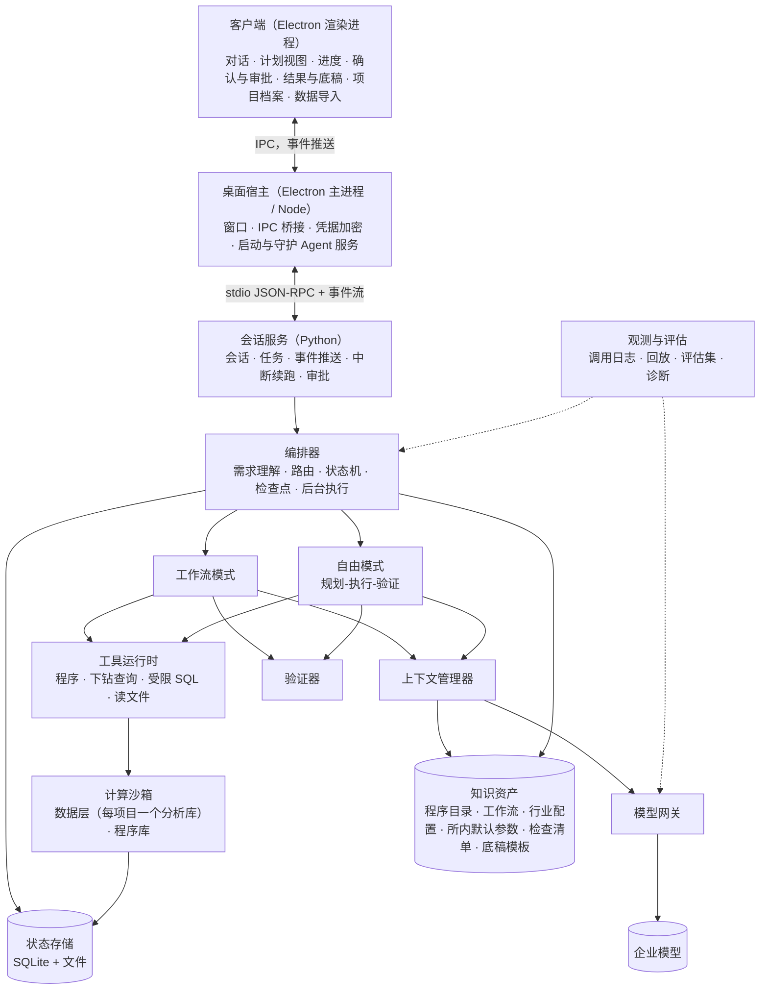

# 通用审计 Agent 实现设计

日期：2026-10-14。状态：待评审。

**依据：**`main` 分支一开始确定的自建 Agent 方案 `docs/01–09`。本文把它落成这个程序的实现结构、模块接口和实施步骤，不另立方案。

**定位：**这个程序原来只有现有工具箱的功能。现在要把它扩充成能承接审计工作的通用 Agent。
- 审计人员可以把某阶段的某项工作，或某个模块的底稿，交给 Agent 完成（05 定位）。
- 重点覆盖数据量大、人工费时的板块。
- 现有程序的界面外壳、Python 运行环境和部分审计逻辑作为零件复用。现有工具清单不是能力边界（第十二节）。

**模型条件：**
- 企业内部 DeepSeek V4 Flash，标称 128K。
- 有效上下文按 32K 起步预算，实测后调整（04）。
- 短期内不换模型，所以要靠结构把"想全、想对"从模型身上移到代码里（02）。

---

## 一、设计原则（01–09 的硬要求）

| 原则 | 落实方式 | 依据 |
|---|---|---|
| 流程由代码控制 | 目录内审计程序走固定工作流；模型只在指定节点做指定小事；何时开始、结束、是否通过由代码决定 | 08 §三 |
| 代码算数，模型写判断 | 原始数据进数据层和程序库，不进上下文；模型只看汇总表和异常清单；结果中的数字由代码原样传递 | 05、08 §4.6 |
| 规划、执行、验证分离 | 自由模式按 03 的循环：独立规划 → 逐步执行（干净上下文）→ 代码验证 → 重试、重规划、报告阻塞 → 汇总自检 | 03 |
| 按有效上下文做预算 | 每次调用按槽位组装，起步 32K；固定锚点不裁剪；工具结果先压缩；不静默截断 | 04、03 §9、08 §4.4 |
| 每一步可验证、可追溯、可恢复 | 验证器由代码强制；文字中的数字必须能在结果中找到；每步检查点，可续跑 | 08 §4.2、§4.7 |
| 准确理解需求，理解不了就追问 | 意图抽取 → 程序映射（带置信度）→ 参数补全（带来源）→ 前置检查 → 按风险确认 | 06 |
| 审计人员掌握关键决定 | 参数确认、异常定性、底稿结论由人确认；需要职业判断的事项只提供数据支持 | 06 §九、§十三，09 §二.6 |
| 先诊断再改造，每次改动回归 | 阶段 0 建立诊断清单、评估集和基准；所有改动先跑评估集 | 07、08 §4.10 |

---

## 二、总体结构

按 08 §二 的模块划分，落到桌面程序上：



### 2.1 进程与语言

- **Agent 服务用 Python 实现。**包括会话服务、编排器、上下文管理器、模型网关、工具运行时、数据层、程序库、验证器和评估。
  - 理由：数据层（DuckDB、pandas）、程序库和现有可复用的审计逻辑都在 Python。同一进程内可以直接查询分析库、跑程序、做验证，不必跨进程传大对象。
  - 08 §七 的选型参考也是 Python 后端。
- **Electron 主进程（Node）只做宿主：**
  - 窗口、IPC、凭据加密（safeStorage）；
  - 启动和守护 Agent 服务；
  - 把服务的事件转发给渲染进程。
- **通信方式：**宿主与服务之间用 stdio 上的 JSON-RPC，加一条事件流。客户端改为接收推送事件（03 §12 的事件协议），不再轮询。
- **部署形态：**单机桌面程序，数据在本地，打包方式沿用现有的单文件 EXE 和内置 Python。
  - 08 的多用户服务端（项目权限、复核人角色）不在首版范围。
  - 接口按 08 §4.1 设计，以后可以把同一服务放到内网服务器上。

### 2.2 代码布局

```
src/agent_service/
  api/            会话服务：动作分发、事件流、审批、续跑
  orchestrator/   状态机、调度、检查点、后台队列、六类节点
  understand/     意图抽取、程序映射、参数补全、前置检查、追问、确认卡
  free_mode/      规划、单步执行、验证、重规划、汇总自检（03）
  context/        槽位预算、固定锚点、依赖输入、证据读取、结果压缩
  gateway/        模型网关：角色参数、约束解码、能力探测、计量、队列、日志
  tools/          工具注册表、权限与审批、下钻查询、受限 SQL、文件读取
  data/           标准数据结构、导入适配器、科目映射、数据质量检查、项目分析库
  procedures/     审计程序库（每个程序：通用代码 + 行业配置 + 项目参数）
  output/         底稿模板填充、小节生成、可追溯标注
  verify/         验证器
  knowledge/      程序目录、工作流定义、行业配置、检查清单、模板、手册检索
  store/          状态存储
  eval/           诊断清单、评估集、回放、指标
src/client/       React 客户端（重做任务相关界面）
src/host/         Electron 宿主（瘦身为窗口、IPC、凭据、服务守护）
```

---

## 三、数据层（05 §一、§四；06 §二、§七）

### 3.1 每个项目一个分析库

- 每个审计项目一个 DuckDB 文件，项目之间物理隔离。
- 原始导入文件保留只读副本和哈希。
- 标准表的每一行都带来源列（来源文件、工作表、行号），这是追溯到源行的依据。

### 3.2 标准数据结构（初版，按 05）

| 标准表 | 主要字段 |
|---|---|
| 科目表 | 科目编码、名称、级次、方向、标准科目映射 |
| 科目余额表 | 期间、科目、期初、借方发生、贷方发生、期末 |
| 序时账 | 凭证日期、凭证号、行号、科目、摘要、借方、贷方、对方科目、制单人、审核人、录入时间、辅助核算 |
| 辅助核算明细 | 往来单位、部门、项目、个人等维度 |
| 银行流水 | 账户、交易日期、对方户名、对方账号、收入、支出、余额、摘要 |
| 报表 | 报表项目、期初、期末、本期、上期 |
| 主体名单 | 往来单位、关联方名单及来源 |

### 3.3 导入

- **通用导入：**
  1. 识别表头行和字段类型；
  2. 模型从真实列中提出"标准字段 → 源列"的映射候选；
  3. 代码校验列存在、类型、期间和借贷方向；
  4. 用户确认后保存为"导入配置"，同一格式的导出以后直接复用。
- **财务系统适配器：**为用友、金蝶、SAP 等常见导出格式写规则适配器（阶段 3 先做 1～2 个），不需要模型参与。
- **数值解析严格：**
  - 能识别千分位、括号负数、全角数字、"-"、空白；
  - 无效值单独标记并计数，不静默变成 0；
  - 超过阈值的无效值让导入检查不通过。

### 3.4 导入后的数据质量检查（代码执行，不调用模型）

- 序时账借贷平衡（全表、每张凭证）
- 凭证号重复、断号
- 关键字段空值
- 期间覆盖与缺失月份
- 余额表期初加发生等于期末
- 序时账按科目汇总等于余额表发生额
- 银行流水余额连续性

### 3.5 科目映射

- 客户科目映射到标准科目：模型先自动匹配，人工确认，按项目保存（05 §四）。
- 未确认的相关科目会在前置检查中拦下（06 §七）。

### 3.6 项目档案（06 §二）

- **内容：**
  - 客户、行业、业务类型（年审、IPO、专项、离任）、审计期间、会计准则；
  - 重要性水平：整体、实际执行、明显微小错报临界值；
  - 数据状态、关联方名单、备注。
- **来源：**项目启动流程建立（05 §四 的新项目启动流程），审计人员可以随时修改。
- **作用：**作为参数默认值的来源，减少追问。

---

## 四、程序库（05 §一、§二；09 §二.1）

### 4.1 接口

```python
def procedure(data: StandardData, params: dict, ctx: ProcedureContext) -> ProcedureResult:
    """
    ProcedureResult:
      summary_table  汇总表（进入模型上下文）
      exceptions     异常清单，每条含：规则 ID、命中原因、源表、源行号/凭证号、金额（带编号）
      full_output    完整结果（分析库中的结果表 + 导出文件路径；不进上下文）
      checks         勾稽与覆盖校验结果（通过/失败及差异）
      params_used    实际使用的参数及来源
    """
```

### 4.2 结构

- 每个程序拆成"通用代码 + 行业配置 + 项目参数"（05 §四）。
- 程序有版本，结果记录所用版本。
- 程序只读标准数据，写入只发生在结果表和导出文件。

### 4.3 建设批次

按 05 §二 的高工作量板块，以及 05 的"建议先做"：

| 批次 | 程序 | 主要内容 |
|---|---|---|
| 第一批 | 数据导入与勾稽 | 余额表、序时账、报表三者核对；期初期末衔接 |
| 第一批 | 日记账测试 | 全量筛查：周末节假日、期末大额、整数金额、异常摘要、非常规对方科目、手工或冲销分录；本福特、重复检测、统计离群值（09 §二.1） |
| 第一批 | 银行流水核对 | 流水与账面双向核对，大额资金流向追踪 |
| 第一批 | 往来款项 | 账龄分析、函证清单生成、回函差异汇总、替代程序 |
| 第二批 | 抽样 | 货币单位抽样、分层抽样、样本清单与底稿 |
| 第二批 | 截止测试 | 期末前后收入、成本、费用的跨期识别 |
| 第二批 | 重新计算 | 折旧、摊销、薪酬、利息、税费 |
| 第二批 | 分析性复核 | 月度波动、毛利率、客户与供应商集中度 |
| 第二批 | 关联方识别 | 交易对手与关联方名单匹配 |
| 第二批 | 调整汇总 | 审计调整分录、试算平衡表、报表草稿 |

### 4.4 验收

- 每个程序先用合成数据做单元测试。
- 再在 2～3 个真实项目数据上，与人工结果比对一致（08 §八 阶段 3 的标准）。

---

## 五、Agent 层

### 5.1 一次请求的处理（06 §一）

```
用户需求
 → ① 意图抽取 → ② 程序映射 → ③ 参数补全 → ④ 前置检查
       ↓低置信        ↓缺关键参数     ↓不满足
     追问/候选        追问            提示或补跑前置程序
 → ⑤ 执行确认卡（按风险）→ ⑥ 执行 → ⑦ 结果解读 → ⑧ 下钻核查（可多轮）
 → ⑨ 输出底稿/结果 → ⑩ 人工复核与反馈
```

| 环节 | 模型角色 | 输入 | 输出 | 代码负责 |
|---|---|---|---|---|
| 意图抽取 | extractor | 用户原话 + 最近 2 轮摘要 | tasks JSON；原话中的数字、科目、条件原样保留在 constraints；不确定的写进 unclear | 校验结构；多任务拆分后逐个登记 |
| 程序映射 | router | task + 候选程序简述 | 程序 ID + 置信度 | 别名和科目规则匹配取候选；候选为空时检索前 3 个；按置信度分流；按前置关系排序 |
| 参数补全 | extractor | 约束原文 + 参数定义 | 参数 JSON | 按来源优先级补全（用户本次 > 本会话已确认 > 项目档案 > 行业配置 > 程序默认）；合法性校验；与重要性水平比较 |
| 追问 | writer | 缺失参数 + 影响说明 | 问题文本（最多 3 个，带选项和建议默认值） | 决定问什么：只问影响结果、无法从数据和档案得到的 |
| 前置检查 | 无 | | | 数据是否导入、科目映射是否确认、前置程序是否通过、期间是否覆盖 |
| 执行确认 | 无 | | 确认卡 | 只读且参数有来源的直接执行；含推断参数的展示推断项；产生正式样本、写底稿、覆盖结果、耗时长的必须确认（06 §5.3） |
| 结果解读 | analyst | 汇总表 + 截断后的异常清单 | 结论摘要、异常分级理由、建议下一步 | 关键数字由代码填写，不由模型生成 |
| 下钻 | executor（agent 节点） | 单条异常 + 下钻结果 | 工具调用或建议定性 | 每个异常最多 5 轮；判断必须引用凭证号和金额 |
| 底稿说明 | writer | 小节数据 + 模板要求 | 文本段落 | 逐节生成，逐节勾稽校验；可追溯验证 |

### 5.2 路由（08 §三）

- **映射到程序目录：**走工作流模式。
- **映射不到，但属于数据查询、对已有结果的追问、解释或手册问答：**走自由模式。
- **其他：**告知不支持，记录到需求池（06 §十一）。

一句话里有多项工作时，拆成多个任务，按程序目录的前置关系排序。例如只要求函证时，提示"将先执行账龄分析"（06 §4.3）。

### 5.3 工作流模式（08 §3.1）

**六类节点：**

| 类型 | 说明 | 是否调用模型 |
|---|---|---|
| code | 前置检查、数据准备等代码逻辑 | 否 |
| procedure | 执行程序库中的审计程序 | 否 |
| llm | 单次模型调用，指定角色和输出格式 | 是 |
| agent | 受限自由循环，指定只读工具和轮数上限 | 是 |
| human | 等待用户确认或输入 | 否 |
| verify | 执行验证器 | 视验证类型 |

**定义格式**沿用 08 的示例（应收账款函证）。工作流和程序目录一起做版本管理，修改要审核并跑回归。

**输入声明规则：**
- 每个 llm 和 agent 节点都要用 `inputs` 声明需要哪些前序节点的哪些输出；
- 引擎只把声明的内容放进该节点的上下文；
- 节点之间传递的数字由引擎从结果表原样读取，不经模型转述。

**每个审计程序在目录中对应一条工作流。**首批工作流随第一批程序一起建设：
- 数据导入与勾稽
- 日记账测试
- 银行流水核对
- 应收账款账龄与函证

### 5.4 自由模式（03）

用于目录外的查询、解释和多步分析。按 03 的伪代码实现：

1. **复杂度分类：**先用规则，拿不准时用极短提示让模型判断简单或复杂。简单任务走小循环，仍保留预算、工具容错和轮数上限。
2. **规划：**独立调用，约束解码输出 3～7 步计划。每步包含目标、完成标准、验证方式和依赖（指明需要哪一步的哪些字段），另有全局约束。用户原话和已确认参数由代码保存，不经模型改写。
3. **覆盖检查：**列出请求里的全部要求点，检查每点是否被某一步覆盖；有遗漏就补步骤。
4. **计划展示：**客户端显示计划，用户可以编辑或确认。
5. **逐步执行：**每步一个干净上下文，内容为固定锚点、任务清单、当前步骤、按依赖取的输入、本步往返。
   - 只给本步需要的工具；
   - 单步最多 8 轮；
   - 工具调用先校验，失败时修复最多 2 次；
   - 工具结果先压缩再进入上下文。
6. **验证：**
   - 能程序化的由代码验证；
   - 不能程序化的由 judge 严格判定，证据不足按未通过处理；
   - 单步重试最多 3 次，重规划最多 2 次，仍失败就报告阻塞：卡在哪、为什么、建议。
7. **汇总自检：**看各步的结构化输出，对照原始请求逐条核对。文字中的数字必须能在步骤输出中找到；有漏项就补步骤，限一次。

**自由模式的工具：**
- 下钻查询；
- 受限 SQL（阶段 5 视评估结果开放）；
- 读取文件；
- 调用只读的目录程序。

产生正式样本、写底稿、覆盖结果的操作需要审批。首版不开放任意代码执行（08 §4.5）。

### 5.5 下钻工具集（06 §9.2）

- `query_voucher`：按凭证号取完整凭证
- `query_counterpart`：查对方科目及金额
- `query_account_period`：查科目期间的发生额和余额变动
- `query_by_party`：查同一往来单位的全部交易
- `query_adjacent`：查期末前后若干天的同类交易
- `query_prior_year`：查上年同期数据

全部只读，结果截断后进入上下文。

### 5.6 会话工作区与结果引用（06 §十）

- 每次程序执行生成结果编号（如 `R-JE-003`），每条异常有序号（如 `R-JE-003#17`）。
- "刚才第 17 条""上一个结果里金额最大的几笔"之类的说法，由代码按编号查询，不依赖模型记忆。
- 工作区保存：已确认参数、已执行程序及结果编号、异常定性状态、待办事项。每次调用只带与当前任务相关的部分。

### 5.7 执行中暂停（06 §八）

出现以下情况时，暂停并展示给用户：
- 勾稽差异超过明显微小错报临界值；
- 异常数量远超预期，比如超过总笔数的 5%；
- 数据质量问题。

用户可以随时中断，修改参数后从当前步骤重跑。

### 5.8 异常定性与复核反馈（06 §9.3、§十一）

- 模型对每个异常给出建议定性和理由，审计人员确认或修改后才计入底稿结论。
- 映射纠正、参数修改、定性推翻、目录外需求，都先进入候选池，由负责人审核后才生效。

---

## 六、输出层（05 §三；08 §4.7）

- **底稿模板：**使用所内统一的 Excel、Word 底稿模板。数字由代码按结果表填写，模型只写分析说明与结论。
- **按小节生成：**例如余额核对 → 账龄分析 → 函证汇总 → 坏账测试 → 结论，每节一次独立调用。每节生成后，代码校验勾稽关系，不通过就重做。
- **首页：**列出所用参数及来源、程序版本、数据版本。
- **可追溯：**每个数字都能追溯到结果表和源行；文字中的数字经过可追溯验证。

---

## 七、模型网关（08 §4.3）

### 7.1 接入

- 用户只配置请求地址和 API Key；服务提供多个模型时从列表选择一次，只有一个时自动选用。
- 温度、输出上限、思考开关、结构化输出方式、上下文预算都由网关按角色决定。

### 7.2 按角色设参（初始值，经评估调整）

| 角色 | 用途 | 思考 | temperature | 输出 |
|---|---|---|---|---|
| router | 意图抽取、程序选择 | 低或关 | 0 | JSON（约束解码） |
| extractor | 约束转参数、映射、手册抽取 | 关 | 0 | JSON（约束解码） |
| planner | 自由模式规划 | 高 | 0.2 | JSON（约束解码） |
| executor | 自由模式单步执行 | 中 | 0.2 | 工具调用 |
| analyst | 结果解读、异常定性建议 | 高 | 0.2 | JSON + 文本 |
| judge | 验证判定、最终自检 | 高 | 0 | JSON（约束解码） |
| writer | 底稿说明、结论 | 中 | 0.3 | 文本 |

### 7.3 功能

- **能力探测：**"测试连接"时执行，结果保存。探测内容包括：
  - 实际上下文和输出上限；
  - 是否支持 JSON Schema 约束、`json_object`、工具调用；
  - 思考参数是否生效、推理内容放在哪个字段、历史中是否需要回传。
- **约束解码：**结构化输出优先用 JSON Schema 约束；解析失败才走修复，最多 2 次。
- **计量：**先估算，再用服务返回的 usage 校准。
- **队列：**限制并发；交互请求优先于后台批量。
- **重试：**连接错误和超时退避重试。
- **前缀缓存：**每个角色的固定前缀保持字节级不变。
- **调用日志：**每次调用记录角色、提示词版本、输入输出 token、耗时、首字时间、原始输出、是否解析成功。

---

## 八、上下文管理器（08 §4.4；03 §9；04）

**每步上下文由五部分组成：**

| 部分 | 说明 |
|---|---|
| 固定锚点 | 用户原话、已确认参数、全局约束；任何情况下不裁剪 |
| 任务清单 | 每步一行状态 |
| 当前步骤 | 目标、完成标准、上次失败原因 |
| 依赖输入 | 按声明取前序步骤的指定字段 |
| 本步往返 | 本步内的工具调用和结果；步骤结束即丢弃 |

**槽位预算**取 03 的 CONFIG 初始值：

| 槽位 | 预算 |
|---|---|
| system | 1500 |
| 任务清单 | 1000 |
| 步骤输入 | 4000 |
| 本步往返 | 10000 |
| 检索内容 | 8000 |
| 输出预留 | 4000 |
| 总量 | 32000 |

诊断测出有效上下文拐点后再调整。

**规则：**
- 结构化状态（计划、已确认参数、结果编号）每次从存储重新渲染，不参与压缩。
- 大对象放引用：结果编号 + 摘要 + 前 N 行。
- 超限时的裁剪顺序：本步往返 → 检索内容 → 步骤输入；固定锚点不动。裁剪要记录，不静默截断。

---

## 九、验证器（08 §4.7）

| 类型 | 示例 | 实现 |
|---|---|---|
| 格式 | JSON 字段齐全、类型正确 | 代码 |
| 勾稽 | 明细合计等于总账；期初加发生等于期末 | 代码 |
| 可追溯 | 文字中的每个数字都能在结果表中找到 | 代码（抽取数字后匹配） |
| 覆盖 | 用户每项要求都有对应结果；检查清单必需项齐全 | 代码 + judge |
| 一致性 | 写"未发现异常"但异常清单非空 | 代码规则 + judge |
| 判定 | 无法程序化检查的完成标准 | judge |

失败处理按 08 第五节的失败矩阵：

| 失败 | 处理 |
|---|---|
| 格式错误 | 修复最多 2 次 |
| 工具参数错误 | 错误回填后修正 |
| 原地打转 | 轮数上限加重复调用检测，终止本步 |
| 验证不通过 | 重试 3 次 → 重规划 2 次 → 报告阻塞 |
| 数据问题 | 暂停并展示差异 |
| 服务不可用 | 挂起，恢复后从检查点续跑 |
| 上下文超限 | 按优先级裁剪并记录 |

---

## 十、状态存储、编排与长任务（08 §4.2、§4.8）

### 10.1 状态存储

- **SQLite：**项目、会话、消息、任务、步骤、检查点、审批记录、结果索引、异常定性记录、项目档案、导入配置。
- **文件：**导入的原始文件（只读副本）、项目分析库、结果导出、底稿文件。
- **版本：**每个结果有编号和版本。参数变更后重跑生成新版本，旧版本保留。

### 10.2 编排

- **状态机：**理解需求、追问、规划、待确认、执行中、验证、重试、重规划、暂停、完成、阻塞、已取消。
- **检查点与续跑：**每步完成后保存输入、输出、结果编号。进程重启或续跑时从检查点恢复。用户修改参数后只重跑受影响的步骤。
- **后台执行：**长任务在后台队列执行，界面关闭不影响。
- **时限：**不设整体时限。单步有轮数和重试上限；程序执行按进度判断是否卡住。
- **并发：**无依赖的步骤可以并行；同一项目的写操作串行。

---

## 十一、知识资产、观测与评估

### 11.1 知识资产（08 §4.9；09 §二）

- **程序目录：**06 §三 的格式，包括别名、范围、所需数据、前置程序、参数及默认值来源、副作用、风险等级。
- **其余资产：**工作流定义、行业配置、所内默认参数、检查清单、底稿模板、手册检索索引。
- **来源：**审计手册抽取加人工维护。全部版本化，变更要审核；每个任务记录所用资产的版本。
- **动态示例库：**阶段 4 起建设。人工确认过的案例按角色检索 2～3 个放进提示词，入库前脱敏。

### 11.2 观测与评估（07；08 §4.10）

- **调用日志与任务回放：**按检查点重放任务，可以替换提示词、参数或模型后对比。
- **诊断清单（07 第一节）：**在应用内自动执行，覆盖实际上下文长度、提示词占用、思考参数、推理内容处理、工具调用错误率、采样参数、有效上下文拐点。
- **评估集：**
  - 首批 10～20 个真实审计任务，逐步扩到 50 个以上；
  - 覆盖单步查询、单个程序、多步程序、底稿生成、多任务请求；
  - 按 07 的标注模板标注。
- **基准指标：**任务完成率、结果正确率、多任务漏项率、工具调用错误率、平均耗时与首字延迟、人工修改量、每任务 token 消耗。
- **回归门禁：**提示词、工作流、程序、模型、参数的任何改动，先跑评估集，指标不下降才合并。
- **诊断包：**一次任务的完整记录（去除密钥）一键导出，用于定位问题和补充评估集。

---

## 十二、现有程序中可以复用的零件

现有程序只作为零件来源，不决定能力范围。

| 零件 | 复用到哪里 |
|---|---|
| Electron 外壳、React 客户端的项目、会话、附件、文件预览界面 | 客户端；任务相关界面按第十三节重做 |
| safeStorage 凭据加密、单文件 EXE 打包、内置 Python 环境 | 宿主与打包 |
| 附件导入与内容寻址快照（只读副本、哈希去重） | 数据层的原始文件保存 |
| JET 规则（`jet-rules.json`，33 条） | 日记账测试程序的规则来源，改为在标准序时账上执行 |
| 银行流水匹配、月间分析、毛利率、关联方匹配、截止抽样等恢复的审计逻辑（`src/audit-domain/recovered/`） | 对应程序的算法参考或实现，改为读取标准数据 |
| 文档信息提取、身份证、地址拆分、公告与 IPO 下载、注协查询 | 作为工具运行时的辅助工具；其中的模型调用改走网关 |
| 普通模板填写执行器（`workbook_plan.py`：受控表达式、写入后回读核对）、明细底稿生成器 | 输出层的底稿填充 |
| 表格整理类操作（选列、填充、合并、删合计行等） | 数据层导入时的预处理 |
| 模型接口兼容处理（流式解析、文本形式的工具调用、参数双重编码、空流回退） | 模型网关 |
| 假模型服务等测试设施 | 测试 |

**不再沿用：**
- 现有的 Node Agent 运行时（长对话循环、16 个流程控制工具、整段压缩、正则意图判断、填表专用模式）；
- 现有九类工作流定义及能力合同；
- 按触发词注入的 Skill 加载方式。

---

## 十三、客户端（02 §三；06）

- **设置：**请求地址、API Key、模型选择、测试连接（显示探测结果）；运行诊断、导出诊断包。
- **项目：**
  - 项目档案编辑；
  - 数据导入向导：选择文件 → 识别格式 → 确认字段映射 → 数据质量检查结果；
  - 科目映射确认；
  - 数据状态。
- **对话：**
  - 意图与程序映射结果，中置信时显示候选让用户选；
  - 确认卡：参数、来源、前置程序，可以修改；
  - 追问：最多 3 个，带选项和建议默认值；
  - 计划视图（自由模式），可编辑后执行。
- **进度：**
  - 每步状态、当前动作、重试原因；
  - 停止、从某步重来、修改参数后重跑；
  - 查看某步的完整工具输出。
- **结果：**
  - 结论摘要、关键数字（代码填写）、异常分级；
  - 异常清单，可以下钻、确认定性；
  - 底稿文件；
  - 参数与来源。
- **区分：**界面上明确区分"代码算出的结果"和"模型给出的建议"（09 §二.6）。

---

## 十四、实施路线（08 §八）

每个阶段结束都用评估集回归，与阶段 0 的基准对比。

| 阶段 | 内容 | 验收 |
|---|---|---|
| 0. 诊断与基准 | 应用内诊断清单、诊断包；评估集格式与标注模板；收集首批真实任务；用现在的方式记录基准指标 | 诊断报告完成；评估集首版；基准指标确定 |
| 1. 基础设施 | Python Agent 服务骨架与宿主桥接、事件推送；模型网关（约束解码、角色参数、计量、队列、日志）；上下文管理器；调用回放 | 工具调用格式错误率明显下降；所有调用可追踪、可回放 |
| 2. 编排器与工作流引擎 | 状态机、检查点、后台执行、六类节点、验证器框架、自由模式循环（03） | 示例工作流端到端跑通；可中断、可续跑；验证失败能正确重试和暂停 |
| 3. 数据层与首批程序 | 标准数据结构、通用导入与映射确认、1～2 个主流财务系统适配器、数据质量检查、科目映射、项目档案；勾稽、日记账测试、银行流水核对、往来款项；下钻工具 | 在 2～3 个真实项目数据上，结果与人工结果一致 |
| 4. 交互与底稿 | 程序映射、参数确认、追问、下钻、底稿模板输出、可追溯验证；异常定性确认；示例库与反馈候选池 | 评估集上需求映射准确率、多任务漏项率、底稿人工修改量达到设定目标 |
| 5. 知识资产与扩展 | 手册抽取（程序目录、参数、检查清单）；第二批程序与行业配置；受限 SQL（视评估结果） | 按板块逐步上线，每个板块通过回归评估 |

阶段 0 的根因分布决定后续侧重（08 §八）：配置和提示词问题占比高，阶段 1 收益最大；模型推理问题占比高，就尽快推进阶段 2、3。

---

## 十五、需要确认的事项

1. **部署形态：**按单机桌面程序实现（本文默认）。如果需要多人协作和复核人角色，要改为 08 的内网服务端。
2. **Agent 服务语言：**Python（本文默认）。
3. **首批财务系统适配：**客户最常用的财务系统是哪一两种（用友、金蝶、SAP 或其他）？
4. **知识资产来源：**审计手册和所内底稿模板能否提供？手册原文能否用于离线抽取（09 §二.5 提到需遵守所内规定）？
5. **评估集：**首批 10～20 个真实任务及审计人员对结果的评价。基准用现在的工作方式记录。
6. **企业 OCR 服务：**扫描件识别的接入方式。
